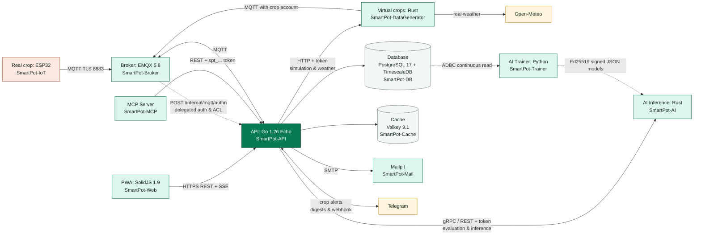
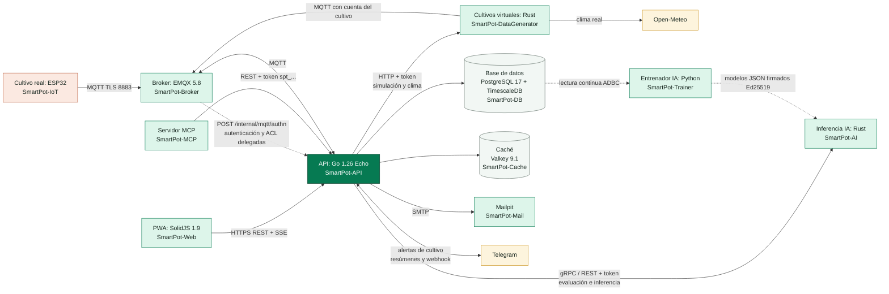

# SmartPot · Environments, Deployment, and Documentation

[English](#english) | [Español](#español)

<a id="english"></a>
## Overview

[](https://github.com/SmartPotTech/.github/actions/workflows/qa.yml)
[](https://github.com/SmartPotTech/.github/actions/workflows/deploy.yml)

Central repository of **SmartPot**, the hydroponic crop monitoring and automation platform published in production at [smartpot.app](https://smartpot.app). It brings together cross-service infrastructure: Docker Compose and Kubernetes environments, production deployment workflows, QA suites, technical platform documentation, and organization community guidelines.

## Repository Contents

```text
.github/
├── .github/
│   ├── workflows/
│   │   ├── deploy.yml          # Production deployment workflow (concurrency control & Snyk gatekeeper)
│   │   ├── request-deploy.yml  # Invoked by services to request deployments and await results
│   │   └── qa.yml              # CI tests across all repositories and E2E validation suite
│   ├── ISSUE_TEMPLATE/         # Organization issue templates
│   ├── dependabot.yml
│   └── PULL_REQUEST_TEMPLATE.md
├── docker/
│   ├── demo/                   # Canonical SmartPot stack in a single command with seed data
│   ├── dev/                    # Build each service from local workspace repositories
│   └── production/             # Production Compose, environment templates, nginx, and backups
├── kubernetes/                 # Manifests for local Kubernetes clusters
├── docs/                       # Technical platform docs, project journey, lifecycle, and architecture diagrams
├── scripts/e2e.py              # End-to-end automated verification suite against demo stack
├── profile/README.md           # Public GitHub organization profile
├── CONTRIBUTING.md
├── SECURITY.md
└── CODE_OF_CONDUCT.md
```

## Architecture

The production platform runs on the canonical **Stack B** architecture:



Each crop is **real** or **virtual**, selected permanently upon creation:
- **Real crops** publish telemetry to `smartpot/v1/{cropId}/telemetry` over MQTT TLS from an ESP32 microcontroller running our primary **Rust Embassy (`no_std`)** firmware (`SmartPot-IoT`) or the alternative **MicroPython** firmware (`SmartPot-IoT-Python`), physically or simulated in Wokwi.
- **Virtual crops** are continuously simulated by `SmartPot-DataGenerator` in Rust, replicating local outdoor weather from Open-Meteo, manual overrides, and species diurnal rhythms.

The **Go API** (`SmartPot-API`, Go 1.26 + Echo) implements a hexagonal architecture with ports and adapters, authenticates clients via `HttpOnly` session cookies + signed CSRF tokens, stores time-series telemetry in **PostgreSQL 17 + TimescaleDB** (`SmartPot-DB`) with hypertables and real-time continuous aggregates, manages caching and limits in **Valkey 9.1** (`SmartPot-Cache`), and delegates MQTT authentication from **EMQX** (`SmartPot-Broker`).

The **AI assistant** comprises two specialized components:
1. `SmartPot-AI` (Rust 1.88+, Axum, Tonic gRPC) executes real-time inference: expert rules, Sugeno fuzzy logic, and native evaluation of ML models verified via Ed25519 signatures.
2. `SmartPot-Trainer` (Python 3.13, Polars, scikit-learn) runs continuous offline learning: queries TimescaleDB via Apache Arrow ADBC on real pseudonymized crops and exports cryptographically signed JSON models.

External AI agents interface through `SmartPot-MCP` (`mcp.smartpot.app`) via Model Context Protocol tools using connection tokens (`spt_...`), while Telegram notifies users of alerts and daily digests.

### Legacy Stack A Architecture (Deprecated)

> [!NOTE]
> The initial implementation (Stack A: Spring Boot 4.1, Java 21, MongoDB 8, Redis 8, Mosquitto 2.1, React 19, and Python simulator) has been completely deprecated and succeeded in production by the canonical Stack B. The previous repositories have been renamed with descriptive technology suffixes (`SmartPot-API-Java`, `SmartPot-DB-Mongo`, `SmartPot-Cache-Redis`, `SmartPot-Broker-Mosquito`, `SmartPot-Web-React`, `SmartPot-AI-Python`, `SmartPot-DataGenerator-Python`, `SmartPot-Proxy`) and archived as historical reference.

## Getting Started

| Objective | Guide |
|---|---|
| Run SmartPot locally in one command | [`docker/demo`](docker/README.md) |
| Develop locally on a service | [`docker/dev`](docker/dev/README.md) |
| Deploy to a production server | [`docker/production`](docker/production/README.md) |
| Test on Kubernetes | [`kubernetes`](kubernetes/README.md) |
| Understand architecture & contracts | [`docs`](docs/README.md) |
| View complete platform architecture | [Global diagrams](docs/README.md#global-diagrams) |

## Quality Assurance (QA)

The [`qa.yml`](.github/workflows/qa.yml) workflow triggers on repository pushes, weekly on schedules, and via manual execution:

| Pipeline Job | Scope of Validation |
|---|---|
| API (`SmartPot-API`) | Go test suites (`./...`), `go vet`, and hexagonal architecture integration tests |
| Web (`SmartPot-Web`) | ESLint, TypeScript verification (`tsc -b`), Vitest suite (96 tests), and production bundle build |
| AI & Simulator (`SmartPot-AI`, `-DataGenerator`, `-IoT`) | Rust `cargo test`, `cargo clippy`, Embassy ESP32 checks, and native model parity tests |
| Learning & MCP (`SmartPot-Trainer`, `SmartPot-MCP`) | Python Ruff lint/format, pytest suites, ADBC query verification, and FastMCP tool tests |
| Infrastructure (`SmartPot-Broker`, `-DB`, `-Cache`, `-Mail`) | Hardened container smoke tests: EMQX authn delegation, PostgreSQL 17/TimescaleDB schema, Valkey socket/password auth, and Mailpit SMTP |
| End-to-End Suite | Spins up the canonical demo stack and validates 101 end-to-end assertions: registration, real crop, MQTT telemetry and capabilities, command ACK, conflict guards (409), AI diagnosis, placement advice, dashboard series, bulk actions, virtual crop simulation, CSV summary/export, password recovery through Mailpit, profile and password changes, `spt_` connections with MCP read/control scopes, cross-account isolation, validation errors, and cleanup. The Telegram link-code check is skipped when no bot is configured (100 checks run). |

## Deployment

Each service publishes its container image to `ghcr.io/smartpottech` (with Docker Hub replica) and requests deployment via [`deploy.yml`](.github/workflows/deploy.yml), updating server compose environments over SSH. Configuration parameters and nginx setups are documented in [`docker/production`](docker/production/README.md).

To prevent redundant deployments during documentation, testing, or minor configuration adjustments, commits containing `[skip deploy]` or `#no-deploy` in their message bypass deployment pipelines.

## License

This project is licensed under the MIT License. See [LICENSE](LICENSE) for details.

---

<a id="español"></a>
## Visión General

[](https://github.com/SmartPotTech/.github/actions/workflows/qa.yml)
[](https://github.com/SmartPotTech/.github/actions/workflows/deploy.yml)

Repositorio central de **SmartPot**, la plataforma de monitoreo y automatización de cultivos hidropónicos publicada en producción en [smartpot.app](https://smartpot.app). Reúne lo que no pertenece a un solo servicio: los entornos de Docker Compose y Kubernetes, el flujo de despliegue a producción, la batería de QA, la documentación técnica y las directrices de comunidad de la organización.

## Contenido

```text
.github/
├── .github/
│   ├── workflows/
│   │   ├── deploy.yml          # Despliegue único a producción con control de concurrencia y Snyk Gatekeeper
│   │   ├── request-deploy.yml  # Invocado por los servicios para solicitar despliegue y esperar resultado
│   │   └── qa.yml              # Pruebas integrales de todos los repositorios y batería E2E
│   ├── ISSUE_TEMPLATE/         # Plantillas de issues de la organización
│   ├── dependabot.yml
│   └── PULL_REQUEST_TEMPLATE.md
├── docker/
│   ├── demo/                   # Stack canónico de SmartPot en un solo comando con datos demo
│   ├── dev/                    # Compilación de cada servicio desde repositorios locales
│   └── production/             # Compose de producción, plantillas de variables, nginx y respaldos
├── kubernetes/                 # Manifiestos para clústeres locales
├── docs/                       # Documentación técnica, recorrido, ciclo de vida y diagramas de arquitectura
├── scripts/e2e.py              # Batería automatizada de verificación de extremo a extremo
├── profile/README.md           # Presentación pública de la organización en GitHub
├── CONTRIBUTING.md
├── SECURITY.md
└── CODE_OF_CONDUCT.md
```

## Arquitectura

La plataforma en producción opera sobre la arquitectura canónica del **Stack B**:



Cada cultivo es **real** o **virtual**, fijado de manera permanente al crearlo:
- Los **cultivos reales** publican telemetría a `smartpot/v1/{cropId}/telemetry` mediante MQTT TLS desde un microcontrolador ESP32 con el firmware principal en **Rust Embassy (`no_std`)** (`SmartPot-IoT`) o el firmware alternativo en **MicroPython** (`SmartPot-IoT-Python`), físico o simulado en Wokwi.
- Los **cultivos virtuales** son simulados continuamente por `SmartPot-DataGenerator` en Rust, replicando el clima exterior de Open-Meteo, ajustes manuales y fotoperiodo de la especie.

La **API en Go** (`SmartPot-API`, Go 1.26 + Echo) implementa arquitectura hexagonal con puertos y adaptadores, autentica clientes mediante cookies `HttpOnly` + tokens CSRF de doble envío firmado, persiste las lecturas en **PostgreSQL 17 + TimescaleDB** (`SmartPot-DB`) con hipertablas y agregados continuos en tiempo real, gestiona límites y caché en **Valkey 9.1** (`SmartPot-Cache`), y atiende la delegación de autenticación de **EMQX** (`SmartPot-Broker`).

El **asistente de IA** está desacoplado en dos componentes:
1. `SmartPot-AI` (Rust 1.88+, Axum, Tonic gRPC): inferencia en tiempo real con sistema experto, lógica difusa Sugeno y evaluación nativa de modelos ML firmados con Ed25519.
2. `SmartPot-Trainer` (Python 3.13, Polars, scikit-learn): entrenamiento continuo fuera del camino crítico mediante consultas ADBC optimizadas sobre cultivos reales seudonimizados.

Los asistentes de IA externos se conectan vía Model Context Protocol a través de `SmartPot-MCP` (`mcp.smartpot.app`) con tokens de conexión (`spt_...`), mientras Telegram envía resúmenes y alertas interactivas.

### Arquitectura histórica del Stack A (Deprecada)

> [!NOTE]
> La arquitectura inicial (Stack A: Spring Boot 4.1, Java 21, MongoDB 8, Redis 8, Mosquitto 2.1, React 19 y simulador en Python) ha sido completamente deprecada y reemplazada en producción por el Stack canónico (Stack B). Los repositorios originales fueron renombrados con sufijos de tecnología (`SmartPot-API-Java`, `SmartPot-DB-Mongo`, `SmartPot-Cache-Redis`, `SmartPot-Broker-Mosquito`, `SmartPot-Web-React`, `SmartPot-AI-Python`, `SmartPot-DataGenerator-Python`, `SmartPot-Proxy`) y archivados como referencia histórica y arqueología de software.

## Empezar

| Quiero... | Guía |
|---|---|
| Ver SmartPot funcionando en mi equipo en un comando | [`docker/demo`](docker/README.md) |
| Programar en un servicio local | [`docker/dev`](docker/dev/README.md) |
| Desplegar en un servidor de producción | [`docker/production`](docker/production/README.md) |
| Probar en Kubernetes | [`kubernetes`](kubernetes/README.md) |
| Entender la arquitectura y contratos | [`docs`](docs/README.md) |
| Ver toda la plataforma en diagramas | [Diagramas generales](docs/README.md#diagramas-generales) |

## QA

El workflow [`qa.yml`](.github/workflows/qa.yml) se ejecuta en cada push, semanalmente y bajo demanda:

| Trabajo | Qué valida |
|---|---|
| API (`SmartPot-API`) | Pruebas unitarias y de integración en Go (`go test ./...`), `go vet` y contratos Echo |
| Web (`SmartPot-Web`) | ESLint, verificación de tipos (`tsc -b`), batería de Vitest (96 pruebas) y compilación de producción con Bun |
| IA y Simulador (`SmartPot-AI`, `-DataGenerator`, `-IoT`) | Pruebas de Rust (`cargo test`), `cargo clippy`, chequeo Embassy para ESP32 y paridad de modelos nativos |
| Aprendizaje y MCP (`SmartPot-Trainer`, `SmartPot-MCP`) | Linter y formateo Ruff, pruebas pytest, consultas ADBC y verificación de herramientas FastMCP |
| Infraestructura (`SmartPot-Broker`, `-DB`, `-Cache`, `-Mail`) | Pruebas de humo de contenedores: delegación authn en EMQX, esquemas e hipertablas de PostgreSQL/TimescaleDB, autenticación en Valkey y SMTP en Mailpit |
| End-to-End | Levanta la demo canónica y valida 101 aserciones de extremo a extremo: registro, cultivo real, telemetría y capacidades MQTT, comando con confirmación, switches con guardas (409), asistente, lugar y clima, panel general, órdenes en bloque, cultivo virtual, resumen y exportación CSV, recuperación de contraseña por Mailpit, perfil y cambio de clave, conexiones `spt_` con alcance READ/CONTROL en MCP, aislamiento entre cuentas, errores de validación y borrado. La comprobación del código de Telegram se omite si no hay bot configurado (se ejecutan 100). |

## Despliegue

Cada servicio publica su imagen en `ghcr.io/smartpottech` (y en Docker Hub como réplica) y pide el despliegue a [`deploy.yml`](.github/workflows/deploy.yml), que actualiza el servidor por SSH con el `compose.yaml` de producción descargando las imágenes de GHCR. Los detalles, secrets necesarios y configuración de nginx están en [`docker/production`](docker/production/README.md).

Para evitar ejecuciones redundantes del despliegue en cambios que no lo requieran (documentación, pruebas, ajustes menores), cualquier commit que contenga `[skip deploy]` o `#no-deploy` en su mensaje omitirá automáticamente la llamada al despliegue central en `.github`. Si un cambio necesita desplegarse a producción, simplemente se omiten dichos marcadores (o se dispara manualmente con `workflow_dispatch`).

## Licencia

Este proyecto está bajo la licencia MIT. Consulta el archivo [LICENSE](LICENSE) para más detalles.
