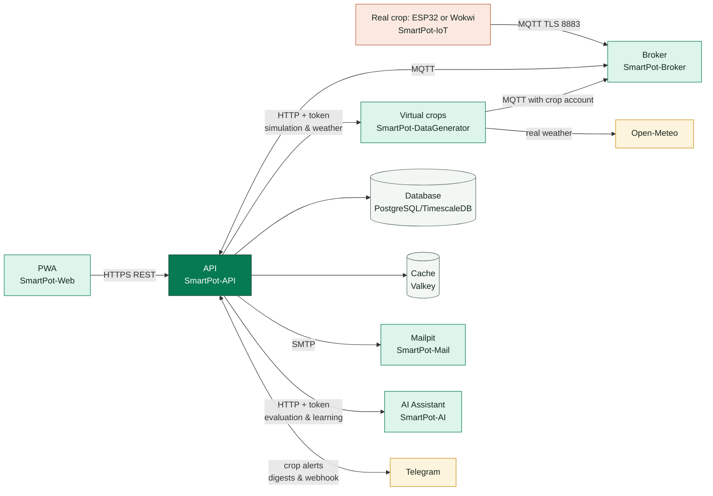
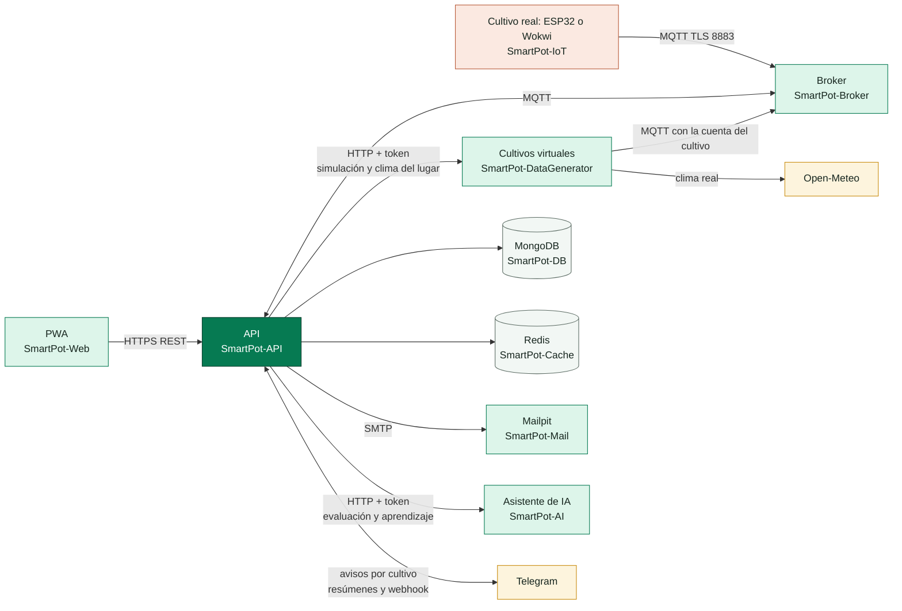

# SmartPot · Environments, Deployment, and Documentation

[English](#english) | [Español](#español)

<a id="english"></a>
## Overview

[](https://github.com/SmartPotTech/.github/actions/workflows/qa.yml)
[](https://github.com/SmartPotTech/.github/actions/workflows/deploy.yml)

Central repository of **SmartPot**, the hydroponic crop monitoring and automation platform published at [smartpot.app](https://smartpot.app). It brings together cross-service infrastructure: Docker and Kubernetes environments, production deployment workflows, QA suites, technical platform documentation, and organization community guidelines.

## Repository Contents

```text
.github/
├── .github/
│   ├── workflows/
│   │   ├── deploy.yml          # Production deployment workflow (concurrency control)
│   │   ├── request-deploy.yml  # Invoked by services to request deployments and await results
│   │   └── qa.yml              # CI tests across all repositories and E2E validation suite
│   ├── ISSUE_TEMPLATE/         # Organization issue templates
│   ├── dependabot.yml
│   └── PULL_REQUEST_TEMPLATE.md
├── docker/
│   ├── demo/                   # Complete SmartPot stack in a single command with seed data
│   ├── dev/                    # Build each service from local workspace repositories
│   └── production/             # Production Compose, environment templates, nginx, and backups
├── kubernetes/                 # Manifests for local Kubernetes clusters
├── docs/                       # Technical platform docs, project journey, lifecycle, and architecture diagrams
├── scripts/e2e.py              # End-to-end automated verification suite against demo stack
├── profile/README.md           # Public GitHub organization profile
├── CONTRIBUTING.md
├── SECURITY.md
└── CODE_OF_CONDUCT.md
```

## Architecture



Each crop is **real** or **virtual**, selected permanently upon creation. Real crops publish telemetry to `smartpot/v1/{cropId}/telemetry` from an ESP32 microcontroller running MicroPython or C++, physically or simulated in Wokwi; virtual crops are continuously simulated by SmartPot, replicating local weather, manual overrides, and species diurnal rhythms. Both appear in live interactive diagrams reflecting form (pot, NFT pipes, tower, or raft), placement (indoor or outdoor with real ambient weather), and actuator switches. The API stores telemetry, consults the AI assistant for diagnoses (expert system, fuzzy logic, machine learning models, and reactive agent), provides placement advice, and under autonomous mode dispatches commands via `smartpot/v1/{cropId}/commands`. The assistant continuously learns from pseudonymized real crop readings across each species to predict upcoming irrigation and heat requirements. Notifications are dispatched to the PWA and to **Telegram** according to user preferences.

Detailed operational sequences and subsystem internals are documented in the [global diagrams](docs/README.md#global-diagrams).

## Getting Started

| Objective                                  | Guide                                                    |
|--------------------------------------------|----------------------------------------------------------|
| Run SmartPot locally in one command        | [`docker/demo`](docker/README.md)                        |
| Develop locally on a service               | [`docker/dev`](docker/dev/README.md)                     |
| Deploy to a production server              | [`docker/production`](docker/production/README.md)       |
| Test on Kubernetes                         | [`kubernetes`](kubernetes/README.md)                     |
| Understand architecture & contracts        | [`docs`](docs/README.md)                                 |
| View complete platform architecture        | [Global diagrams](docs/README.md#global-diagrams)        |

## Quality Assurance (QA)

The [`qa.yml`](.github/workflows/qa.yml) workflow triggers on changes, weekly on schedules, and via manual execution:

| Pipeline Job                        | Scope of Validation                                                                                                                                                                                                                                                                  |
|-------------------------------------|--------------------------------------------------------------------------------------------------------------------------------------------------------------------------------------------------------------------------------------------------------------------------------------|
| API                                 | Unit, integration, and controller tests                                                                                                                                                                                                                                              |
| Web                                 | ESLint, TypeScript verification, Vitest suite, and production bundle build                                                                                                                                                                                                           |
| SmartPot-AI, -DataGenerator, -IoT   | Ruff linting, pytest suites, and engine parity checks                                                                                                                                                                                                                                |
| SmartPot-Broker, -DB, -Cache, -Mail | Hardened container images and smoke tests (authentication, per-crop ACL, TLS, database schemas)                                                                                                                                                                                      |
| End-to-End Suite                    | Builds container images, spins up demo stack, and validates 46 end-to-end assertions: registration, real crop, MQTT telemetry, command ACK, actuator conflict guards (409), AI diagnosis, placement advice, dashboard series, bulk actions, virtual crop simulation, and cleanup. |

## Deployment

Each service publishes its container image to `ghcr.io/smartpottech` (with Docker Hub replica) and requests deployment via [`deploy.yml`](.github/workflows/deploy.yml), updating server compose environments over SSH. Configuration parameters and nginx setups are documented in [`docker/production`](docker/production/README.md).

To prevent redundant deployments during documentation, testing, or minor configuration adjustments, commits containing `[skip deploy]` or `#no-deploy` in their message bypass deployment pipelines.

## License

This project is licensed under the MIT License. See [LICENSE](LICENSE) for details.

---

<a id="español"></a>
[](https://github.com/SmartPotTech/.github/actions/workflows/qa.yml)
[](https://github.com/SmartPotTech/.github/actions/workflows/deploy.yml)

Repositorio central de **SmartPot**, la plataforma de monitoreo y automatización de cultivos hidropónicos publicada
en [smartpot.app](https://smartpot.app). Reúne lo que no pertenece a un solo servicio: los entornos de Docker y
Kubernetes, el despliegue a producción, la batería de QA, la documentación técnica y los archivos de comunidad de la
organización.

## Contenido

```text
.github/
├── .github/
│   ├── workflows/
│   │   ├── deploy.yml          # Único despliegue a producción, de a uno (concurrency)
│   │   ├── request-deploy.yml  # Lo llaman los servicios para pedir el despliegue y esperar el resultado
│   │   └── qa.yml              # Pruebas de todos los repositorios y prueba de extremo a extremo
│   ├── ISSUE_TEMPLATE/         # Plantillas de issues de la organización
│   ├── dependabot.yml
│   └── PULL_REQUEST_TEMPLATE.md
├── docker/
│   ├── demo/                   # SmartPot completo con un comando y datos de ejemplo
│   ├── dev/                    # Compila cada servicio desde los repositorios locales
│   └── production/             # Compose, variables, nginx y respaldos del servidor
├── kubernetes/                 # Manifiesto para clústeres locales
├── docs/                       # Documentación técnica, recorrido y ciclo de vida; diagramas específicos y generales
├── scripts/e2e.py              # Prueba de extremo a extremo sobre la demo
├── profile/README.md           # Presentación pública de la organización
├── CONTRIBUTING.md
├── SECURITY.md
└── CODE_OF_CONDUCT.md
```

## Arquitectura



Cada cultivo es **real** o **virtual**, y eso se elige al crearlo. Uno real publica sus lecturas en
`smartpot/v1/{cropId}/telemetry` desde un ESP32 con el firmware, físico o simulado en Wokwi; uno virtual lo simula
SmartPot, que sigue el clima de la ciudad, los medidores que mueva la persona o el día y la noche de la especie. Los dos
se ven en vivo con su forma (maceta, tubos NFT, torre o balsa), en su lugar (bajo techo o al aire libre, con el clima
de afuera) y con cada actuador, que se maneja con un switch. La API guarda cada lectura, pide al asistente de IA un
diagnóstico (sistema experto, lógica difusa, modelos de aprendizaje automático y un agente reactivo) con el consejo de
lugar y, si el cultivo tiene el modo automático, envía comandos a los actuadores por `smartpot/v1/{cropId}/commands`.
El asistente además **aprende de forma continua** con las lecturas de los cultivos reales de cada especie,
seudonimizadas, para anticipar el riego y el calor de la próxima hora. Los avisos llegan a la PWA, que se instala en el
teléfono, y a **Telegram**: cada cultivo elige qué avisa, al instante o en resúmenes, y con qué chats se comparte.

Para ver cada pieza por dentro y toda la operación paso a paso están
los [diagramas generales](docs/README.md#diagramas-generales).

## Empezar

| Quiero...                                  | Guía                                                      |
|--------------------------------------------|-----------------------------------------------------------|
| Ver SmartPot funcionando en mi equipo      | [`docker/demo`](docker/README.md)                         |
| Programar en un servicio                   | [`docker/dev`](docker/dev/README.md)                      |
| Desplegar en un servidor                   | [`docker/production`](docker/production/README.md)        |
| Probar en Kubernetes                       | [`kubernetes`](kubernetes/README.md)                      |
| Entender el sistema                        | [`docs`](docs/README.md)                                  |
| Ver toda la plataforma en un solo diagrama | [Diagramas generales](docs/README.md#diagramas-generales) |

## QA

El workflow [`qa.yml`](.github/workflows/qa.yml) se ejecuta en cada cambio de este repositorio, cada lunes y a mano:

| Trabajo                             | Qué valida                                                                                                                                                                                                                                                                                                                                                                           |
|-------------------------------------|--------------------------------------------------------------------------------------------------------------------------------------------------------------------------------------------------------------------------------------------------------------------------------------------------------------------------------------------------------------------------------------|
| API                                 | Pruebas unitarias y de controladores con Maven                                                                                                                                                                                                                                                                                                                                       |
| Web                                 | Lint, tipos, pruebas con Vitest y build de producción                                                                                                                                                                                                                                                                                                                                |
| SmartPot-AI, -DataGenerator, -IoT   | Ruff y pytest                                                                                                                                                                                                                                                                                                                                                                        |
| SmartPot-Broker, -DB, -Cache, -Mail | Imagen endurecida y pruebas de humo (autenticación, ACL por cultivo, TLS, validadores de MongoDB)                                                                                                                                                                                                                                                                                    |
| End-to-End                          | Compila las ocho imágenes, levanta la demo y recorre en 46 comprobaciones registro, cultivo real, telemetría MQTT, comando con confirmación, switches que rechazan órdenes repetidas, asistente, lugar con su consejo y su clima, panel general, órdenes en bloque, tipo fijo, cultivo virtual con pausa, aprendizaje continuo, canales y avisos por cultivo, y borrado de la cuenta |

## Despliegue

Cada servicio publica su imagen en `ghcr.io/smartpottech` (y en Docker Hub como réplica) y pide el despliegue a [
`deploy.yml`](.github/workflows/deploy.yml), que actualiza el servidor por SSH con el `compose.yaml` de producción
descargando las imágenes de GHCR. Los detalles, los secrets necesarios y la configuración de nginx están en [
`docker/production`](docker/production/README.md).

Para evitar ejecuciones redundantes del despliegue en cambios que no lo requieran (documentación, pruebas, ajustes menores), cualquier commit que contenga `[skip deploy]` o `#no-deploy` en su mensaje omitirá automáticamente la llamada al despliegue central en `.github`. Si un cambio necesita desplegarse a producción, simplemente se omiten dichos marcadores (o se dispara manualmente con `workflow_dispatch`).

## Licencia

Este proyecto está bajo la licencia MIT. Consulta el archivo [LICENSE](LICENSE) para más detalles.
