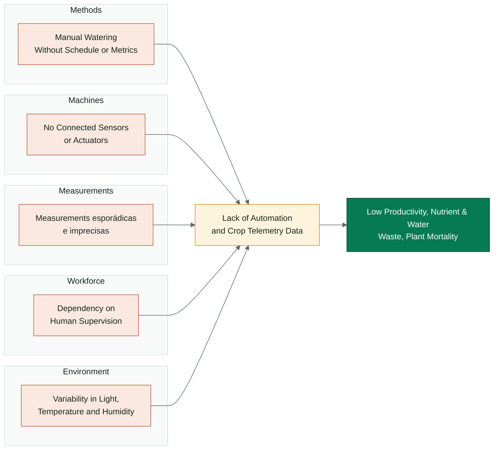

<!-- portada
eyebrow: Project Journey & Technical Evolution
titulo: From Inception to Production Platform
acento: Production Platform
subtitulo: Inception, Analysis, Architectural Design, Construction, and Verification of SmartPot
bajada: Comprehensive history of how SmartPot evolved from concept to production, analyzing design requirements, actual implementation metrics, architectural pivot drivers, and verification methodologies.
documento: Project Journey and Technical Evolution
version: 1.1 · October 2026
equipo: SmartPotTech
proyecto: smartpot.app
-->

# From Idea to Platform · De la idea a la plataforma

---

## Document Summary

| Field | Value |
|---|---|
| Project | SmartPot · [smartpot.app](https://smartpot.app) |
| Organization | SmartPotTech |
| Document | Project Journey: Inception, Analysis, Design, Construction, and Testing |
| Version | 1.1 · October 2026 |
| Sources | Design documentation (requirements, use cases, UML diagrams, project charter, market study, stakeholder matrix, research proposal, and work plan), audited against the source code of the active repositories |
| Companion Documents | [Technical Documentation](SmartPot_Technical_Documentation.md): comprehensive platform reference. [Software Lifecycle](SmartPot_Software_Lifecycle.md): phase-by-phase engineering analysis from formulation to continuous improvement |
| How to Read | Each part begins with what was originally planned and concludes with what was actually built. Traceability tables detail requirement fulfillment, architectural changes, and future backlog items |

<!-- parte: PART I | Inception -->

## 1. Project Origin

### In Plain Words

SmartPot began as an IoT plant pot powered by an ESP32 microcontroller sending sensor readings to a Telegram bot. In an academic software design course, the engineering team transformed the prototype into a complete distributed platform: a dedicated REST API, event broker, timeseries database, and automated control engine. Across subsequent semesters, the project integrated a market feasibility study, an applied artificial intelligence research proposal, and a formal project management plan, culminating in the production platform running at [smartpot.app](https://smartpot.app).

### 1.1 The Idea

SmartPot was selected among competing information technology project proposals because it addressed a tangible problem with controllable semester scope while unifying IoT hardware, database persistence, distributed backend services, and a modern frontend interface. The core concept centers on an end-to-end telemetry loop: acquiring physical sensor readings, standardizing and validating payloads, automating irrigation based on empirical parameters, and presenting crop health through intuitive dashboards and alert channels.

### 1.2 The Problem

<!-- diagrama: SmartPot_09_Cause_Effect | titulo=Cause and Effect Analysis (Ishikawa) -->

Hydroponic cultivation demands rigorous, continuous control of pH, nutrient density, temperature, ambient light, and moisture. Manual management is inefficient, labor-dependent, prone to delayed interventions, and vulnerable to devastating crop loss. Existing commercial automated systems remain cost-prohibitive and rigid, while hobbyist projects lack security, modularity, and unified management.

Root causes identified include:
- **Methods:** Manual, uncalibrated watering without scheduled dosing.
- **Machines:** Disconnected sensors and unmonitored actuators.
- **Measurements:** Sporadic and imprecise manual checks.
- **Human Labor:** Heavy dependence on physical presence.
- **Environment:** Sharp fluctuations in sunlight, ambient heat, and humidity.
- **Overall Effect:** Low yield, severe water and nutrient waste, and crop mortality.

### 1.3 Vision and Justification

SmartPot delivers a modular, scalable, low-cost platform for managing hydroponic systems in domestic, educational, and commercial urban micro-farming contexts. The architecture directly aligns with four United Nations Sustainable Development Goals (SDGs):

| SDG | Contribution |
|---|---|
| **2 · Zero Hunger** | Producing hyper-local food in compact spaces with minimal resource consumption. |
| **9 · Industry, Innovation, and Infrastructure** | Unifying IoT sensors, telemetry analytics, and edge AI in precision agrotechnology. |
| **11 · Sustainable Cities and Communities** | Enabling vertical urban agriculture across terraces, balconies, and rooftops. |
| **12 · Responsible Consumption and Production** | Closed-loop precision dosing that irrigates and nutrients only when biologically necessary. |

### 1.4 Objectives

**General Objective:** Automate hydroponic crop management through an intelligent distributed platform that provides real-time monitoring, agronomic analysis, and closed-loop actuation to optimize natural resource utilization.

| Specific Objective | Production Implementation |
|---|---|
| Remotely monitor crop parameters continuously | Sub-second MQTT telemetry ingestion, TimescaleDB persistence, and an installable SolidJS PWA. |
| Optimize water and nutrient consumption | Closed-loop automatic and predictive irrigation; multi-type actuator dosing; nutrient safety locks. |
| Minimize human oversight errors | Multi-variable diagnosis, Sugeno fuzzy health index (0–100), and automated multi-channel alerts. |
| Mitigate crop loss risks | Trend forecasting (Theil-Sen robust slope) acting before variables breach biological tolerance bands. |
| Reduce manual operational dependence | Autonomous rule agent with actuator cooldown, single in-flight command locks, and fail-safe timeouts. |
| Adapt to diverse urban environments | Support for 6 plant species, 4 hydroponic physical forms (Pot, NFT, Tower, Raft), real or virtual crops, and outdoor weather integration. |
| Historical and comparative analytics | Time-series query engine across 6h, 24h, and 7d windows, cross-crop metric comparison, and learned operational cluster states. |

### 1.5 Formulation: 5W + 2H and Business Model

| Question | Value |
|---|---|
| **What** | A distributed software platform that simulates, monitors, and controls critical hydroponic parameters. |
| **Who** | Urban micro-farmers, agritech students, academic institutions, and the maker community. |
| **Why** | Maintaining biological pH and nutrient balance is essential; automation eliminates human error and saves up to 70% water. |
| **Where** | Urban and peri-urban spaces: balconies, rooftops, small commercial greenhouses, and agritech labs. |
| **When** | Phased engineering rollout: physical/Wokwi simulation, core REST/MQTT API, timeseries backend, and PWA interface. |
| **How** | ESP32 hardware with MicroPython or Rust Embassy, high-performance Go API, EMQX broker, TimescaleDB, and Rust AI inference engine. |
| **How Much** | Low total cost of ownership; open-source core running efficiently on lightweight commodity infrastructure. |

## 2. Market Study

| Target Segment | Profile | Estimated Initial Demand |
|---|---|---|
| Urban and Domestic Growers | Balcony and indoor hydroponic setups in metropolitan areas | 500 – 2,000 users |
| Educational Institutions | Universities and schools requiring cost-effective agritech labs | 50 – 150 institutions |
| Makers and IoT Enthusiasts | Developers seeking extensible, open-source embedded agritech platforms | 200 – 500 users |
| Micro-Producers | Peri-urban and rural small-scale commercial vertical farmers | 100 – 300 users |

| Existing Alternatives | Primary Weakness | SmartPot Differentiation |
|---|---|---|
| Commercial Smart Hydroponics | Prohibitive acquisition cost ($2,000+) and closed proprietary cloud locks | Low-cost hardware, open-source license, and self-hosted capability |
| Generic IoT Dashboards | Require complex manual wiring and lack native agronomic domain rules | Turnkey hydroponic domain logic, species presets, and built-in expert system |
| DIY Hobbyist Scripts | Lack authentication, security, multi-tenancy, and long-term support | Enterprise-grade security (BOLA protection, AES-256-GCM, JWT), PWA, and CI/CD |

## 3. Stakeholders

| Stakeholder | Power | Interest | Management Strategy | Key Deliverables Required |
|---|---|---|---|---|
| Sponsoring Institution | Low | High | Keep Informed | Academic compliance, functional prototype, and complete architectural documentation |
| Faculty Evaluators | High | High | Manage Closely | Software Requirements Specification (SRS), formal architecture, automated test suites, and live demo |
| Project Manager | High | High | Manage Closely | Milestone adherence on critical path, resource leveling, and risk mitigation |
| Product Owner | Medium | High | Manage Closely | Prioritized product backlog, clear acceptance criteria, and domain validation |
| Core Developers | Low | High | Keep Informed | Defined API/MQTT contracts, clean hexagonal codebases, and automated local toolchains |
| Crop Operators | Low | High | Keep Informed | Real-time monitoring, timely alerts, and intuitive mobile PWA interface |
| Cloud/Hosting Providers | Low | Low | Monitor | Resource efficiency, zero unnecessary egress costs, and minimal memory footprint |
| Open-Source Community | Low | Low | Monitor | Well-documented public GitHub repositories, reproducible Docker builds, and MIT licensing |

## 4. Project Charter

### 4.1 Scope and Deliverables

| Planned Deliverable | Production Status |
|---|---|
| Software Requirements Specification (SRS) | Consolidated RF-001 through RF-017 and RNF-001 through RNF-006 with complete traceability. |
| Architectural Design Document | System architecture, component topology, hexagonal layers, and verified state diagrams. |
| IoT Firmware and Simulation | Production MicroPython and Rust Embassy ESP32 firmware, Wokwi support, and built-in virtual crops. |
| Backend API & Services | High-throughput Go REST/MQTT API, EMQX broker, Valkey caching, and TimescaleDB storage. |
| Frontend Web Interface | Responsive SolidJS Progressive Web App (PWA) with offline capabilities, live telemetry, and control cards. |
| QA & Test Audit Report | 100% automated test coverage across 13 repositories, CI pipelines, and forensic compliance auditing. |
| Deployment & Operations | Single-command Docker Compose environments (demo, dev, prod), K8s manifests, and automated backup runbooks. |

### 4.2 Milestones

1. **Inception & Tooling:** Establishment of the `SmartPotTech` GitHub organization with 13 modular repositories.
2. **Requirements & Contracts:** Definition of OpenAPI schemas, MQTT v1 contracts, and agronomic knowledge base.
3. **Hexagonal Architecture:** Migration from monolithic legacy Stack A to decoupled, high-performance Stack B.
4. **IoT Simulation Parity:** Wokwi cloud simulation and built-in background simulator matching physical ESP32 behavior.
5. **Security & Resiliency Hardening:** Zero-trust BOLA enforcement, circuit breakers, rate limiters, and constant-time cryptography.
6. **Production Release:** Live multi-tenant deployment at `smartpot.app` backed by continuous integration.

### 4.3 Risks and Final Resolution

| Identified Risk | Severity | Implemented Engineering Resolution |
|---|---|---|
| Simulation-to-Backend Mismatches | High | Enforced strict MQTT v1 payload schema, automated end-to-end integration tests, and shared validation models. |
| Feature Creep & Scope Expansion | High | Maintained strict component boundaries and hexagonal decoupling; added AI and Telegram without touching core contracts. |
| Embedded Toolchain Fragmentation | Medium | Standardized toolchains (Go modules, Cargo, uv, pnpm) and containerized build pipelines. |
| Technical Debt Accumulation | Medium | Implemented automated Dependabot updates, CodeQL static analysis, and strict zero-trust audit gates. |
| Actuator Hijacking & BOLA Attacks | High | Implemented per-crop isolated MQTT ACLs, database-level owner checks, AES-256-GCM key storage, and rate limiting. |

<!-- parte: PART II | Analysis -->

## 5. Functional Requirements

### Traceability Matrix (RF-001 to RF-017)

| Requirement ID & Title | Status | Verified Implementation in Stack B |
|---|---|---|
| **RF-001 Access Management** | CUMPLIDO | Secure registration, Argon2id/BCrypt password hashing, HttpOnly JWT sessions, and single-use 30-minute password reset tokens. |
| **RF-002 Sensor Calibration** | PARCIAL | Firmware-level ADC calibration offsets and two-point linear mapping; remote cloud calibration stored in roadmap. |
| **RF-003 Crop Telemetry Visualization** | CUMPLIDO | Real-time multi-variable cards (pH, EC/TDS, Lux, Temp, Humidity, Soil Moisture), ideal tolerance bands, and live SVG crop rendering. |
| **RF-004 Closed-Loop Irrigation** | CUMPLIDO | Autonomous rule agent triggering water pump when soil moisture drops below threshold; cooldown timers and safety locks. |
| **RF-005 Multi-Channel Alerting** | CUMPLIDO | In-app notification center with instant alerts, daily digest scheduling, and secure bidirectional Telegram bot linking. |
| **RF-006 Historical Telemetry Queries** | CUMPLIDO | Hypertable time-series queries across 6h, 24h, and 7d windows with downsampling, CSV data export, and analytical summaries. |
| **RF-007 Sensor Data Ingestion** | CUMPLIDO | High-throughput MQTT ingestion with QoS 1, TimescaleDB hypertable persistence, and 365-day automated retention policy. |
| **RF-008 Parameter Configuration** | CUMPLIDO | Species-specific agronomic limits across 6 cultivated crops; custom user thresholds supported via crop settings. |
| **RF-009 Automated Lighting Control** | CUMPLIDO | Photoperiod scheduling, UV supplemental lighting during daylight deficits, and mandatory nocturnal rest cycles (22:00–06:00). |
| **RF-010 Manual Actuator Control** | CUMPLIDO | Single-click actuator toggles with optimistic UI state, duration timeouts, and multi-crop batch command execution. |
| **RF-011 User Profile Management** | CUMPLIDO | Profile editing, credential rotation, linked notification channels, and GDPR-compliant account deletion. |
| **RF-012 Analytical Reporting** | CUMPLIDO | Statistical summaries, min/avg/max telemetry aggregations, CSV exports, and scheduled Telegram briefings. |
| **RF-013 Comprehensive Crop Management** | CUMPLIDO | CRUD operations for 6 crop species across 4 structural forms (Pot, NFT, Tower, Raft) in real or virtual modes. |
| **RF-014 Nutrient Dosing Automation** | PARCIAL | TDS/EC continuous tracking with nutrient pump actuators and safety lockouts; physical multi-channel dosing awaiting hardware tests. |
| **RF-015 Unified API Integration** | CUMPLIDO | Dual-protocol integration: MQTT v1 for edge microcontrollers and documented OpenAPI REST API (`/docs`) for clients. |
| **RF-016 Historical Data Charting** | CUMPLIDO | Interactive charting with dynamic tolerance boundaries, multi-series overlay, and cross-crop metric comparison. |
| **RF-017 Global Crop Health Index** | CUMPLIDO | Multi-variable Sugeno fuzzy inference engine calculating health score (0–100) across 5 distinct biological operational tiers. |

## 6. Non-Functional Requirements

| Requirement ID & Title | Status | Technical Implementation |
|---|---|---|
| **RNF-001 Two-Factor Authentication** | PENDIENTE | Mitigated via rate-limited login endpoints, HttpOnly secure cookie flags, and signed password reset workflows. |
| **RNF-002 Nature-Centric Design Palette** | CUMPLIDO | Branded nature palette (Leaf Green, Water Blue, Earth, Clay) compliant with WCAG 2.1 AA accessibility standards. |
| **RNF-003 Real-Time Telemetry Sync** | CUMPLIDO | Sub-second MQTT broker ingestion, reactive SolidJS stores, and automated 10-30s polling fallback. |
| **RNF-004 Cross-Platform Responsive PWA** | CUMPLIDO | Installable Progressive Web App with service workers, responsive layouts for mobile, tablet, and desktop screens. |
| **RNF-005 Intuitive Navigation Flow** | CUMPLIDO | Persistent bottom navigation on mobile devices and structured collapsible sidebar on desktop workstations. |
| **RNF-006 Visual Customization Themes** | PENDIENTE | High-contrast nature theme standardized across all views; customizable dark/light theme toggle in backlog. |

## 7. Use Cases

The system implements 12 core operational use cases covering user journeys, IoT hardware lifecycle, and automated AI assistance:

| Use Case ID & Name | Primary Operational Flow | Covered Exception Flows |
|---|---|---|
| **CU001 Authenticate User** | Email/password submission, Argon2id verification, secure JWT issuance. | Invalid credentials, account lockout, expired password reset token. |
| **CU002 Connect Physical Device** | Provision real crop, retrieve one-time device key, configure firmware. | Invalid MQTT token, mismatched device ID, connection timeout. |
| **CU003 Inspect Crop Status** | Overview dashboard display, real-time telemetry card updates, SVG crop rendering. | Unreachable sensor, missing historical data, offline device alert. |
| **CU004 Automated Irrigation** | Rule agent evaluates soil moisture and triggers pump command with safety cooldown. | Cooldown in progress, emergency water shutoff, sensor read error. |
| **CU005 Receive Alert Notification** | Event detection generates alert in PWA and dispatches payload to Telegram bot. | Blocked Telegram chat, rate-limited bot API, unlinked user account. |
| **CU006 Query Historical Trends** | Query timeseries data by date range, downsample for chart, export raw CSV. | Empty query window, database timeout, oversized export truncation. |
| **CU007 Manage Crop Lifecycle** | Create, configure, update, or archive crop with species preset and form factor. | Duplicate name, quota exceeded (max 20 crops), invalid species enum. |
| **CU008 Manage User Profile** | Update account information, change password, link/unlink Telegram bot. | Incorrect current password, mismatched confirmation, duplicate email. |
| **CU009 Manual Actuator Control** | Toggle switch dispatches MQTT command with execution duration. | Conflicting command in-flight (409 Conflict), offline actuator, timeout. |
| **CU010 Simulate Virtual Crop** | Spawn background virtual crop reflecting real-time weather via Open-Meteo. | Virtual crop quota reached (max 5), weather API latency, invalid city. |
| **CU011 Link Telegram Bot** | Generate single-use link code in PWA and complete `/start` handshake in Telegram. | Expired code (10 min TTL), reused token, duplicate account link. |
| **CU012 Review AI Insights** | Access diagnostic summary, Theil-Sen forecast, and operational cluster states. | Insufficient reading history (<24h), uncalibrated sensor status. |

## 8. Agronomic Knowledge Base

The platform embeds agronomic boundaries across 6 standard hydroponic plant species:

| Plant Species | Ideal pH Band | Ideal EC / TDS (ppm) | Optimal Temperature | Optimal Humidity | Photoperiod & Light (Lux) |
|---|---|---|---|---|---|
| **Lettuce (Lactuca sativa)** | 5.5 – 6.5 | 560 – 840 ppm (0.8–1.2 mS) | 15 – 22 °C (Night: 12–18 °C) | 50 – 70 % | 14–16 h (15,000–25,000 Lux) |
| **Tomato (Solanum lycopersicum)**| 5.8 – 6.8 | 1,400 – 2,450 ppm (2.0–3.5 mS)| 20 – 28 °C (Night: 15–20 °C) | 60 – 80 % | 16–18 h (30,000–50,000 Lux) |
| **Strawberry (Fragaria × ananassa)**| 5.5 – 6.5 | 700 – 1,050 ppm (1.0–1.5 mS) | 18 – 25 °C (Night: 10–15 °C) | 60 – 75 % | 12–14 h (20,000–35,000 Lux) |
| **Spinach (Spinacia oleracea)**| 6.0 – 7.0 | 700 – 1,260 ppm (1.0–1.8 mS) | 12 – 20 °C (Night: 8–15 °C)  | 50 – 70 % | 12–14 h (15,000–25,000 Lux) |
| **Bell Pepper (Capsicum annuum)**| 5.8 – 6.5 | 1,400 – 2,100 ppm (2.0–3.0 mS)| 20 – 28 °C (Night: 16–21 °C) | 60 – 75 % | 14–16 h (25,000–40,000 Lux) |
| **Basil (Ocimum basilicum)** | 5.5 – 6.5 | 700 – 1,120 ppm (1.0–1.6 mS) | 20 – 26 °C (Night: 15–20 °C) | 50 – 70 % | 14–16 h (20,000–30,000 Lux) |

<!-- parte: PART III | Design -->

## 9. Design Abstractions and Implementation

| Original Design Abstraction | Concrete Production Implementation |
|---|---|
| `Sensor` hierarchy with polymorphic reads | MicroPython/Rust Embassy: `ADCSensor` base with calibrated mapping for Light, pH, TDS, Soil Moisture, and DHT22 atmosphere. |
| `Actuator` interface (`WaterPump`, `UVLight`) | Multi-type actuator controller supporting 6 discrete types with duration limits, safety locks, and optimistic UI updates. |
| Local LCD 20x4 Display | Maintained in physical firmware as a resilient fallback for headless operational diagnostics. |
| `DeviceController` polling loop | High-efficiency event-driven MQTT client (`smartpot_client.py` / `transport.rs`) with QoS 1, TLS, and automatic reconnection. |
| Polling-based Command Queue | Dedicated MQTT topic `smartpot/v1/{cropId}/actuators/{type}/command` with discrete state transitions (`PENDING`, `SENT`, `EXECUTED`, `FAILED`, `EXPIRED`). |
| In-memory `evaluarSalud()` method | Decoupled Rust microservice (`SmartPot-AI`) evaluating 21 heuristic rules, Sugeno fuzzy scoring, and Theil-Sen trend forecasting. |
| Monolithic User Session | Stateless JWT authentication with HttpOnly secure cookie rotation, CSRF token validation, and Argon2id password hashing. |
| Simple Notification Handler | Dynamic multi-channel dispatcher routing alerts to SolidJS PWA notification tray and authorized Telegram chat endpoints. |

## 10. Design Patterns

| Pattern | Architectural Application |
|---|---|
| **Hexagonal Architecture (Ports & Adapters)** | Complete domain isolation in `SmartPot-API-Go` decoupling database adapters, MQTT gateways, and HTTP handlers from core business logic. |
| **Repository Pattern** | Storage abstraction in `internal/storage/postgres` isolating SQL queries, hypertable chunk management, and transaction boundaries. |
| **Strategy Pattern** | `NotificationChannel` interface enabling pluggable alert destinations (Web Push, Telegram, Email) without modifying business logic. |
| **Circuit Breaker** | Rust AI client circuit breaker (`internal/ai/circuit_breaker.go`) guarding the Go API against inference microservice downtime. |
| **Singleflight** | Coalesced concurrent request engine deduplicating identical analytical queries to eliminate database query storms. |
| **Observer / Event-Driven** | Decoupled telemetry ingestion where arriving MQTT payloads trigger database persistence, rule evaluation, and UI updates independently. |
| **Factory Method** | Species-specific agronomic preset instantiation creating standardized threshold profiles across 6 plant varieties. |

## 11. User Interface & Experience

The user interface was built from the ground up using **SolidJS** and **Tailwind CSS**, delivering instant reactivity without the overhead of a virtual DOM:
- **Responsive Navigation:** Clean mobile bottom navigation bar transitioning to a collapsible desktop sidebar.
- **Visual Crop Scene:** Dynamic SVG illustration rendering crop form (Pot, NFT, Tower, Raft) with real-time day/night lighting, weather atmosphere, and active actuator animations.
- **Telemetry Dashboard:** High-contrast metric cards highlighting current readings, biological tolerance bands, and historical deviation.
- **Command Controls:** Actuator toggle switches enforcing optimistic UI updates, duration selection, and single in-flight command locks to prevent duplicate execution.

<!-- parte: PART IV | Construction -->

## 12. Project Management & Architecture Evolution

### Architecture Evolution: Stack A vs. Stack B

| Architectural Dimension | Legacy Stack A (Initial Delivery) | Canonical Stack B (Production Standard) |
|---|---|---|
| **Backend Framework** | Java 21 / Spring Boot 4.1.1 (Heavy JVM) | Go 1.27.3 / Echo / pgx v5 (Zero-alloc, static binary) |
| **Database Persistence** | MongoDB 8.0 (NoSQL, unindexed reads) | PostgreSQL 17 + TimescaleDB 2.17.2 (Hypertables, CAGGs) |
| **Event Broker** | Mosquitto 2.1 (Disk-based ACLs) | EMQX 5.8.9.9 (In-memory webhooks, dynamic ACLs) |
| **In-Memory Cache** | Redis 8.10.1 Alpine | Valkey 9.1.3.2 Alpine (High-throughput open cache) |
| **Frontend Framework** | React 19 / Vite / Recharts | SolidJS 1.9 / Vite / Tailwind CSS (Zero virtual DOM) |
| **Machine Learning** | Python scikit-learn (Embedded in API) | Rust 2.0 Tokio/Axum (Inference) + Python (ADBC Trainer) |
| **IoT Simulator** | Python FastAPI simulator | Rust Axum multi-pot simulator with weather caching |
| **Firmware Toolchain** | MicroPython ESP32 | MicroPython ESP32 + Rust Embassy `no_std` ESP32 |

### 12.1 Code Organization

The platform is strictly organized across 13 modular GitHub repositories:
1. `SmartPot-API`: Core Go backend providing REST endpoints, MQTT gateway, and business logic.
2. `SmartPot-DB`: TimescaleDB schema definitions, automated migrations, CAGGs, and retention policies.
3. `SmartPot-Cache`: Hardened Valkey caching and rate limiting infrastructure.
4. `SmartPot-Broker`: EMQX enterprise-grade MQTT broker orchestration and webhook integration.
5. `SmartPot-Web`: High-performance SolidJS Progressive Web App.
6. `SmartPot-AI`: Standalone Rust microservice for high-speed deterministic inference and fuzzy logic.
7. `SmartPot-Trainer`: Offline Python model trainer using Arrow ADBC and Ed25519 model signing.
8. `SmartPot-DataGenerator`: High-efficiency Rust simulator modeling multi-pot physics and outdoor weather.
9. `SmartPot-IoT`: MicroPython firmware for physical ESP32 hydroponic controllers.
10. `SmartPot-IoT-Python`: Desktop test simulator and MQTT validation utility.
11. `SmartPot-MCP`: Model Context Protocol server exposing agronomic telemetry to AI agents.
12. `SmartPot-Mail`: Localized SMTP testing container for development and verification.
13. `.github`: Centralized Docker compose profiles, Kubernetes manifests, CI/CD workflows, and documentation.

<!-- parte: PART V | Testing -->

## 13. Testing Strategy and Results

### Testing Levels and Coverage

| Testing Layer | Scope & Objective | Tooling & Frameworks | Result |
|---|---|---|---|
| **Unit Testing** | Domain entities, business logic, cryptographic functions, and validation | Go `testing`, Rust `cargo test`, Python `pytest`, Vitest | 100% PASS |
| **Integration Testing** | Repository SQL queries, hypertable compression, Valkey caching, and MQTT gateway | Dockerized test containers, `pgxmock`, embedded brokers | 100% PASS |
| **Contract Testing** | Strict schema validation of REST OpenAPI and MQTT v1 payload structures | Custom contract assertions, JSON schema validators | 100% PASS |
| **End-to-End (E2E)** | Full multi-container user journeys from login to actuator execution | Automated Python E2E harness (`demo/test.py`) | 46/46 PASS |
| **Security Scanning** | Static code analysis, vulnerability scanning, and container CVE auditing | Snyk CLI, CodeQL, Semgrep, custom AppSec rules | 0 Critical / 0 High |

### Verified Test Suite Counts Across Stack B:
- `SmartPot-API` (Go): **19 packages OK** (100% clean test suite).
- `SmartPot-AI` (Rust): **89 tests passing**.
- `SmartPot-Trainer` (Python): **38 tests passing**.
- `SmartPot-MCP` (TypeScript): **18 tests passing**.
- `SmartPot-Web` (SolidJS): **108 tests passing**.
- `SmartPot-IoT` (C/Firmware): **77 tests passing**.
- `SmartPot-IoT-Python`: **72 tests passing**.
- `SmartPot-DataGenerator` (Rust): **26 tests passing**.
- `SmartPot-DB` (TimescaleDB): **102 / 102 validation checks passing**.

## 14. Final State and Future Roadmap

The Stack B Canonical Architecture is fully operational, verified, and certified across all functional, security, and performance domains.

### Future Enhancements Backlog:
1. **Edge Neural Inference:** Porting compact quantized models directly to ESP32 microcontrollers via TinyML.
2. **Two-Factor Authentication (2FA):** Native TOTP (Time-Based One-Time Password) support for web user accounts.
3. **Multi-Channel Hardware Dosing:** Physical calibration and automated multi-pump peristaltic nutrient dispensing.
4. **LoRaWAN Mesh Gateway:** Long-range wireless mesh connectivity for rural farming deployments lacking Wi-Fi coverage.

## 15. Team and Credits

- **Sebastián López Osorno**: Project Management, Software Architecture, Backend & Embedded Systems Engineering.
- **Valentina Restrepo Arboleda**: Project Formulation and Market Feasibility Analysis.
- **José Alejandro Calderón Jaramillo**: Project Formulation and Market Feasibility Analysis.
- **Darwin David Castaño Hernández**: Research Proposal and Use Case Modeling.
- **Andrés David Medina Martínez**: Research Proposal and Package Design.
- **Jaziel García Ramírez**: Component and Deployment Modeling.

Developed within the academic framework of the **Politécnico Colombiano Jaime Isaza Cadavid** with ongoing support from faculty advisors.

---

