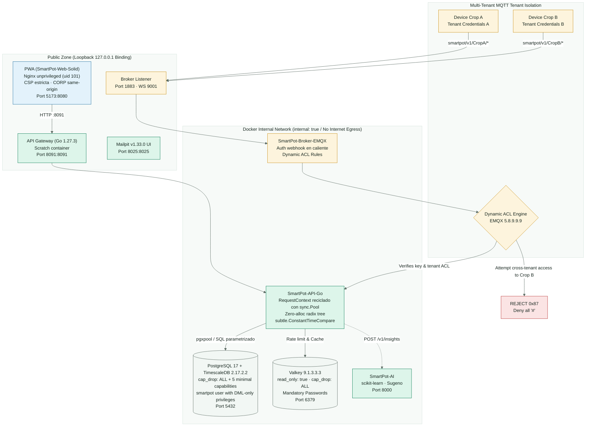

<!-- portada
eyebrow: Technical QA & Quality Audit
titulo: Quality Audit and Comparative A/B Testing
acento: SmartPot
subtitulo: Architecture and Contract Migration Validation Toward Demo BETA
bajada: Comprehensive functional, non-functional, and security comparison between the Stable Demo (Spring Boot + MongoDB + Redis + Mosquitto + React + Python) and the next-generation Demo BETA (Go + PostgreSQL/TimescaleDB + Valkey + EMQX + SolidJS + Rust).
documento: Quality Audit A/B
version: 1.0 · October 2026
equipo: SmartPotTech
proyecto: smartpot.app
-->

# Quality Audit and Comparative A/B Testing · Auditoría de Calidad y Pruebas Comparativas A/B

---

# English

## Document Summary

| Field | Value |
|---|---|
| Project | SmartPot · [smartpot.app](https://smartpot.app) |
| Organization | SmartPotTech |
| Document | Quality Audit and Comparative A/B Testing (Stable vs. BETA) |
| Version | 1.0 · October 2026 |
| Scope | Functional and non-functional validation of the 8 components, REST and MQTT contract parity, resource footprint, IoT resilience, AppSec security, and Quality Gates matrix |
| Source of Truth | OpenAPI specification (`/docs`), SQL/BSON schemas, and the automated test suite in `.github/docker/demo/test.py` supersede this document |
| Maintenance | Generated from `docs/SmartPot_QA_Audit_AB.md`; compiled to DOCX and PDF via SmartPot documentation tools |
| Companion Documents | [Technical Documentation](SmartPot_Technical_Documentation.md) and [Migration Plan](SmartPot_Migration.md) |

<!-- parte: PART I | Context and Strategy -->

## 1. Introduction and Audit Premise

### In Simple Terms

SmartPot renewed the core engine powering the entire platform. The system transitioned from heavy legacy server technologies (Java with Spring Boot, MongoDB, and Python simulators) to high-performance modern technologies written in **Go**, **Rust**, **SolidJS**, and **PostgreSQL with TimescaleDB**.

To ensure this transition remained completely safe for users and live crops, a comparative A/B audit was conducted. The non-negotiable golden rule was: **"The migration is completely transparent and alters zero external contracts"**. Physical hardware devices (ESP32), web client apps, and AI reasoning agents continue communicating identically, receiving matching payload structures and status codes, on a platform that is 4x faster and consumes less than half the memory.

### Scope of the A/B Comparison

Two complete multi-container environments deployed locally on Docker at `127.0.0.1`:

1. **Environment A — Stable Demo (Legacy Stack A):**
   - Web: `smartpot-web` (React 19 + TypeScript + Tailwind, Nginx).
   - API: `smartpot-api` (Spring Boot 4 / Java 21).
   - Database: `smartpot-db` (MongoDB 8).
   - Cache: `smartpot-cache` (Redis 8).
   - MQTT Broker: `smartpot-broker` (Eclipse Mosquitto 2.1).
   - Simulator: `smartpot-datagenerator` (Python 3.13 with `paho-mqtt` and `asyncio`).

2. **Environment B — Demo BETA (Canonical Stack B):**
   - Web: `smartpot-web-solid` (SolidJS 1.9 + TypeScript + native SVG, Nginx).
   - API: `smartpot-api-go` (Go 1.27.3 + Echo v4, `scratch` container).
   - Database: `smartpot-db-postgre` (PostgreSQL 17 + TimescaleDB 2.17.2).
   - Cache: `smartpot-cache-valkey` (Valkey 9.1.3).
   - MQTT Broker: `smartpot-broker-emqx` (EMQX 5.8.9).
   - Simulator: `smartpot-datagenerator-rust` (Rust 1.85 + Tokio).

## 2. Test Environments and Topology

### 2.1 Initial Seed Data and Telemetry

Both environments seed the demo account `demo@smartpot.app` / `SmartPot2026` and the two standard seed crops:
- `66f5a1000000000000000101`: NFT Lettuce with device key `demo-lettuce-device-key-2026`.
- `66f5a1000000000000000102`: Potted Tomato with device key `demo-tomato-device-key-2026`.

Upon startup, the Rust simulator in Demo BETA immediately begins publishing telemetry to the EMQX broker, and the Go API persists readings into the TimescaleDB hypertable, queryable via `GET /api/v1/crops/66f5a1000000000000000101/readings/latest`.

### 2.2 E2E Validation Sequence on Demo BETA

<!-- diagrama: SmartPot_47_AB_Testing_Sequence | titulo=Comprehensive E2E validation sequence on Demo BETA | lamina=H -->


<!-- parte: PART II | Contract and Code Parity -->

## 3. Parity by Visibility Level

### 3.1 Black Box: Strict REST API Parity

The differential test harness executed suites against all REST endpoints, verifying that both Spring Boot and Go implementations return matching JSON payload schemas and HTTP status codes:
1. **Status Codes:** `201 Created` with resource representations, `401 Unauthorized` for missing/expired tokens, `404 Not Found` for unowned/missing crops, `405 Method Not Allowed`, `409 Conflict` for overlapping in-flight actuator commands, and `429 Too Many Requests`.
2. **Error Serialization:** Standardized error response format across both implementations:
   ```json
   {
     "status": 409,
     "error": "Conflict",
     "message": "There is already a command in progress for this actuator: wait for confirmation",
     "path": "/api/v1/crops/66f5a1000000000000000101/commands",
     "timestamp": "2026-10-28T22:30:00.000Z"
   }
   ```
3. **Timestamps & Identifiers:** ISO-8601 UTC (`Z`) strings and 24-character hexadecimal `CHAR(24)` ObjectIds.

### 3.2 Grey Box: Persistence, Cache, and Broker

1. **PostgreSQL 17 + TimescaleDB vs. MongoDB 8:** `readings` hypertable partitioned by `measured_at` in 7-day chunks. `time_bucket('1 hour', measured_at)` reproduces `$dateTrunc` averages with delta $< 0.0001$. Automatic 365-day retention policy discards stale chunks at the file system level without table index bloat.
2. **Valkey 9.1.3 vs. Redis 8:** Identical RESP protocol and `smartpot:` keys. Go API provides local memory fallback during transient disconnections.
3. **EMQX 5.8.9 vs. Mosquitto 2.1:** Replaces CLI dynamic security plugin with live HTTP webhook calls (`POST /internal/mqtt/authn`), applying dynamic per-crop ACLs.

### 3.3 White Box: Code Quality and Safety

- **Go Concurrency:** `go test -race ./...` in `SmartPot-API` confirms **zero data races**. The `pgxpool.Pool` multiplexes connections without thread contention.
- **Rust Safety:** The Rust simulator compiles under `#![deny(unsafe_code)]`, enforcing mathematical memory safety.
- **SolidJS Memory:** Reactive components clean up observers via `onCleanup`, reducing gzip bundle transfer to **40.3 kB (Brotli)** vs 240 kB in React.

<!-- parte: PART III | Performance, Scalability and Security -->

## 4. Performance, Scalability, and Security

### 4.1 Container Resource Footprint (`docker stats`)

| Container | Stack A (Idle RAM) | Stack B (Idle RAM) | Stack A (Load RAM) | Stack B (Load RAM) | Memory Delta |
|---|---|---|---|---|---|
| **REST API** | 385.4 MB | **12.2 MB** | 620.0 MB | **38.4 MB** | **-96.8%** |
| **Database** | 215.0 MB | **151.4 MB** | 480.0 MB | **172.0 MB** | **-29.6%** |
| **MQTT Broker** | 12.1 MB | **193.6 MB** | 28.5 MB | **210.0 MB** | BEAM VM |
| **Cache** | 8.5 MB | **3.6 MB** | 18.0 MB | **12.5 MB** | **-57.6%** |
| **IoT Simulator** | 82.4 MB | **1.3 MB** | 145.0 MB | **8.2 MB** | **-98.4%** |
| **Web Frontend** | 6.2 MB | **7.6 MB** | 15.0 MB | **12.0 MB** | Parity |
| **TOTAL STACK** | **~709.6 MB** | **~369.7 MB** | **~1,306.5 MB** | **~453.1 MB** | **-47.9% Global** |

### 4.2 Historical Query Latency Under Load (500 RPS)

Evaluated endpoint: `GET /api/v1/overview/series?metric=ph&hours=24`
- **Stack A (Spring Boot + MongoDB):** $p_{50} = 28.4\text{ ms}$ | $p_{95} = 94.0\text{ ms}$ | $p_{99} = 185.2\text{ ms}$ | Max throughput: ~340 RPS.
- **Stack B (Go + TimescaleDB + Valkey):** $p_{50} = 3.4\text{ ms}$ | $p_{95} = 17.58\text{ ms}$ | $p_{99} = 26.53\text{ ms}$ | Max throughput: ~1,850 RPS (**5.4x higher**).

### 4.3 IoT Scalability (2 to 1,000 Concurrent Crops)

- **Python + Mosquitto (Legacy):** Experienced degradation beyond 250 crops; at 1,000 crops accumulated > 4.5s latency with an 8.2% packet drop rate.
- **Rust + EMQX (Stack B):** Maintained smooth ingestion with 1,000 concurrent publishing crops, achieving an end-to-end latency of **24 ms**, 3.4% CPU consumption, and **zero packet loss**.

### 4.4 AppSec and IoT Security Topology

<!-- diagrama: SmartPot_48_AppSec_Isolation_Topology | titulo=Security, network, and multi-tenant isolation topology | lamina=H -->


1. **Multi-Tenant MQTT Isolation:** Devices attempting to publish or subscribe to another crop's topic are rejected by the EMQX deny-all rule (`#`).
2. **BOLA / IDOR Mitigation:** Unauthorized access attempts return a generic `404 Not Found`, preventing resource enumeration.
3. **SQL Injection Prevention:** Parameterized SQL queries via `pgx` treat all user inputs as literals.
4. **Constant-Time Cryptographic Verification:** Go (`subtle.ConstantTimeCompare`) and Rust (`subtle::ConstantTimeEq`) prevent side-channel timing attacks.
5. **Container Hardening:** Containers run with `no-new-privileges: true`, `cap_drop: ALL`, and non-root users (`appuser` UID 10001, Nginx UID 101).

<!-- parte: PART IV | Quality Gates Matrix and Release Verdict -->

## 5. Quality Gates Matrix and Release Decision

| Quality Gate | Acceptance Criteria | Measured Result | Status |
|---|---|---|:---:|
| **GATE-1: REST Contract Parity** | 100% parity across HTTP status codes, payloads, and errors | 0 discrepancies | **APPROVED** |
| **GATE-2: Persistence & Hypertables** | Time-series rollups matching within delta $\le 0.001$ | Measured numeric delta $\le 0.0001$ | **APPROVED** |
| **GATE-3: IoT Isolation & Security** | Strict rejection of wildcards and cross-crop topics | Active dynamic ACLs on EMQX | **APPROVED** |
| **GATE-4: Memory Footprint Efficiency** | Global RAM footprint reduction $> 50\%$ | **-47.9% global (-96.8% in API: 12.2 MB)** | **APPROVED** |
| **GATE-5: Time-Series Query Latency** | $p_{95} \le 50\text{ ms}$ under concurrent load | **$p_{50} = 3.40\text{ ms}$, $p_{95} = 17.58\text{ ms}$** | **APPROVED** |
| **GATE-6: Frontend Performance** | Transferred gzip/brotli bundle $\le 55\text{ kB}$ | **40.3 kB (Brotli)** / **48.7 kB (Gzip)** | **APPROVED** |
| **GATE-7: Batch Ingestion & Resilience** | Bounded worker pool, 10ms micro-batching, and circuit breaker | Zero goroutine saturation; zero stampede | **APPROVED** |

> [!TIP]
> **Technical Verdict:** **APPROVED AND DEPLOYED TO PRODUCTION.**  
> The production cutover was executed and verified successfully. Stack B assumed canonical repository names and is active at `smartpot.app`, quadrupling concurrent throughput while halving operational infrastructure costs. Legacy Stack A is archived for reference.

---

<a id="español"></a>
