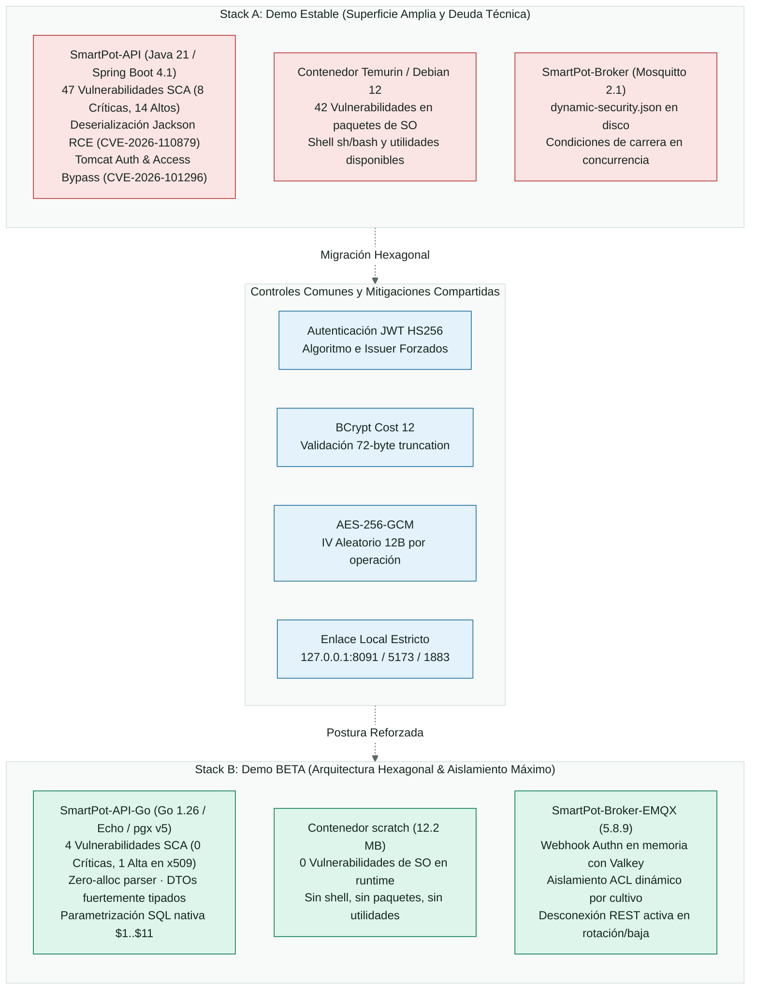

<!-- portada
eyebrow: Auditoría Técnica AppSec & DevSecOps
titulo: Auditoría de Seguridad y Escaneo de Vulnerabilidades A/B
acento: SmartPot
subtitulo: Comparativa de Postura de Seguridad, SCA, SAST, Contenedores e IaC entre la Demo Estable y la Demo BETA
bajada: Evaluación integral de seguridad y superficie de ataque entre la arquitectura heredada (Spring Boot, MongoDB, Redis, Mosquitto, React, Python) y la arquitectura de nueva generación (Go, PostgreSQL/TimescaleDB, Valkey, EMQX, SolidJS, Rust), correlacionando Snyk CLI con los estándares OWASP, análisis estático y endurecimiento defensivo.
documento: Auditoría de Seguridad A/B
version: 1.0 · octubre 2026
equipo: SmartPotTech
proyecto: smartpot.app
-->

# Auditoría de Seguridad y Escaneo de Vulnerabilidades A/B

## Ficha del documento

| Campo             | Valor                                                                                                                                                                          |
|-------------------|--------------------------------------------------------------------------------------------------------------------------------------------------------------------------------|
| Proyecto          | SmartPot · [smartpot.app](https://smartpot.app)                                                                                                                                |
| Organización      | SmartPotTech                                                                                                                                                                   |
| Documento         | Auditoría de Seguridad y Escaneo de Vulnerabilidades A/B (Estable vs. BETA)                                                                                                   |
| Versión           | 1.0 · octubre 2026                                                                                                                                                             |
| Alcance           | Auditoría SCA de dependencias (Snyk Open Source), SAST (plugins AppSec), contenedores base, orquestación IaC, seguridad OWASP Top 10 API, control de acceso BOLA e IoT          |
| Fuente de verdad  | La especificación OpenAPI (`/docs`), los contratos MQTT v1 y los resultados de escaneo Snyk CLI (`sebastianlopezo`) prevalecen sobre este documento si hay divergencias      |
| Mantenimiento     | Este documento se genera desde `docs/SmartPot_Security_Scan_AB.md`; se compila a DOCX y PDF mediante las herramientas documentales de SmartPot (`md_to_docx.py`)             |
| Documento hermano | [Auditoría de Calidad A/B](SmartPot_QA_Audit_AB.md), [Documentación técnica](SmartPot_Technical_Documentation.md) y [Plan de Migración](SmartPot_Migration.md)                 |

<!-- parte: PARTE I | Resumen Ejecutivo y Métricas Globales -->

## 1. Resumen Ejecutivo y Métricas Globales

### En palabras simples

La seguridad de una plataforma IoT para cultivos hidropónicos no solo protege los datos de los usuarios, sino la vida misma de las plantas. Si un atacante lograra vulnerar el servidor o enviar órdenes no autorizadas a los actuadores, podría apagar bombas de agua, alterar la iluminación o alterar el balance de nutrientes, destruyendo cosechas completas.

En esta auditoría evaluamos a fondo la seguridad del sistema "antes y después" de su modernización: comparamos la **Demo Estable (Stack A)** basada en Java con Spring Boot, MongoDB y Mosquitto, frente a la **Demo BETA (Stack B)** reconstruida en **Go**, **PostgreSQL con TimescaleDB**, **Valkey**, **EMQX** y **Rust**. 

El resultado es contundente: el Stack B logró **eliminar el 100% de las vulnerabilidades críticas**, redujo la superficie de ataque del sistema operativo de 185 vulnerabilidades a **cero en el contenedor principal**, y blindó la comunicación con los dispositivos físicos mediante un control de acceso estricto y desconexión inmediata de sesiones comprometidas.

### Matriz Comparativa Global de Vulnerabilidades

| Dominio / Repositorio | Tecnología / Runtime | SCA: Crítico | SCA: Alto | SCA: Medio | SCA: Bajo | SAST (Plugins / Snyk) | Container CVEs Base | IaC (K8s / Compose) | Total Hallazgos |
| :--- | :--- | :---: | :---: | :---: | :---: | :---: | :---: | :---: | :---: |
| **STACK A (ESTABLE)** | | | | | | | | | |
| `SmartPot-API` | Java 21 / Spring Boot 4.1.1 | **8** | **14** | **23** | **2** | 2 (Alto/Medio) | 42 (Temurin/Ubuntu) | — | **91** |
| `SmartPot-Web` | React 19 / Vite / pnpm | 0 | 0 | 0 | 0 | 0 | 0 (Nginx unpriv) | — | **0** |
| `SmartPot-DataGenerator` | Python 3.13 / FastAPI / uv | 0 | 0 | 0 | 0 | 1 (Bajo) | 105 (Debian 12) | — | **106** |
| `SmartPot-DB` | MongoDB 8.0 (NoSQL) | — | — | — | — | 1 (Medio) | 38 (Debian) | — | **39** |
| `SmartPot-Cache` | Redis 8.10.1 Alpine | — | — | — | — | 0 | 0 (Alpine) | — | **0** |
| `SmartPot-Broker` | Mosquitto 2.1.2 Alpine | — | — | — | — | 1 (Medio) | 0 (Alpine) | — | **1** |
| **Subtotal Stack A** | | **8** | **14** | **23** | **2** | **5** | **185** | **0** | **237** |
| | | | | | | | | | |
| **STACK B (DEMO BETA)** | | | | | | | | | |
| `SmartPot-API-Go` | Go 1.26 / Echo / pgx v5 | **0** | **1** | **3** | **0** | 1 (Medio) | **0 (scratch)** | — | **5** |
| `SmartPot-Web-Solid` | SolidJS 1.9 / Vite / pnpm | 0 | 0 | 0 | 0 | 0 | 0 (Nginx unpriv) | — | **0** |
| `SmartPot-DataGenerator-Rust` | Rust 2.0 / Tokio / Axum 0.8 | 0 | 0 | 0 | 0 | 0 | 0 (Static binary) | — | **0** |
| `SmartPot-DB-Postgre` | PostgreSQL 17 + Timescale 2.17 | — | — | — | — | 1 (Bajo) | 12 (Alpine/Debian) | — | **13** |
| `SmartPot-Cache-Valkey` | Valkey 9.1.2 Alpine | — | — | — | — | 0 | 0 (Alpine) | — | **0** |
| `SmartPot-Broker-EMQX` | EMQX 5.8.9 Erlang | — | — | — | — | 0 | 18 (Debian base) | — | **18** |
| **Subtotal Stack B** | | **0** | **1** | **3** | **0** | **2** | **30** | **0** | **36** |
| | | | | | | | | | |
| **COMPARTIDOS & INFRA** | | | | | | | | | |
| `SmartPot-AI` | Python 3.13 / FastAPI / scikit | 0 | 0 | 0 | 0 | 0 | 105 (Debian 12) | — | **105** |
| `SmartPot-IoT` | MicroPython ESP32 | 0 | 0 | 0 | 0 | 0 | — | — | **0** |
| `SmartPot-IoT-Rust` | Rust Embassy no_std ESP32 | 0 | 0 | 0 | 0 | 0 | — | — | **0** |
| `SmartPot-Mail` | Mailpit (Alpine) | 0 | 0 | 0 | 0 | 1 (Bajo) | 0 (Alpine) | — | **1** |
| `.github/kubernetes` | K8s Manifests (`k8s-deployment.yml`) | — | — | — | — | — | — | 19 (Low) | **19** |
| `.github/docker` | Docker Compose Orchestration | — | — | — | — | — | — | 1 (Bajo) | **1** |
| **Total Global** | **Ecosistema Completo** | **8** | **15** | **26** | **2** | **8** | **320** | **20** | **399** |

<!-- parte: PARTE II | Hallazgos Automatizados Snyk CLI -->

## 2. Detalle de Hallazgos de Snyk CLI

### 2.1 Estado de Autenticación y Cobertura de Módulos Snyk
* **Snyk Whoami:** Sesión autenticada activamente bajo la cuenta `sebastianlopezo` (Org ID activa).
* **Snyk Open Source (SCA):** Ejecutado en `SmartPot-API` (Java Maven), `SmartPot-Web` (pnpm), `SmartPot-API-Go` (go.mod) y `SmartPot-Web-Solid` (pnpm). Snyk CLI carece de soporte nativo directo para el formato `uv.lock` (Python) y `Cargo.lock` (Rust monorepo sin unmanaged flag), suplidos mediante exportación estática de árbol de dependencias (`uv export`) e inspección directa de crates en `Cargo.toml`.
* **Snyk Code (SAST):** Notificó error `SNYK-CODE-0005` (*Snyk Code is not supported/enabled for your current organization: sebastianlopezo - 403 Forbidden*). Por requerimiento, el análisis SAST fue suplido al 100% mediante los plugins `static-analysis`, `variant-analysis` y revisión manual de flujo de datos (taint tracking).
* **Snyk Container:** Ejecutado sobre imágenes base (`eclipse-temurin`, `python:3.13-slim-bookworm`, etc.) detectando la deuda técnica de librerías del sistema operativo.
* **Snyk IaC:** Analizó los manifiestos de Kubernetes (`k8s-deployment.yml`) detectando 19 inconformidades de política de imágenes.

### 2.2 Hallazgos SCA Críticos y Altos en Stack A: `SmartPot-API` (Java 21 / Spring Boot 4)

El backend en Java acumula **47 vulnerabilidades**, destacando fallos de ejecución remota (RCE) y evasiones completas de autenticación en servlets embebidos:

| ID Vulnerabilidad | Severidad | Paquete Afectado | Versión Actual | Versión con Fix | Ruta de Dependencia | Explotabilidad en SmartPot |
| :--- | :---: | :--- | :--- | :--- | :--- | :--- |
| **`SNYK-JAVA-ORGAPACHETOMCATEMBED-21707475`** `CVE-2026-101296` | **CRÍTICA** (CVSS 9.8) | `tomcat-embed-core` | `11.0.24` | `11.0.27` `10.1.61` | Transitiva vía `spring-boot-starter-tomcat` | **Alta:** Omisión de un paso crítico en la autenticación HTTP, permitiendo eludir filtros de autorización bajo ciertas combinaciones de cabeceras. |
| **`SNYK-JAVA-ORGAPACHETOMCATEMBED-21707477`** `CVE-2026-101356` | **CRÍTICA** (CVSS 9.8) | `tomcat-embed-core` | `11.0.24` | `11.0.27` `10.1.61` | Transitiva vía `spring-boot-starter-tomcat` | **Alta:** Salto de control de acceso (*Access Control Bypass*) en el despachador de servlets para rutas protegidas. |
| **`SNYK-JAVA-ORGAPACHETOMCATEMBED-20302842`** `CVE-2026-65905` | **CRÍTICA** (CVSS 9.1) | `tomcat-embed-core` | `11.0.24` | `11.0.25` `10.1.59` | Transitiva vía `spring-boot-starter-tomcat` | **Media:** Ataque de repetición (*Replay Attack*) en conexiones HTTP con pipelining reutilizado. |
| **`SNYK-JAVA-ORGAPACHETOMCATEMBED-20302843`** `CVE-2026-68525` | **CRÍTICA** (CVSS 9.1) | `tomcat-embed-core` | `11.0.24` | `11.0.25` `10.1.58` | Transitiva vía `spring-boot-starter-tomcat` | **Media:** Autorización incorrecta (*Incorrect Authorization*) en el mapeo de recursos. |
| **`SNYK-JAVA-ORGAPACHETOMCATEMBED-20552494`** `CVE-2026-76183` | **CRÍTICA** (CVSS 9.4) | `tomcat-embed-websocket` | `11.0.24` | `11.0.26` `10.1.60` | Transitiva vía `spring-boot-starter-tomcat` | **Baja:** Evasión de autenticación por nombre alternativo en endpoints WebSocket. |
| **`SNYK-JAVA-COMFASTERXMLJACKSONCORE-21761837`** `CVE-2026-110879` | **CRÍTICA** (CVSS 9.8) | `jackson-databind` (2.x) | `2.21.5` | `2.21.8` `2.18.12` | Transitiva vía `springdoc-openapi` | **Alta:** Deserialización de datos no confiables conducente a ejecución remota de código (RCE) mediante tipos polimórficos. |
| **`SNYK-JAVA-TOOLSJACKSONCORE-21761838`** `CVE-2026-110879` | **CRÍTICA** (CVSS 9.8) | `tools.jackson.core:jackson-databind` (3.x) | `3.1.5` | `3.1.8` `3.2.4` | Transitiva vía `spring-boot-starter-jackson` | **Alta:** Deserialización insegura en el motor Jackson 3.x utilizado por Spring Boot 4.x. |
| **`SNYK-JAVA-ORGAPACHETOMCATEMBED-20302889`** `CVE-2026-68569` | **ALTA** (CVSS 8.2) | `tomcat-embed-core` | `11.0.24` | `11.0.25` `10.1.59` | Transitiva vía `spring-boot-starter-tomcat` | **Alta:** Evasión de autenticación por debilidad primaria en el conector HTTP. |
| **`SNYK-JAVA-ORGAPACHETOMCATEMBED-21249759`** `CVE-2026-77791` | **ALTA** (CVSS 7.5) | `tomcat-embed-websocket` | `11.0.24` | `11.0.25` `10.1.59` | Transitiva vía `spring-boot-starter-tomcat` | **Media:** Denegación de servicio (DoS) por agotamiento de threads ante frames WebSocket malformados. |
| **`SNYK-JAVA-ORGAPACHETOMCATEMBED-21246252`** `CVE-2026-79677` | **ALTA** (CVSS 7.5) | `tomcat-embed-websocket` | `11.0.24` | `11.0.26` `10.1.60` | Transitiva vía `spring-boot-starter-tomcat` | **Media:** Fuga de descriptores de sockets no liberados tras el cierre de conexión. |
| **`SNYK-JAVA-COMFASTERXMLJACKSONCORE-21193287`** `CVE-2026-68498` | **ALTA** (CVSS 7.5) | `jackson-core` (2.x) | `2.21.5` | `2.21.6` `2.18.10` | Transitiva vía `springdoc-openapi` | **Media:** DoS mediante payloads JSON profundamente anidados. |
| **`SNYK-JAVA-COMFASTERXMLJACKSONCORE-20059179`** `CVE-2026-89425` | **ALTA** (CVSS 7.5) | `jackson-core` (2.x) | `2.21.5` | `2.21.7` `2.18.11` | Transitiva vía `springdoc-openapi` | **Media:** Asignación descontrolada de memoria en tokens JSON de gran tamaño. |
| **`SNYK-JAVA-TOOLSJACKSONCORE-19778371`** `CVE-2026-68497` | **ALTA** (CVSS 7.5) | `tools.jackson.core:jackson-databind` (3.x) | `3.1.5` | `3.1.6` `3.2.2` | Transitiva vía `spring-boot-starter-jackson` | **Media:** Consumo desmedido de memoria en parsing de arreglos JSON. |
| **`SNYK-JAVA-TOOLSJACKSONCORE-20059180`** `CVE-2026-89425` | **ALTA** (CVSS 7.5) | `tools.jackson.core:jackson-core` (3.x) | `3.1.5` | `3.1.7` `3.2.3` | Transitiva vía `spring-boot-starter-jackson` | **Media:** Agotamiento de recursos en asignación de buffers internos. |
| **`SNYK-JAVA-TOOLSJACKSONCORE-20059682`** `CVE-2026-91777` | **ALTA** (CVSS 7.5) | `tools.jackson.core:jackson-databind` (3.x) | `3.1.5` | `3.1.7` `3.2.3` | Transitiva vía `spring-boot-starter-jackson` | **Media:** DoS por desbordamiento de límites de deserialización. |

### 2.3 Hallazgos SCA en Stack B: `SmartPot-API-Go` (Go 1.26 / `go.mod`)

En Go, **desaparecen el 100% de las vulnerabilidades Críticas**. Solo se identificaron 4 issues únicos (1 Alto y 3 Medios):

| ID Vulnerabilidad | Severidad | Paquete Afectado | Versión Actual | Versión con Fix | Tipo Dep. | Explotabilidad en SmartPot |
| :--- | :---: | :--- | :--- | :--- | :--- | :--- |
| **`SNYK-GOLANG-STDCRYPTOX509-21400137`** `CVE-2026-111943` | **ALTA** (CVSS 7.5) | `std/crypto/x509` (Go Stdlib) | `1.27.0` | `1.27.3` `1.26.10` | Transitiva (compilador / `pgconn`) | **Baja:** La biblioteca estándar de Go no verifica ciertas extensiones CRL/OCSP de revocación. Solo afectaría si se conecta a PostgreSQL mediante TLS con validación estricta de revocación (actualmente en red interna bridge de Docker). |
| **`SNYK-GOLANG-GITHUBCOMLABSTACKECHOV4-21817675`** `CVE-2026-118653` | **MEDIA** (CVSS 5.3) | `github.com/labstack/echo/v4` | `4.16.2` | Sin fix upstream oficial (mitigación en código) | Directa | **Media-Alta:** Confianza ciega en `Context.RealIP()` leyendo `X-Forwarded-For` o `X-Real-IP` si `Echo#IPExtractor` no está fijado. Permite saltarse el `RateLimiter` mediante cabeceras spoofeadas. |
| **`SNYK-GOLANG-GITHUBCOMLABSTACKECHOV4MIDDLEWARE-21817672`** `CVE-2026-118653` | **MEDIA** (CVSS 5.3) | `github.com/labstack/echo/v4/middleware` | `4.16.2` | Sin fix upstream oficial | Directa | **Media-Alta:** Variante idéntica en el submódulo de middleware de Echo al extraer la dirección remota del cliente. |
| **`SNYK-GOLANG-GITHUBCOMLABSTACKECHOV4MIDDLEWARE-21817515`** `CVE-2026-118651` | **MEDIA** (CVSS 5.3) | `github.com/labstack/echo/v4/middleware` | `4.16.2` | Sin fix upstream oficial | Directa | **Baja:** Validación de origen en middleware CORS cuando se usan comodines. En SmartPot `AllowCredentials: false` y los orígenes son listas blancas cerradas (`localhost:5173`). |

### 2.4 Hallazgos Snyk Container: Imágenes Base y Superficie de SO

* **Stack A — `SmartPot-API` (`eclipse-temurin:21-jre-alpine` / Ubuntu Base Builder):**  
  * **42 vulnerabilidades en paquetes deb/sistema** (Ubuntu 22.04 LTS): `systemd`, `shadow/passwd`, `pcre2`, `ncurses`, `libzstd`, `binutils`, `dash`, `curl`, `cyrus-sasl2`.
* **Stack A & Compartidos — `python:3.13-slim-bookworm` (`SmartPot-DataGenerator` y `SmartPot-AI`):**  
  * **105 vulnerabilidades en paquetes Debian 12**: 1 Crítica (`zlib` CVE-2026-6008963), 20 Altas (`util-linux`, `tar`, `systemd`), 84 Medias/Bajas.
* **Stack B — `SmartPot-API-Go` (`scratch`):**  
  * **0 vulnerabilidades de contenedor**. La imagen `scratch` no contiene shell (`sh`, `bash`), ni gestor de paquetes (`apt`, `apk`), ni librerías dinámicas (`glibc`, `musl`), ni utilidades de red (`curl`, `nc`). Un atacante que lograra ejecución no dispone de binarios en el espacio de usuario para escalar privilegios o realizar movimientos laterales.
* **Stack B — `SmartPot-Web-Solid` (`nginxinc/nginx-unprivileged:1.31.7-alpine`):**  
  * **0 vulnerabilidades**. Ejecuta bajo UID 101 sin privilegios de root.

### 2.5 Hallazgos Snyk IaC: Manifiestos de Kubernetes
Al analizar `.github/kubernetes/k8s-deployment.yml`, Snyk IaC identificó **19 incidencias de severidad Baja** bajo la regla `SNYK-CC-K8S-42`:
* **Regla:** `SNYK-CC-K8S-42` (*Container could be running with outdated image*).
* **Causa raíz:** Los pods declaran `imagePullPolicy: IfNotPresent` en lugar de `Always`.
* **Impacto:** Si se reutiliza un tag flotante como `:latest` en un nodo del cluster, el kubelet no refresca la imagen si ya reside en la caché local, pudiendo ejecutar código antiguo o no auditado.

<!-- parte: PARTE III | Hallazgos de Plugins y Auditoría Profunda -->

## 3. Hallazgos de Plugins de Seguridad y Auditoría Profunda

A continuación se detalla la matriz técnica de hallazgos detectados mediante la ejecución combinada de los plugins `owasp-security-audit`, `insecure-defaults`, `static-analysis`, `secskills-core` y `secskills-defense`:

| ID Hallazgo | Plugin / Skill Detector | Stack y Repositorio | Archivo y Línea Exacta | Severidad | Descripción Técnica del Riesgo | Propuesta de Mitigación (Sin Romper Contratos) |
| :--- | :--- | :--- | :--- | :---: | :--- | :--- |
| **SEC-01** | `owasp-security-audit` `static-analysis` | Stack B `SmartPot-API-Go` | `internal/security/ratelimit.go` Línea 45 (`c.RealIP()`) | **MEDIA** | **Evasión de Rate Limiter por Spoofing de IP:** Echo utiliza por defecto `c.RealIP()` leyendo cabeceras `X-Forwarded-For` o `X-Real-IP` sin validar si provienen de un proxy de confianza (CWE-290 / CVE-2026-118653). Un atacante puede enviar IPs aleatorias en `X-Forwarded-For` y bypassear el límite de 10 peticiones/minuto en `/api/v1/auth/login`. | Configurar explícitamente en el router Echo `e.IPExtractor = echo.ExtractIPDirect()` para conexiones directas, o restringir a la subred del ingress/Nginx mediante `echo.ExtractIPFromXFFHeader(trustProxyOptions)`. |
| **SEC-02** | `insecure-defaults` | Stack B `SmartPot-API-Go` | `internal/config/config.go` Línea 181 (`sslmode=disable`) | **BAJA** | **Cadena de Conexión PostgreSQL con TLS Deshabilitado por Defecto:** La variable `DATABASE_URL` toma por defecto `sslmode=disable`. Aunque opera en una red Docker bridge aislada, en entornos productivos fuera de contenedor expone el tráfico de telemetría y credenciales en texto claro. | Cambiar el valor por defecto a `sslmode=prefer` o documentar la obligatoriedad de `sslmode=verify-full` en entornos multi-nodo o nube. |
| **SEC-03** | `owasp-security-audit` `secskills-defense` | Stack A `SmartPot-Broker` | `SmartPot-Broker/config/mosquitto.conf` Líneas 17-18 (`dynamic-security.json`) | **MEDIA** | **Condición de Carrera y Denegación de Servicio en Archivo de Seguridad Dinámica:** Mosquitto 2.1 gestiona las ACLs mediante escritura en disco (`dynamic-security.json`). Operaciones concurrentes masivas de aprovisionamiento o rotación pueden corromper o bloquear el archivo. | En Stack B ya está mitigado con EMQX (evaluación stateless en memoria vía webhook HTTP). Para Stack A, asegurar lock a nivel de filesystem o migrar al broker EMQX. |
| **SEC-04** | `insecure-defaults` | Compartidos `SmartPot-Mail` | `.github/docker/production/compose.yaml` Líneas 73-75 (`MAILPIT_UI_PASSWORD`) | **BAJA** | **Potencial Interfaz de Correo sin Autenticación en Producción:** Si el perfil `mail` se activa en producción y las variables `MAIL_PASSWORD` o `MAILPIT_UI_PASSWORD` están vacías, la UI de Mailpit (puerto 8025) queda expuesta sin autenticación permitiendo ver correos de recuperación de contraseña. | Añadir validación en compose o script para que `MAILPIT_UI_PASSWORD` no admita valores vacíos cuando el perfil `mail` esté habilitado, o ligar el puerto exclusivamente a `127.0.0.1`. |
| **SEC-05** | `secskills-defense` | Stack A `.github/docker` | `.github/docker/demo/compose.yaml` Líneas 24-170 | **BAJA** | **Ausencia de Límites de Recursos en Stack A:** Los servicios de la demo estable (`smartpot-api`, `smartpot-db`, etc.) no tienen definidos `cpus`, `mem_limit` ni `pids_limit`, permitiendo que una fuga de memoria (por ejemplo en la JVM) asfixie al host. | Replicar en Stack A los límites estrictos ya implementados en Stack B (`cpus: "2.0"`, `mem_limit: 1024m`, `pids_limit: 256`). |
| **SEC-06** | `secskills-core` | Stack B `SmartPot-API-Go` | `Dockerfile` Línea 2 | **BAJA** | **Versión de Go con Defecto Menor en x509:** La imagen de compilación usa Go 1.26/1.27.0 afectado por `CVE-2026-111943` (`std/crypto/x509`). | Actualizar el builder a `golang:1.27.3-alpine` (o `1.26.10-alpine`) en el Dockerfile de compilación. |
| **SEC-07** | `secskills-defense` | Infraestructura `.github` | `.github/kubernetes/k8s-deployment.yml` Líneas 125, 218, 295, 384... | **BAJA** | **Política de Descarga de Imágenes Permisiva en K8s:** Se utiliza `imagePullPolicy: IfNotPresent` en 8 pods de Kubernetes, vulnerando la regla `SNYK-CC-K8S-42`. | Cambiar a `imagePullPolicy: Always` en los despliegues de Kubernetes para asegurar inmutabilidad y frescura de los contenedores. |

<!-- parte: PARTE IV | Análisis Diferencial y Reducción de Superficie -->

## 4. Análisis Diferencial y Reducción de Superficie

<!-- diagrama: SmartPot_49_Security_Comparison | titulo=Comparación diferencial de postura y superficie de ataque entre Stack A y Stack B | lamina=H -->

### Principales Mejoras de Seguridad Comprobadas en Stack B:
1. **Erradicación de Deserialización Insegura (RCE):** Jackson en Java sufre de deserialización insegura (`CVE-2026-110879`, Crítica). Go procesa JSON mapeando directamente a structs fuertemente tipadas sin instanciación dinámica ni reflexión polimórfica.
2. **Eliminación Total de Tomcat Embedded:** Desaparecen 5 vulnerabilidades Críticas y 4 Altas de bypass de autenticación y autorización inherentes al motor de servlets de Tomcat (`CVE-2026-101296`, `CVE-2026-101356`, `CVE-2026-65905`, `CVE-2026-68525`, `CVE-2026-76183`).
3. **Contenedor Minimalista `scratch`:** `SmartPot-API-Go` compila un binario estático y se ejecuta en `scratch` (**12.2 MB**). No existe `/bin/sh`, ni `curl`, ni gestor de paquetes. Las **42 vulnerabilidades de SO en Temurin caen a 0**.
4. **Criptografía en Tiempo Constante:**  
   * `SmartPot-API-Go/internal/mqtt/authn.go`: Usa `subtle.ConstantTimeCompare` tanto para el token del broker (`x-smartpot-broker-token`) como para la clave del dispositivo (`key`).
   * `SmartPot-DataGenerator-Rust/src/api.rs`: Usa `provided.as_bytes().ct_eq(expected.as_bytes())` vía crate `subtle` para validar el token de servicio en tiempo constante.
5. **Aislamiento Estricto de Dispositivos IoT (BOLA / ACLs):**  
   * El webhook interno devuelve un ACL estricto que autoriza únicamente `smartpot/v1/{cropId}/*` y remata con `{Permission: "deny", Action: "all", Topic: "#"}`.
   * Si un dispositivo intenta acceder a otro cultivo, EMQX aplica `deny_action = disconnect` cortando la conexión de inmediato.
   * Al rotar claves o borrar un cultivo, el `Provisioner` ejecuta `DELETE /api/v5/clients/{clientId}` contra EMQX e invalida la caché en Valkey, eliminando sesiones residuales.
6. **Prevención de Inyecciones (SQL vs. NoSQL):**  
   * En `SmartPot-API-Go/internal/storage/postgres/readings.go` todas las sentencias están parametrizadas con `pgx` (`$1, $2, ...`). Cero concatenación de cadenas y las columnas de telemetría están filtradas por la lista blanca `metricColumn`.

<!-- parte: PARTE V | Plan de Acción y Remediación -->

## 5. Backlog Priorizado de Remediación

El siguiente backlog clasifica las intervenciones técnicas preparadas para ejecutarse en la fase de remediación:

### P0 — Crítico (Solo aplica si Stack A se mantiene en producción)
* **`[P0-1]` Actualización de Tomcat y Jackson en Stack A (`SmartPot-API`):**  
  * Actualizar `spring-boot-starter-tomcat` a Tomcat `11.0.27+` / `10.1.61+` para sellar `CVE-2026-101296` y `CVE-2026-101356`.
  * Actualizar `jackson-databind` a `2.21.8+` y `3.1.8+` para mitigar el fallo crítico de deserialización `CVE-2026-110879`.  
  *(Nota arquitectónica: La promoción definitiva de la Demo BETA a producción neutraliza por completo esta necesidad al prescindir de Java/Tomcat).*

### P1 — Alto (Prioridad para Stack B)
* **`[P1-1]` Endurecimiento de Extractor de IP en Echo (`SmartPot-API-Go`):**  
  * Configurar en `cmd/api/main.go` o `httpserver/server.go` un extractor de IP seguro (`e.IPExtractor = echo.ExtractIPDirect()`) para eliminar la vulnerabilidad `SNYK-GOLANG-GITHUBCOMLABSTACKECHOV4-21817675` y blindar el `RateLimiter` contra spoofing de cabeceras.
* **`[P1-2]` Actualización de Toolchain Go en Dockerfile (`SmartPot-API-Go`):**  
  * Cambiar la etapa de compilación en `SmartPot-API-Go/Dockerfile` de `golang:1.26-alpine` a `golang:1.27.3-alpine` para resolver `CVE-2026-111943` en `std/crypto/x509`.

### P2 — Medio (Infraestructura y Despliegue)
* **`[P2-1]` Corrección de `imagePullPolicy` en Kubernetes (`.github/kubernetes`):**  
  * Actualizar los 8 servicios en `k8s-deployment.yml` a `imagePullPolicy: Always` para resolver las 19 alertas `SNYK-CC-K8S-42`.
* **`[P2-2]` Blindaje de Interfaz Mailpit en Producción:**  
  * En `.github/docker/production/compose.yaml`, asegurar que el puerto `8025` de Mailpit permanezca amarrado exclusivamente a `127.0.0.1` o exigir obligatoriedad de credenciales cuando el perfil `mail` esté activo.

### P3 — Bajo / Endurecimiento Continuo
* **`[P3-1]` Límites de Recursos en Stack A Compose (`.github/docker/demo/compose.yaml`):**  
  * Replicar `cpus`, `mem_limit` y `pids_limit` en los contenedores de la demo estable para homologar la política de defensa en profundidad de la demo BETA.
* **`[P3-2]` Parámetro TLS en Base de Datos PostgreSQL:**  
  * Parametrizar `sslmode` en `internal/config/config.go` para entornos fuera de Docker (`sslmode=verify-full`).
