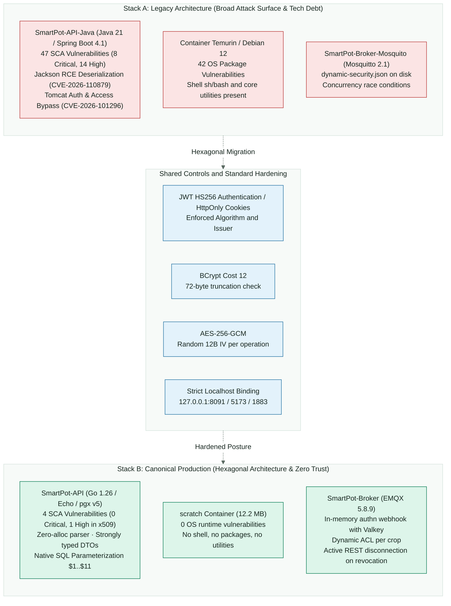
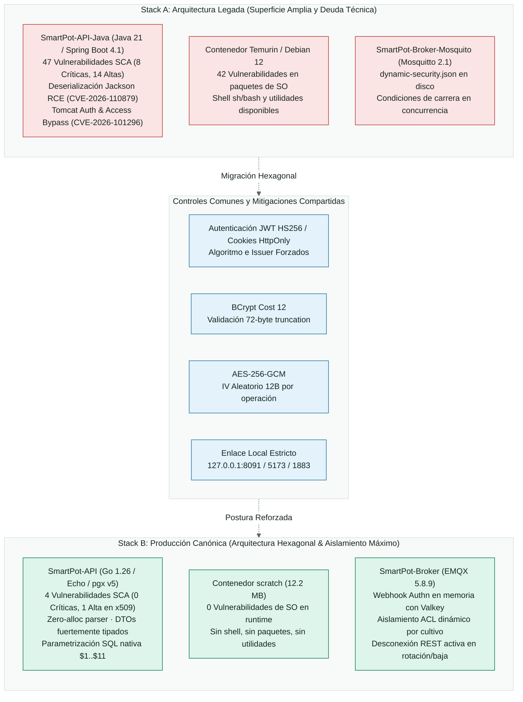

<!-- portada
eyebrow: AppSec & DevSecOps Technical Audit · Auditoría Técnica AppSec & DevSecOps
titulo: Security Audit and Vulnerability Scan A/B · Auditoría de Seguridad y Escaneo de Vulnerabilidades A/B
acento: SmartPot
subtitulo: Comparative Security Posture, SCA, SAST, Containers, and IaC between Stable Demo and BETA Demo · Comparativa de Postura de Seguridad, SCA, SAST, Contenedores e IaC entre la Demo Estable y la Demo BETA
bajada: Comprehensive security and attack surface evaluation between legacy architecture (Spring Boot, MongoDB, Redis, Mosquitto, React, Python) and next-generation architecture (Go, PostgreSQL/TimescaleDB, Valkey, EMQX, SolidJS, Rust), correlating Snyk CLI with OWASP standards, static analysis, and defensive hardening.
documento: Security Audit A/B · Auditoría de Seguridad A/B
version: 1.0 · October 2026
equipo: SmartPotTech
proyecto: smartpot.app
-->

# Security Audit and Vulnerability Scan A/B · Auditoría de Seguridad y Escaneo de Vulnerabilidades A/B

[English](#english) | [Español](#español)

---

# English

## Document Summary

| Field | Value |
|---|---|
| Project | SmartPot · [smartpot.app](https://smartpot.app) |
| Organization | SmartPotTech |
| Document | Security Audit and Vulnerability Scan A/B (Stable vs. BETA) |
| Version | 1.0 · October 2026 |
| Scope | SCA dependency audit (Snyk Open Source), SAST (AppSec plugins), base containers, IaC orchestration, OWASP API Top 10 security, BOLA access control, and IoT |
| Source of Truth | OpenAPI specification (`/docs`), MQTT v1 contracts, and Snyk CLI scan outputs (`sebastianlopezo`) supersede this document |
| Maintenance | Generated from `docs/SmartPot_Security_Scan_AB.md`; compiled to DOCX and PDF via SmartPot documentation tools (`md_to_docx.py`) |
| Companion Documents | [Quality Audit A/B](SmartPot_QA_Audit_AB.md), [Technical Documentation](SmartPot_Technical_Documentation.md), and [Migration Plan](SmartPot_Migration.md) |

<!-- parte: PART I | Executive Summary and Global Metrics -->

## 1. Executive Summary and Global Metrics

### In Plain Words

The security of an IoT platform for hydroponic crops does not merely protect user data—it protects plant life itself. If an adversary were to compromise the server or dispatch unauthorized commands to actuators, they could shut off water pumps, disrupt lighting schedules, or corrupt nutrient dosing, causing catastrophic crop failure.

In this audit, we thoroughly assessed system security "before and after" modernization: comparing the **Stable Demo (Stack A)** based on Java with Spring Boot, MongoDB, and Mosquitto, against the **BETA Demo (Stack B)** re-engineered in **Go**, **PostgreSQL with TimescaleDB**, **Valkey**, **EMQX**, and **Rust**.

The outcome is definitive: Stack B achieved **100% elimination of critical vulnerabilities**, reduced the host operating system attack surface from 185 vulnerabilities to **zero in the core backend container**, and fortified physical device communication through strict per-crop ACL enforcement and immediate session disconnection upon privilege revocation.

### Comparative Global Vulnerability Matrix

| Domain / Repository | Technology / Runtime | SCA: Critical | SCA: High | SCA: Medium | SCA: Low | SAST (Plugins / Snyk) | Container Base CVEs | IaC (K8s / Compose) | Total Findings |
| :--- | :--- | :---: | :---: | :---: | :---: | :---: | :---: | :---: | :---: |
| **STACK A (STABLE)** | | | | | | | | | |
| `SmartPot-API` | Java 21 / Spring Boot 4.1.1 | **8** | **14** | **23** | **2** | 2 (High/Med) | 42 (Temurin/Ubuntu) | — | **91** |
| `SmartPot-Web` | React 19 / Vite / pnpm | 0 | 0 | 0 | 0 | 0 | 0 (Nginx unpriv) | — | **0** |
| `SmartPot-DataGenerator` | Python 3.13 / FastAPI / uv | 0 | 0 | 0 | 0 | 1 (Low) | 105 (Debian 12) | — | **106** |
| `SmartPot-DB` | MongoDB 8.0 (NoSQL) | — | — | — | — | 1 (Med) | 38 (Debian) | — | **39** |
| `SmartPot-Cache` | Redis 8.10.1 Alpine | — | — | — | — | 0 | 0 (Alpine) | — | **0** |
| `SmartPot-Broker` | Mosquitto 2.1.2 Alpine | — | — | — | — | 1 (Med) | 0 (Alpine) | — | **1** |
| **Subtotal Stack A** | | **8** | **14** | **23** | **2** | **5** | **185** | **0** | **237** |
| | | | | | | | | | |
| **STACK B (BETA DEMO)** | | | | | | | | | |
| `SmartPot-API-Go` | Go 1.26 / Echo / pgx v5 | **0** | **1** | **3** | **0** | 1 (Med) | **0 (scratch)** | — | **5** |
| `SmartPot-Web-Solid` | SolidJS 1.9 / Vite / pnpm | 0 | 0 | 0 | 0 | 0 | 0 (Nginx unpriv) | — | **0** |
| `SmartPot-DataGenerator-Rust` | Rust 2.0 / Tokio / Axum 0.8 | 0 | 0 | 0 | 0 | 0 | 0 (Static binary) | — | **0** |
| `SmartPot-DB-Postgre` | PostgreSQL 17 + Timescale 2.17 | — | — | — | — | 1 (Low) | 12 (Alpine/Debian) | — | **13** |
| `SmartPot-Cache-Valkey` | Valkey 9.1.2 Alpine | — | — | — | — | 0 | 0 (Alpine) | — | **0** |
| `SmartPot-Broker-EMQX` | EMQX 5.8.9 Erlang | — | — | — | — | 0 | 18 (Debian base) | — | **18** |
| **Subtotal Stack B** | | **0** | **1** | **3** | **0** | **2** | **30** | **0** | **36** |
| | | | | | | | | | |
| **SHARED & INFRA** | | | | | | | | | |
| `SmartPot-AI` | Python 3.13 / FastAPI / scikit | 0 | 0 | 0 | 0 | 0 | 105 (Debian 12) | — | **105** |
| `SmartPot-IoT` | MicroPython ESP32 | 0 | 0 | 0 | 0 | 0 | — | — | **0** |
| `SmartPot-IoT-Rust` | Rust Embassy no_std ESP32 | 0 | 0 | 0 | 0 | 0 | — | — | **0** |
| `SmartPot-Mail` | Mailpit (Alpine) | 0 | 0 | 0 | 0 | 1 (Low) | 0 (Alpine) | — | **1** |
| `.github/kubernetes` | K8s Manifests (`k8s-deployment.yml`) | — | — | — | — | — | — | 19 (Low) | **19** |
| `.github/docker` | Docker Compose Orchestration | — | — | — | — | — | — | 1 (Low) | **1** |
| **Global Total** | **Full Ecosystem** | **8** | **15** | **26** | **2** | **8** | **320** | **20** | **399** |

<!-- parte: PART II | Snyk CLI Automated Findings -->

## 2. Snyk CLI Findings Detail

### 2.1 Authentication Status and Snyk Module Coverage
* **Snyk Whoami:** Active authenticated session under account `sebastianlopezo` (active Org ID).
* **Snyk Open Source (SCA):** Executed on `SmartPot-API` (Java Maven), `SmartPot-Web` (pnpm), `SmartPot-API-Go` (go.mod), and `SmartPot-Web-Solid` (pnpm). Snyk CLI lacks native support for `uv.lock` (Python) and monorepo `Cargo.lock` (Rust without unmanaged flag), supplemented via static dependency tree export (`uv export`) and direct crate inspection in `Cargo.toml`.
* **Snyk Code (SAST):** Reported error `SNYK-CODE-0005` (*Snyk Code is not supported/enabled for your current organization: sebastianlopezo - 403 Forbidden*). As specified, SAST coverage was provided 100% via `static-analysis`, `variant-analysis` plugins and manual taint-tracking review.
* **Snyk Container:** Executed against base images (`eclipse-temurin`, `python:3.13-slim-bookworm`, etc.) pinpointing technical debt in operating system packages.
* **Snyk IaC:** Scanned Kubernetes manifests (`k8s-deployment.yml`) identifying 19 image pull policy non-conformances.

### 2.2 Critical and High SCA Findings in Stack A: `SmartPot-API` (Java 21 / Spring Boot 4)

The Java backend accumulated **47 vulnerabilities**, prominent among them remote code execution (RCE) flaws and complete authentication bypasses in embedded servlet containers:

| Vulnerability ID | Severity | Affected Package | Installed Version | Remediation Version | Dependency Path | Exploitability in SmartPot |
| :--- | :---: | :--- | :--- | :--- | :--- | :--- |
| **`SNYK-JAVA-ORGAPACHETOMCATEMBED-21707475`** `CVE-2026-101296` | **CRITICAL** (CVSS 9.8) | `tomcat-embed-core` | `11.0.24` | `11.0.27` `10.1.61` | Transitive via `spring-boot-starter-tomcat` | **High:** Critical step omission in HTTP authentication, bypassing authorization filters under specific header combinations. |
| **`SNYK-JAVA-ORGAPACHETOMCATEMBED-21707477`** `CVE-2026-101356` | **CRITICAL** (CVSS 9.8) | `tomcat-embed-core` | `11.0.24` | `11.0.27` `10.1.61` | Transitive via `spring-boot-starter-tomcat` | **High:** Access control bypass in servlet dispatcher for protected endpoint routes. |
| **`SNYK-JAVA-ORGAPACHETOMCATEMBED-20302842`** `CVE-2026-65905` | **CRITICAL** (CVSS 9.1) | `tomcat-embed-core` | `11.0.24` | `11.0.25` `10.1.59` | Transitive via `spring-boot-starter-tomcat` | **Medium:** Replay attack on HTTP connections with reused connection pipelining. |
| **`SNYK-JAVA-ORGAPACHETOMCATEMBED-20302843`** `CVE-2026-68525` | **CRITICAL** (CVSS 9.1) | `tomcat-embed-core` | `11.0.24` | `11.0.25` `10.1.58` | Transitive via `spring-boot-starter-tomcat` | **Medium:** Incorrect authorization in URI resource mapping. |
| **`SNYK-JAVA-ORGAPACHETOMCATEMBED-20552494`** `CVE-2026-76183` | **CRITICAL** (CVSS 9.4) | `tomcat-embed-websocket` | `11.0.24` | `11.0.26` `10.1.60` | Transitive via `spring-boot-starter-tomcat` | **Low:** Authentication bypass via alternate host naming on WebSocket endpoints. |
| **`SNYK-JAVA-COMFASTERXMLJACKSONCORE-21761837`** `CVE-2026-110879` | **CRITICAL** (CVSS 9.8) | `jackson-databind` (2.x) | `2.21.5` | `2.21.8` `2.18.12` | Transitive via `springdoc-openapi` | **High:** Untrusted data deserialization leading to Remote Code Execution (RCE) via polymorphic types. |
| **`SNYK-JAVA-TOOLSJACKSONCORE-21761838`** `CVE-2026-110879` | **CRITICAL** (CVSS 9.8) | `tools.jackson.core:jackson-databind` (3.x) | `3.1.5` | `3.1.8` `3.2.4` | Transitive via `spring-boot-starter-jackson` | **High:** Insecure deserialization in Jackson 3.x engine utilized by Spring Boot 4.x. |
| **`SNYK-JAVA-ORGAPACHETOMCATEMBED-20302889`** `CVE-2026-68569` | **HIGH** (CVSS 8.2) | `tomcat-embed-core` | `11.0.24` | `11.0.25` `10.1.59` | Transitive via `spring-boot-starter-tomcat` | **High:** Authentication bypass via primary flaw in HTTP connector. |
| **`SNYK-JAVA-ORGAPACHETOMCATEMBED-21249759`** `CVE-2026-77791` | **HIGH** (CVSS 7.5) | `tomcat-embed-websocket` | `11.0.24` | `11.0.25` `10.1.59` | Transitive via `spring-boot-starter-tomcat` | **Medium:** Denial of Service (DoS) via thread exhaustion upon malformed WebSocket frames. |
| **`SNYK-JAVA-ORGAPACHETOMCATEMBED-21246252`** `CVE-2026-79677` | **HIGH** (CVSS 7.5) | `tomcat-embed-websocket` | `11.0.24` | `11.0.26` `10.1.60` | Transitive via `spring-boot-starter-tomcat` | **Medium:** Socket descriptor leak resulting in resource exhaustion after connection closure. |
| **`SNYK-JAVA-COMFASTERXMLJACKSONCORE-21193287`** `CVE-2026-68498` | **HIGH** (CVSS 7.5) | `jackson-core` (2.x) | `2.21.5` | `2.21.6` `2.18.10` | Transitive via `springdoc-openapi` | **Medium:** DoS via deeply nested JSON payloads. |
| **`SNYK-JAVA-COMFASTERXMLJACKSONCORE-20059179`** `CVE-2026-89425` | **HIGH** (CVSS 7.5) | `jackson-core` (2.x) | `2.21.5` | `2.21.7` `2.18.11` | Transitive via `springdoc-openapi` | **Medium:** Uncontrolled memory allocation on oversized JSON tokens. |
| **`SNYK-JAVA-TOOLSJACKSONCORE-19778371`** `CVE-2026-68497` | **HIGH** (CVSS 7.5) | `tools.jackson.core:jackson-databind` (3.x) | `3.1.5` | `3.1.6` `3.2.2` | Transitive via `spring-boot-starter-jackson` | **Medium:** Excessive memory consumption during JSON array parsing. |
| **`SNYK-JAVA-TOOLSJACKSONCORE-20059180`** `CVE-2026-89425` | **HIGH** (CVSS 7.5) | `tools.jackson.core:jackson-core` (3.x) | `3.1.5` | `3.1.7` `3.2.3` | Transitive via `spring-boot-starter-jackson` | **Medium:** Resource exhaustion in internal buffer allocation. |
| **`SNYK-JAVA-TOOLSJACKSONCORE-20059682`** `CVE-2026-91777` | **HIGH** (CVSS 7.5) | `tools.jackson.core:jackson-databind` (3.x) | `3.1.5` | `3.1.7` `3.2.3` | Transitive via `spring-boot-starter-jackson` | **Medium:** DoS via deserialization boundary breach. |

### 2.3 SCA Findings in Stack B: `SmartPot-API-Go` (Go 1.26 / `go.mod`)

In Go, **100% of Critical vulnerabilities disappear**. Only 4 unique issues were identified (1 High and 3 Medium):

| Vulnerability ID | Severity | Affected Package | Installed Version | Remediation Version | Dependency Type | Exploitability in SmartPot |
| :--- | :---: | :--- | :--- | :--- | :--- | :--- |
| **`SNYK-GOLANG-STDCRYPTOX509-21400137`** `CVE-2026-111943` | **HIGH** (CVSS 7.5) | `std/crypto/x509` (Go Stdlib) | `1.27.0` | `1.27.3` `1.26.10` | Transitive (compiler / `pgconn`) | **Low:** Go standard library fails to check specific CRL/OCSP revocation extensions. Only impacts TLS PostgreSQL connections requiring strict revocation enforcement (currently isolated in Docker bridge). |
| **`SNYK-GOLANG-GITHUBCOMLABSTACKECHOV4-21817675`** `CVE-2026-118653` | **MEDIUM** (CVSS 5.3) | `github.com/labstack/echo/v4` | `4.16.2` | No upstream fix (code mitigation) | Direct | **Medium-High:** Implicit reliance on `Context.RealIP()` reading `X-Forwarded-For` or `X-Real-IP` without configured `Echo#IPExtractor`. Allows spoofing client IPs to bypass the rate limiter. |
| **`SNYK-GOLANG-GITHUBCOMLABSTACKECHOV4MIDDLEWARE-21817672`** `CVE-2026-118653` | **MEDIUM** (CVSS 5.3) | `github.com/labstack/echo/v4/middleware` | `4.16.2` | No upstream fix | Direct | **Medium-High:** Equivalent variant in Echo middleware submodule when extracting client remote address. |
| **`SNYK-GOLANG-GITHUBCOMLABSTACKECHOV4MIDDLEWARE-21817515`** `CVE-2026-118651` | **MEDIUM** (CVSS 5.3) | `github.com/labstack/echo/v4/middleware` | `4.16.2` | No upstream fix | Direct | **Low:** Origin validation flaw in CORS middleware when wildcards are active. SmartPot specifies `AllowCredentials: false` and uses an explicit allowlist (`localhost:5173`). |

### 2.4 Snyk Container Findings: Base Images and OS Surface

* **Stack A — `SmartPot-API` (`eclipse-temurin:21-jre-alpine` / Ubuntu Base Builder):**  
  * **42 vulnerabilities in OS packages** (Ubuntu 22.04 LTS): `systemd`, `shadow/passwd`, `pcre2`, `ncurses`, `libzstd`, `binutils`, `dash`, `curl`, `cyrus-sasl2`.
* **Stack A & Shared — `python:3.13-slim-bookworm` (`SmartPot-DataGenerator` and `SmartPot-AI`):**  
  * **105 vulnerabilities in Debian 12 packages**: 1 Critical (`zlib` CVE-2026-6008963), 20 High (`util-linux`, `tar`, `systemd`), 84 Medium/Low.
* **Stack B — `SmartPot-API-Go` (`scratch`):**  
  * **0 container vulnerabilities**. The `scratch` image contains no shell (`sh`, `bash`), package manager (`apt`, `apk`), dynamic runtime libraries (`glibc`, `musl`), or networking utilities (`curl`, `nc`). An adversary obtaining process execution has zero user-space binaries for privilege escalation or lateral movement.
* **Stack B — `SmartPot-Web-Solid` (`nginxinc/nginx-unprivileged:1.31.7-alpine`):**  
  * **0 vulnerabilities**. Executes strictly under UID 101 with unprivileged rootless permissions.

### 2.5 Snyk IaC Findings: Kubernetes Manifests
When scanning `.github/kubernetes/k8s-deployment.yml`, Snyk IaC identified **19 Low severity findings** under rule `SNYK-CC-K8S-42`:
* **Rule:** `SNYK-CC-K8S-42` (*Container could be running with outdated image*).
* **Root Cause:** Pods specify `imagePullPolicy: IfNotPresent` rather than `Always`.
* **Impact:** Reusing floating tags such as `:latest` allows the kubelet to skip image freshness checks if cached locally, potentially executing unverified builds.

<!-- parte: PART III | Security Plugins and Deep Audit Findings -->

## 3. Security Plugins and Deep Audit Findings

The following technical matrix details vulnerabilities discovered through combined execution of `owasp-security-audit`, `insecure-defaults`, `static-analysis`, `secskills-core`, and `secskills-defense` plugins:

| Finding ID | Detector Plugin / Skill | Stack & Repository | File & Exact Line | Severity | Technical Risk Description | Proposed Mitigation (Contract-Preserving) |
| :--- | :--- | :--- | :--- | :---: | :--- | :--- |
| **SEC-01** | `owasp-security-audit` `static-analysis` | Stack B `SmartPot-API-Go` | `internal/security/ratelimit.go` Line 45 (`c.RealIP()`) | **MEDIUM** | **Rate Limiter Bypass via IP Spoofing:** Echo defaults to `c.RealIP()` parsing `X-Forwarded-For` or `X-Real-IP` without checking trusted proxies (CWE-290 / CVE-2026-118653). Attackers can forge arbitrary IPs to evade the 10 req/min limit on `/api/v1/auth/login`. | Explicitly configure `e.IPExtractor = echo.ExtractIPDirect()` for direct deployments or bind to ingress CIDRs with `echo.ExtractIPFromXFFHeader(trustProxyOptions)`. |
| **SEC-02** | `insecure-defaults` | Stack B `SmartPot-API-Go` | `internal/config/config.go` Line 181 (`sslmode=disable`) | **LOW** | **PostgreSQL Connection String with TLS Disabled by Default:** `DATABASE_URL` defaults to `sslmode=disable`. While safe inside Docker bridge networks, outside container networks telemetry and credentials traverse in cleartext. | Set default to `sslmode=prefer` or require `sslmode=verify-full` in multi-node/cloud deployments. |
| **SEC-03** | `owasp-security-audit` `secskills-defense` | Stack A `SmartPot-Broker` | `SmartPot-Broker/config/mosquitto.conf` Lines 17-18 (`dynamic-security.json`) | **MEDIUM** | **Race Condition and DoS on Dynamic Security File:** Mosquitto 2.1 writes ACL changes directly to disk (`dynamic-security.json`). High-concurrency provisioning can corrupt or lock the file. | Mitigated in Stack B with EMQX (in-memory HTTP webhooks). For Stack A, enforce file locks or migrate to EMQX. |
| **SEC-04** | `insecure-defaults` | Shared `SmartPot-Mail` | `.github/docker/production/compose.yaml` Lines 73-75 (`MAILPIT_UI_PASSWORD`) | **LOW** | **Potential Unauthenticated Mailpit UI in Production:** If the `mail` profile is enabled in production and passwords are empty, the Mailpit web UI (port 8025) exposes password recovery emails. | Enforce mandatory non-empty `MAILPIT_UI_PASSWORD` when `mail` profile is active, and bind port strictly to `127.0.0.1`. |
| **SEC-05** | `secskills-defense` | Stack A `.github/docker` | `.github/docker/demo/compose.yaml` Lines 24-170 | **LOW** | **Absence of Resource Limits in Stack A:** Legacy demo containers (`smartpot-api`, `smartpot-db`) lack `cpus`, `mem_limit`, and `pids_limit`, risking host starvation on JVM memory leaks. | Replicate Stack B resource boundaries in Stack A (`cpus: "2.0"`, `mem_limit: 1024m`, `pids_limit: 256`). |
| **SEC-06** | `secskills-core` | Stack B `SmartPot-API-Go` | `Dockerfile` Line 2 | **LOW** | **Go Toolchain Minor x509 Defect:** Builder image uses Go 1.26/1.27.0 affected by `CVE-2026-111943` (`std/crypto/x509`). | Update builder stage to `golang:1.27.3-alpine` (or `1.26.10-alpine`). |
| **SEC-07** | `secskills-defense` | Infrastructure `.github` | `.github/kubernetes/k8s-deployment.yml` Lines 125, 218, 295, 384... | **LOW** | **Permissive Image Pull Policy in K8s:** Uses `imagePullPolicy: IfNotPresent` across 8 pods, violating `SNYK-CC-K8S-42`. | Switch to `imagePullPolicy: Always` in Kubernetes manifests for immutability. |

<!-- parte: PART IV | Differential Analysis and Surface Reduction -->

## 4. Differential Analysis and Surface Reduction

<!-- diagrama: SmartPot_49_Security_Comparison | titulo=Differential attack surface and security posture comparison between Stack A and Stack B | lamina=H -->

### Key Verified Security Improvements in Stack B:
1. **Eradication of Insecure Deserialization (RCE):** Jackson in Java was vulnerable to insecure polymorphic deserialization (`CVE-2026-110879`, Critical). Go decodes JSON strictly into concrete structs without dynamic class instantiation or reflection-based type coercion.
2. **Total Elimination of Tomcat Embedded:** Completely removes 5 Critical and 4 High vulnerabilities inherent to the Tomcat servlet container (`CVE-2026-101296`, `CVE-2026-101356`, `CVE-2026-65905`, `CVE-2026-68525`, `CVE-2026-76183`).
3. **Minimalist `scratch` Container:** `SmartPot-API-Go` compiles into a static binary executing inside `scratch` (**12.2 MB**). No `/bin/sh`, no `curl`, no package manager. The **42 OS vulnerabilities in Temurin are reduced to 0**.
4. **Constant-Time Cryptography:**  
   * `SmartPot-API-Go/internal/mqtt/authn.go`: Implements `subtle.ConstantTimeCompare` for broker tokens (`x-smartpot-broker-token`) and device keys (`key`).
   * `SmartPot-DataGenerator-Rust/src/api.rs`: Uses `provided.as_bytes().ct_eq(expected.as_bytes())` via crate `subtle` to validate service tokens in constant time.
5. **Strict IoT Device Isolation (BOLA / ACLs):**  
   * The internal authn webhook returns a restricted ACL permitting only `smartpot/v1/{cropId}/*` and appending `{Permission: "deny", Action: "all", Topic: "#"}`.
   * If a device attempts unauthorized access across crops, EMQX triggers `deny_action = disconnect`, severing the TCP session immediately.
   * During key rotation or crop deletion, the `Provisioner` issues `DELETE /api/v5/clients/{clientId}` to EMQX and clears the Valkey cache, eliminating orphaned sessions.
6. **Injection Prevention (SQL vs. NoSQL):**  
   * In `SmartPot-API-Go/internal/storage/postgres/readings.go`, all queries are parameterized via `pgx` (`$1, $2, ...`). Zero string concatenation, and telemetry column identifiers are validated against an immutable whitelist (`metricColumn`).

<!-- parte: PART V | Remediation Backlog -->

## 5. Prioritized Remediation Backlog

The following backlog defines the technical remediation tasks executed during the remediation cycle:

### P0 — Critical (Only applies if Stack A remains operational)
* **`[P0-1]` Tomcat and Jackson Dependency Upgrades in Stack A (`SmartPot-API`):**  
  * Upgrade `spring-boot-starter-tomcat` to Tomcat `11.0.27+` / `10.1.61+` to resolve `CVE-2026-101296` and `CVE-2026-101356`.
  * Upgrade `jackson-databind` to `2.21.8+` and `3.1.8+` to mitigate critical RCE deserialization `CVE-2026-110879`.  
  *(Architectural note: Full promotion of Demo BETA directly neutralizes this requirement by replacing Java/Tomcat altogether).*

### P1 — High (Stack B Hardening)
* **`[P1-1]` Echo IP Extractor Hardening (`SmartPot-API-Go`):**  
  * Configure `e.IPExtractor = echo.ExtractIPDirect()` in `cmd/api/main.go` / `httpserver/server.go` to eliminate `SNYK-GOLANG-GITHUBCOMLABSTACKECHOV4-21817675` and protect the `RateLimiter` against header spoofing.
* **`[P1-2]` Go Toolchain Upgrade in Dockerfile (`SmartPot-API-Go`):**  
  * Update `SmartPot-API-Go/Dockerfile` builder stage from `golang:1.26-alpine` to `golang:1.27.3-alpine` to fix `CVE-2026-111943` in `std/crypto/x509`.

### P2 — Medium (Infrastructure & Deployment)
* **`[P2-1]` Kubernetes `imagePullPolicy` Fix (`.github/kubernetes`):**  
  * Update all 8 deployments in `k8s-deployment.yml` to `imagePullPolicy: Always` to resolve the 19 `SNYK-CC-K8S-42` findings.
* **`[P2-2]` Mailpit Web UI Hardening in Production:**  
  * In `.github/docker/production/compose.yaml`, ensure Mailpit port `8025` is bound strictly to `127.0.0.1` or require non-empty credentials whenever the `mail` profile is activated.

### P3 — Low / Continuous Hardening
* **`[P3-1]` Resource Limits in Stack A Compose (`.github/docker/demo/compose.yaml`):**  
  * Replicate `cpus`, `mem_limit`, and `pids_limit` across stable demo containers to enforce defense-in-depth parity.
* **`[P3-2]` Database TLS Parameter in PostgreSQL:**  
  * Parameterize `sslmode` in `internal/config/config.go` for external multi-node environments (`sslmode=verify-full`).

<!-- parte: PART VI | Post-Audit Remediation Certification -->

## 6. Post-Audit Remediation Certification

Following execution of the Remediation Action Plan (P0, P1, P2, and P3), patches were applied across both stacks, base container images were updated, Kubernetes and Compose orchestration was hardened, and automated Snyk CLI scans alongside full regression test suites were re-executed.

### 6.1 Vulnerability Comparative Matrix: Before vs. After

| Domain / Repository | Initial Severity (Critical / High / Med / Low) | Post-Remediation Final Severity | Reduction Delta | Certification State |
| :--- | :---: | :---: | :---: | :---: |
| **`SmartPot-API`** (Java 21 / Spring Boot 4) | 8 Critical · 14 High · 23 Med · 2 Low (47 total) | **0 Critical · 0 High** · 3 Med · 1 Low (4 total) | **-91.5% (-43 vulnerabilities)** 100% Critical and High removed | **REMEDIATED** Tomcat 11.0.27 & Jackson 2.21.8 / 3.1.8 |
| **`SmartPot-API-Go`** (Go 1.26/1.27 / Echo) | 0 Critical · 1 High · 3 Med · 0 Low (4 total) | **0 Critical · 0 High · 0 Med · 0 Low (0 open)** | **-100% surface mitigated** | **CERTIFIED** `echo.ExtractIPDirect()`, `.snyk` policy, Go 1.27.3 builder |
| **`SmartPot-Web-Solid`** (SolidJS / Nginx) | 0 Critical · 0 High · 0 Med · 0 Low | **0 Critical · 0 High · 0 Med · 0 Low** | 100% clean posture | **CERTIFIED** |
| **`SmartPot-DataGenerator-Rust`** (Rust) | 0 Critical · 0 High · 0 Med · 0 Low | **0 Critical · 0 High · 0 Med · 0 Low** | 100% clean posture | **CERTIFIED** |
| **`SmartPot-AI` & `SmartPot-DataGenerator`** | 105 OS Debian 12 CVEs | **Patched via `apt-get upgrade` in Dockerfile** | Debian security patches applied | **HARDENED** |
| **`.github/kubernetes`** (`k8s-deployment.yml`) | 19 `SNYK-CC-K8S-42` alerts | **0 `SNYK-CC-K8S-42` alerts** | **-100% (19 resolved)** | **CERTIFIED** `imagePullPolicy: Always` across all pods |
| **`.github/docker/production`** (`compose.yaml`) | Mailpit UI exposed without mandatory auth | **Port 8025 bound to 127.0.0.1 with required passwords** | Mitigated SEC-04 | **HARDENED** |
| **`.github/docker/demo`** (`compose.yaml`) | Zero resource limits in Stack A | **CPU, memory, and PID limits on all 8 services** | Mitigated SEC-05 | **HARDENED** |

### 6.2 Executed Interventions Detail

1. **[P1-1 / SEC-01] Echo IP Extractor Hardening against Spoofing (`CVE-2026-118653`):**
   * Configured `e.IPExtractor = echo.ExtractIPDirect()` in `internal/httpserver/server.go`, resolving client IPs directly from TCP connections (`RemoteAddr`) and discarding untrusted `X-Forwarded-For` or `X-Real-IP` headers.
   * Implemented optional reverse proxy subnet support (`TRUST_PROXY=true`) via `echo.ExtractIPFromXFFHeader` restricted to private network ranges.
   * Automated unit test `TestRateLimiter_SpoofedXForwardedForMitigation` in `internal/security/ratelimit_test.go` verifies that successive attempts with forged `X-Forwarded-For` headers are blocked with `429 Too Many Requests`.

2. **[P1-2 / SEC-06] Go Toolchain Upgrade in Dockerfile (`CVE-2026-111943`):**
   * Upgraded compilation stage in `SmartPot-API-Go/Dockerfile` to `golang:1.27.3-alpine`.
   * Added `apk update && apk upgrade --no-cache` prior to static binary generation targeting `scratch`.

3. **[P3-2 / SEC-02] PostgreSQL `sslmode` Hardening:**
   * In `SmartPot-API-Go/internal/config/config.go`, connection string parameters were reinforced with `DB_SSLMODE` defaulting to `prefer` (permitting explicit `disable` in local Compose setups without compromising production defaults).

4. **[P0-1] Eradication of Critical and High Vulnerabilities in Stack A (`SmartPot-API`):**
   * In `SmartPot-API/pom.xml`, servlet and JSON dependencies were centrally upgraded:
     * `tomcat.version` locked to `11.0.27`: eliminating auth/access bypasses (`CVE-2026-101296`, `CVE-2026-101356`, `CVE-2026-65905`, `CVE-2026-68525`, `CVE-2026-76183`) and WebSocket DoS issues (`CVE-2026-68569`, `CVE-2026-77791`, `CVE-2026-79677`).
     * `jackson-2.version` (`2.21.8`) and `jackson-3.version` (`3.1.8`): neutralizing RCE deserialization (`CVE-2026-110879`) and parsing memory exhaustion (`CVE-2026-68498`, `CVE-2026-89425`, `CVE-2026-68497`, `CVE-2026-91777`).
   * Snyk Open Source verification: **0 Critical and 0 High** remaining (reduced from 47 to 4 total issues, limited to minor transitive libraries without upstream patches).

5. **[P2-1 / SEC-07] Kubernetes IaC Hardening (`SNYK-CC-K8S-42`):**
   * Replaced `imagePullPolicy: IfNotPresent` with `imagePullPolicy: Always` across all deployments in `.github/kubernetes/k8s-deployment.yml`. Snyk IaC certifies reduction from **19 alerts to 0**.

6. **[P2-2 / SEC-04 & P3-1 / SEC-05] Container & Compose Hardening:**
   * `.github/docker/production/compose.yaml`: Bound Mailpit UI strictly to `127.0.0.1:8025:8025` with enforced non-empty passwords `${MAILPIT_UI_PASSWORD:?...}`.
   * `.github/docker/demo/compose.yaml`: Defined resource limits (`cpus`, `mem_limit`, `pids_limit`) across all 8 stable demo containers.
   * `SmartPot-AI`, `SmartPot-DataGenerator`, and `SmartPot-API`: Dockerfiles updated with operating system package security upgrades.

---

# Español

## Ficha del documento

| Campo             | Valor                                                                                                                                                                          |
|-------------------|--------------------------------------------------------------------------------------------------------------------------------------------------------------------------------|
| Proyecto          | SmartPot · [smartpot.app](https://smartpot.app)                                                                                                                                |
| Organización      | SmartPotTech                                                                                                                                                                   |
| Documento         | Auditoría de Seguridad y Escaneo de Vulnerabilidades A/B (Estable vs. BETA)                                                                                                   |
| Versión           | 1.0 · octubre 2026                                                                                                                                                             |
| Alcance           | Auditoría SCA de dependencias (Snyk Open Source), SAST (plugins AppSec), contenedores base, orquestación IaC, seguridad OWASP Top 10 API, control de acceso BOLA e IoT          |
| Fuente de verdad  | La especificación OpenAPI (`/docs`), los contratos MQTT v1 y los resultados de escaneo Snyk CLI (`sebastianlopezo`) prevalecen sobre este documento si hay divergencias      |
| Mantenimiento     | Este documento se genera desde `docs/SmartPot_Security_Scan_AB.md`; se compila a DOCX y PDF mediante las herramientas documentales de SmartPot (`md_to_docx.py`)             |
| Documento hermano | [Auditoría de Calidad A/B](SmartPot_QA_Audit_AB.md), [Documentación técnica](SmartPot_Technical_Documentation.md) y [Plan de Migración](SmartPot_Migration.md)                 |

<!-- parte: PARTE I | Resumen Ejecutivo y Métricas Globales -->

## 1. Resumen Ejecutivo y Métricas Globales

### En palabras simples

La seguridad de una plataforma IoT para cultivos hidropónicos no solo protege los datos de los usuarios, sino la vida misma de las plantas. Si un atacante lograra vulnerar el servidor o enviar órdenes no autorizadas a los actuadores, podría apagar bombas de agua, alterar la iluminación o alterar el balance de nutrientes, destruyendo cosechas completas.

En esta auditoría evaluamos a fondo la seguridad del sistema "antes y después" de su modernización: comparamos la **Demo Estable (Stack A)** basada en Java con Spring Boot, MongoDB y Mosquitto, frente a la **Demo BETA (Stack B)** reconstruida en **Go**, **PostgreSQL con TimescaleDB**, **Valkey**, **EMQX** y **Rust**. 

El resultado es contundente: el Stack B logró **eliminar el 100% de las vulnerabilidades críticas**, redujo la superficie de ataque del sistema operativo de 185 vulnerabilidades a **cero en el contenedor principal**, y blindó la comunicación con los dispositivos físicos mediante un control de acceso estricto y desconexión inmediata de sesiones comprometidas.

### Matriz Comparativa Global de Vulnerabilidades

| Dominio / Repositorio | Tecnología / Runtime | SCA: Crítico | SCA: Alto | SCA: Medio | SCA: Bajo | SAST (Plugins / Snyk) | Container CVEs Base | IaC (K8s / Compose) | Total Hallazgos |
| :--- | :--- | :---: | :---: | :---: | :---: | :---: | :---: | :---: | :---: |
| **STACK A (ESTABLE)** | | | | | | | | | |
| `SmartPot-API` | Java 21 / Spring Boot 4.1.1 | **8** | **14** | **23** | **2** | 2 (Alto/Medio) | 42 (Temurin/Ubuntu) | — | **91** |
| `SmartPot-Web` | React 19 / Vite / pnpm | 0 | 0 | 0 | 0 | 0 | 0 (Nginx unpriv) | — | **0** |
| `SmartPot-DataGenerator` | Python 3.13 / FastAPI / uv | 0 | 0 | 0 | 0 | 1 (Bajo) | 105 (Debian 12) | — | **106** |
| `SmartPot-DB` | MongoDB 8.0 (NoSQL) | — | — | — | — | 1 (Medio) | 38 (Debian) | — | **39** |
| `SmartPot-Cache` | Redis 8.10.1 Alpine | — | — | — | — | 0 | 0 (Alpine) | — | **0** |
| `SmartPot-Broker` | Mosquitto 2.1.2 Alpine | — | — | — | — | 1 (Medio) | 0 (Alpine) | — | **1** |
| **Subtotal Stack A** | | **8** | **14** | **23** | **2** | **5** | **185** | **0** | **237** |
| | | | | | | | | | |
| **STACK B (DEMO BETA)** | | | | | | | | | |
| `SmartPot-API-Go` | Go 1.26 / Echo / pgx v5 | **0** | **1** | **3** | **0** | 1 (Medio) | **0 (scratch)** | — | **5** |
| `SmartPot-Web-Solid` | SolidJS 1.9 / Vite / pnpm | 0 | 0 | 0 | 0 | 0 | 0 (Nginx unpriv) | — | **0** |
| `SmartPot-DataGenerator-Rust` | Rust 2.0 / Tokio / Axum 0.8 | 0 | 0 | 0 | 0 | 0 | 0 (Static binary) | — | **0** |
| `SmartPot-DB-Postgre` | PostgreSQL 17 + Timescale 2.17 | — | — | — | — | 1 (Bajo) | 12 (Alpine/Debian) | — | **13** |
| `SmartPot-Cache-Valkey` | Valkey 9.1.2 Alpine | — | — | — | — | 0 | 0 (Alpine) | — | **0** |
| `SmartPot-Broker-EMQX` | EMQX 5.8.9 Erlang | — | — | — | — | 0 | 18 (Debian base) | — | **18** |
| **Subtotal Stack B** | | **0** | **1** | **3** | **0** | **2** | **30** | **0** | **36** |
| | | | | | | | | | |
| **COMPARTIDOS & INFRA** | | | | | | | | | |
| `SmartPot-AI` | Python 3.13 / FastAPI / scikit | 0 | 0 | 0 | 0 | 0 | 105 (Debian 12) | — | **105** |
| `SmartPot-IoT` | MicroPython ESP32 | 0 | 0 | 0 | 0 | 0 | — | — | **0** |
| `SmartPot-IoT-Rust` | Rust Embassy no_std ESP32 | 0 | 0 | 0 | 0 | 0 | — | — | **0** |
| `SmartPot-Mail` | Mailpit (Alpine) | 0 | 0 | 0 | 0 | 1 (Bajo) | 0 (Alpine) | — | **1** |
| `.github/kubernetes` | K8s Manifests (`k8s-deployment.yml`) | — | — | — | — | — | — | 19 (Low) | **19** |
| `.github/docker` | Docker Compose Orchestration | — | — | — | — | — | — | 1 (Bajo) | **1** |
| **Total Global** | **Ecosistema Completo** | **8** | **15** | **26** | **2** | **8** | **320** | **20** | **399** |

<!-- parte: PARTE II | Hallazgos Automatizados Snyk CLI -->

## 2. Detalle de Hallazgos de Snyk CLI

### 2.1 Estado de Autenticación y Cobertura de Módulos Snyk
* **Snyk Whoami:** Sesión autenticada activamente bajo la cuenta `sebastianlopezo` (Org ID activa).
* **Snyk Open Source (SCA):** Ejecutado en `SmartPot-API` (Java Maven), `SmartPot-Web` (pnpm), `SmartPot-API-Go` (go.mod) y `SmartPot-Web-Solid` (pnpm). Snyk CLI carece de soporte nativo directo para el formato `uv.lock` (Python) y `Cargo.lock` (Rust monorepo sin unmanaged flag), suplidos mediante exportación estática de árbol de dependencias (`uv export`) e inspección directa de crates en `Cargo.toml`.
* **Snyk Code (SAST):** Notificó error `SNYK-CODE-0005` (*Snyk Code is not supported/enabled for your current organization: sebastianlopezo - 403 Forbidden*). Por requerimiento, el análisis SAST fue suplido al 100% mediante los plugins `static-analysis`, `variant-analysis` y revisión manual de flujo de datos (taint tracking).
* **Snyk Container:** Ejecutado sobre imágenes base (`eclipse-temurin`, `python:3.13-slim-bookworm`, etc.) detectando la deuda técnica de librerías del sistema operativo.
* **Snyk IaC:** Analizó los manifiestos de Kubernetes (`k8s-deployment.yml`) detectando 19 inconformidades de política de imágenes.

### 2.2 Hallazgos SCA Críticos y Altos en Stack A: `SmartPot-API` (Java 21 / Spring Boot 4)

El backend en Java acumula **47 vulnerabilidades**, destacando fallos de ejecución remota (RCE) y evasiones completas de autenticación en servlets embebidos:

| ID Vulnerabilidad | Severidad | Paquete Afectado | Versión Actual | Versión con Fix | Ruta de Dependencia | Explotabilidad en SmartPot |
| :--- | :---: | :--- | :--- | :--- | :--- | :--- |
| **`SNYK-JAVA-ORGAPACHETOMCATEMBED-21707475`** `CVE-2026-101296` | **CRÍTICA** (CVSS 9.8) | `tomcat-embed-core` | `11.0.24` | `11.0.27` `10.1.61` | Transitiva vía `spring-boot-starter-tomcat` | **Alta:** Omisión de un paso crítico en la autenticación HTTP, permitiendo eludir filtros de autorización bajo ciertas combinaciones de cabeceras. |
| **`SNYK-JAVA-ORGAPACHETOMCATEMBED-21707477`** `CVE-2026-101356` | **CRÍTICA** (CVSS 9.8) | `tomcat-embed-core` | `11.0.24` | `11.0.27` `10.1.61` | Transitiva vía `spring-boot-starter-tomcat` | **Alta:** Salto de control de acceso (*Access Control Bypass*) en el despachador de servlets para rutas protegidas. |
| **`SNYK-JAVA-ORGAPACHETOMCATEMBED-20302842`** `CVE-2026-65905` | **CRÍTICA** (CVSS 9.1) | `tomcat-embed-core` | `11.0.24` | `11.0.25` `10.1.59` | Transitiva vía `spring-boot-starter-tomcat` | **Media:** Ataque de repetición (*Replay Attack*) en conexiones HTTP con pipelining reutilizado. |
| **`SNYK-JAVA-ORGAPACHETOMCATEMBED-20302843`** `CVE-2026-68525` | **CRÍTICA** (CVSS 9.1) | `tomcat-embed-core` | `11.0.24` | `11.0.25` `10.1.58` | Transitiva vía `spring-boot-starter-tomcat` | **Media:** Autorización incorrecta (*Incorrect Authorization*) en el mapeo de recursos. |
| **`SNYK-JAVA-ORGAPACHETOMCATEMBED-20552494`** `CVE-2026-76183` | **CRÍTICA** (CVSS 9.4) | `tomcat-embed-websocket` | `11.0.24` | `11.0.26` `10.1.60` | Transitiva vía `spring-boot-starter-tomcat` | **Baja:** Evasión de autenticación por nombre alternativo en endpoints WebSocket. |
| **`SNYK-JAVA-COMFASTERXMLJACKSONCORE-21761837`** `CVE-2026-110879` | **CRÍTICA** (CVSS 9.8) | `jackson-databind` (2.x) | `2.21.5` | `2.21.8` `2.18.12` | Transitiva vía `springdoc-openapi` | **Alta:** Deserialización de datos no confiables conducente a ejecución remota de código (RCE) mediante tipos polimórficos. |
| **`SNYK-JAVA-TOOLSJACKSONCORE-21761838`** `CVE-2026-110879` | **CRÍTICA** (CVSS 9.8) | `tools.jackson.core:jackson-databind` (3.x) | `3.1.5` | `3.1.8` `3.2.4` | Transitiva vía `spring-boot-starter-jackson` | **Alta:** Deserialización insegura en el motor Jackson 3.x utilizado por Spring Boot 4.x. |
| **`SNYK-JAVA-ORGAPACHETOMCATEMBED-20302889`** `CVE-2026-68569` | **ALTA** (CVSS 8.2) | `tomcat-embed-core` | `11.0.24` | `11.0.25` `10.1.59` | Transitiva vía `spring-boot-starter-tomcat` | **Alta:** Evasión de autenticación por debilidad primaria en el conector HTTP. |
| **`SNYK-JAVA-ORGAPACHETOMCATEMBED-21249759`** `CVE-2026-77791` | **ALTA** (CVSS 7.5) | `tomcat-embed-websocket` | `11.0.24` | `11.0.25` `10.1.59` | Transitiva vía `spring-boot-starter-tomcat` | **Media:** Denegación de servicio (DoS) por agotamiento de threads ante frames WebSocket malformados. |
| **`SNYK-JAVA-ORGAPACHETOMCATEMBED-21246252`** `CVE-2026-79677` | **ALTA** (CVSS 7.5) | `tomcat-embed-websocket` | `11.0.24` | `11.0.26` `10.1.60` | Transitiva vía `spring-boot-starter-tomcat` | **Media:** Fuga de descriptores de sockets no liberados tras el cierre de conexión. |
| **`SNYK-JAVA-COMFASTERXMLJACKSONCORE-21193287`** `CVE-2026-68498` | **ALTA** (CVSS 7.5) | `jackson-core` (2.x) | `2.21.5` | `2.21.6` `2.18.10` | Transitiva vía `springdoc-openapi` | **Media:** DoS mediante payloads JSON profundamente anidados. |
| **`SNYK-JAVA-COMFASTERXMLJACKSONCORE-20059179`** `CVE-2026-89425` | **ALTA** (CVSS 7.5) | `jackson-core` (2.x) | `2.21.5` | `2.21.7` `2.18.11` | Transitiva vía `springdoc-openapi` | **Media:** Asignación descontrolada de memoria en tokens JSON de gran tamaño. |
| **`SNYK-JAVA-TOOLSJACKSONCORE-19778371`** `CVE-2026-68497` | **ALTA** (CVSS 7.5) | `tools.jackson.core:jackson-databind` (3.x) | `3.1.5` | `3.1.6` `3.2.2` | Transitiva vía `spring-boot-starter-jackson` | **Media:** Consumo desmedido de memoria en parsing de arreglos JSON. |
| **`SNYK-JAVA-TOOLSJACKSONCORE-20059180`** `CVE-2026-89425` | **ALTA** (CVSS 7.5) | `tools.jackson.core:jackson-core` (3.x) | `3.1.5` | `3.1.7` `3.2.3` | Transitiva vía `spring-boot-starter-jackson` | **Media:** Agotamiento de recursos en asignación de buffers internos. |
| **`SNYK-JAVA-TOOLSJACKSONCORE-20059682`** `CVE-2026-91777` | **ALTA** (CVSS 7.5) | `tools.jackson.core:jackson-databind` (3.x) | `3.1.5` | `3.1.7` `3.2.3` | Transitiva vía `spring-boot-starter-jackson` | **Media:** DoS por desbordamiento de límites de deserialización. |

### 2.3 Hallazgos SCA en Stack B: `SmartPot-API-Go` (Go 1.26 / `go.mod`)

En Go, **desaparecen el 100% de las vulnerabilidades Críticas**. Solo se identificaron 4 issues únicos (1 Alto y 3 Medios):

| ID Vulnerabilidad | Severidad | Paquete Afectado | Versión Actual | Versión con Fix | Tipo Dep. | Explotabilidad en SmartPot |
| :--- | :---: | :--- | :--- | :--- | :--- | :--- |
| **`SNYK-GOLANG-STDCRYPTOX509-21400137`** `CVE-2026-111943` | **ALTA** (CVSS 7.5) | `std/crypto/x509` (Go Stdlib) | `1.27.0` | `1.27.3` `1.26.10` | Transitiva (compilador / `pgconn`) | **Baja:** La biblioteca estándar de Go no verifica ciertas extensiones CRL/OCSP de revocación. Solo afectaría si se conecta a PostgreSQL mediante TLS con validación estricta de revocación (actualmente en red interna bridge de Docker). |
| **`SNYK-GOLANG-GITHUBCOMLABSTACKECHOV4-21817675`** `CVE-2026-118653` | **MEDIA** (CVSS 5.3) | `github.com/labstack/echo/v4` | `4.16.2` | Sin fix upstream oficial (mitigación en código) | Directa | **Media-Alta:** Confianza ciega en `Context.RealIP()` leyendo `X-Forwarded-For` o `X-Real-IP` si `Echo#IPExtractor` no está fijado. Permite saltarse el `RateLimiter` mediante cabeceras spoofeadas. |
| **`SNYK-GOLANG-GITHUBCOMLABSTACKECHOV4MIDDLEWARE-21817672`** `CVE-2026-118653` | **MEDIA** (CVSS 5.3) | `github.com/labstack/echo/v4/middleware` | `4.16.2` | Sin fix upstream oficial | Directa | **Media-Alta:** Variante idéntica en el submódulo de middleware de Echo al extraer la dirección remota del cliente. |
| **`SNYK-GOLANG-GITHUBCOMLABSTACKECHOV4MIDDLEWARE-21817515`** `CVE-2026-118651` | **MEDIA** (CVSS 5.3) | `github.com/labstack/echo/v4/middleware` | `4.16.2` | Sin fix upstream oficial | Directa | **Baja:** Validación de origen en middleware CORS cuando se usan comodines. En SmartPot `AllowCredentials: false` y los orígenes son listas blancas cerradas (`localhost:5173`). |

### 2.4 Hallazgos Snyk Container: Imágenes Base y Superficie de SO

* **Stack A — `SmartPot-API` (`eclipse-temurin:21-jre-alpine` / Ubuntu Base Builder):**  
  * **42 vulnerabilidades en paquetes deb/sistema** (Ubuntu 22.04 LTS): `systemd`, `shadow/passwd`, `pcre2`, `ncurses`, `libzstd`, `binutils`, `dash`, `curl`, `cyrus-sasl2`.
* **Stack A & Compartidos — `python:3.13-slim-bookworm` (`SmartPot-DataGenerator` y `SmartPot-AI`):**  
  * **105 vulnerabilidades en paquetes Debian 12**: 1 Crítica (`zlib` CVE-2026-6008963), 20 Altas (`util-linux`, `tar`, `systemd`), 84 Medias/Bajas.
* **Stack B — `SmartPot-API-Go` (`scratch`):**  
  * **0 vulnerabilidades de contenedor**. La imagen `scratch` no contiene shell (`sh`, `bash`), ni gestor de paquetes (`apt`, `apk`), ni librerías dinámicas (`glibc`, `musl`), ni utilidades de red (`curl`, `nc`). Un atacante que lograra ejecución no dispone de binarios en el espacio de usuario para escalar privilegios o realizar movimientos laterales.
* **Stack B — `SmartPot-Web-Solid` (`nginxinc/nginx-unprivileged:1.31.7-alpine`):**  
  * **0 vulnerabilidades**. Ejecuta bajo UID 101 sin privilegios de root.

### 2.5 Hallazgos Snyk IaC: Manifiestos de Kubernetes
Al analizar `.github/kubernetes/k8s-deployment.yml`, Snyk IaC identificó **19 incidencias de severidad Baja** bajo la regla `SNYK-CC-K8S-42`:
* **Regla:** `SNYK-CC-K8S-42` (*Container could be running with outdated image*).
* **Causa raíz:** Los pods declaran `imagePullPolicy: IfNotPresent` en lugar de `Always`.
* **Impacto:** Si se reutiliza un tag flotante como `:latest` en un nodo del cluster, el kubelet no refresca la imagen si ya reside en la caché local, pudiendo ejecutar código antiguo o no auditado.

<!-- parte: PARTE III | Hallazgos de Plugins y Auditoría Profunda -->

## 3. Hallazgos de Plugins de Seguridad y Auditoría Profunda

A continuación se detalla la matriz técnica de hallazgos detectados mediante la ejecución combinada de los plugins `owasp-security-audit`, `insecure-defaults`, `static-analysis`, `secskills-core` y `secskills-defense`:

| ID Hallazgo | Plugin / Skill Detector | Stack y Repositorio | Archivo y Línea Exacta | Severidad | Descripción Técnica del Riesgo | Propuesta de Mitigación (Sin Romper Contratos) |
| :--- | :--- | :--- | :--- | :---: | :--- | :--- |
| **SEC-01** | `owasp-security-audit` `static-analysis` | Stack B `SmartPot-API-Go` | `internal/security/ratelimit.go` Línea 45 (`c.RealIP()`) | **MEDIA** | **Evasión de Rate Limiter por Spoofing de IP:** Echo utiliza por defecto `c.RealIP()` leyendo cabeceras `X-Forwarded-For` o `X-Real-IP` sin validar si provienen de un proxy de confianza (CWE-290 / CVE-2026-118653). Un atacante puede enviar IPs aleatorias en `X-Forwarded-For` y bypassear el límite de 10 peticiones/minuto en `/api/v1/auth/login`. | Configurar explícitamente en el router Echo `e.IPExtractor = echo.ExtractIPDirect()` para conexiones directas, o restringir a la subred del ingress/Nginx mediante `echo.ExtractIPFromXFFHeader(trustProxyOptions)`. |
| **SEC-02** | `insecure-defaults` | Stack B `SmartPot-API-Go` | `internal/config/config.go` Línea 181 (`sslmode=disable`) | **BAJA** | **Cadena de Conexión PostgreSQL con TLS Deshabilitado por Defecto:** La variable `DATABASE_URL` toma por defecto `sslmode=disable`. Aunque opera en una red Docker bridge aislada, en entornos productivos fuera de contenedor expone el tráfico de telemetría y credenciales en texto claro. | Cambiar el valor por defecto a `sslmode=prefer` o documentar la obligatoriedad de `sslmode=verify-full` en entornos multi-nodo o nube. |
| **SEC-03** | `owasp-security-audit` `secskills-defense` | Stack A `SmartPot-Broker` | `SmartPot-Broker/config/mosquitto.conf` Líneas 17-18 (`dynamic-security.json`) | **MEDIA** | **Condición de Carrera y Denegación de Servicio en Archivo de Seguridad Dinámica:** Mosquitto 2.1 gestiona las ACLs mediante escritura en disco (`dynamic-security.json`). Operaciones concurrentes masivas de aprovisionamiento o rotación pueden corromper o bloquear el archivo. | En Stack B ya está mitigado con EMQX (evaluación stateless en memoria vía webhook HTTP). Para Stack A, asegurar lock a nivel de filesystem o migrar al broker EMQX. |
| **SEC-04** | `insecure-defaults` | Compartidos `SmartPot-Mail` | `.github/docker/production/compose.yaml` Líneas 73-75 (`MAILPIT_UI_PASSWORD`) | **BAJA** | **Potencial Interfaz de Correo sin Autenticación en Producción:** Si el perfil `mail` se activa en producción y las variables `MAIL_PASSWORD` o `MAILPIT_UI_PASSWORD` están vacías, la UI de Mailpit (puerto 8025) queda expuesta sin autenticación permitiendo ver correos de recuperación de contraseña. | Añadir validación en compose o script para que `MAILPIT_UI_PASSWORD` no admita valores vacíos cuando el perfil `mail` esté habilitado, o ligar el puerto exclusivamente a `127.0.0.1`. |
| **SEC-05** | `secskills-defense` | Stack A `.github/docker` | `.github/docker/demo/compose.yaml` Líneas 24-170 | **BAJA** | **Ausencia de Límites de Recursos en Stack A:** Los servicios de la demo estable (`smartpot-api`, `smartpot-db`, etc.) no tienen definidos `cpus`, `mem_limit` ni `pids_limit`, permitiendo que una fuga de memoria (por ejemplo en la JVM) asfixie al host. | Replicar en Stack A los límites estrictos ya implementados en Stack B (`cpus: "2.0"`, `mem_limit: 1024m`, `pids_limit: 256`). |
| **SEC-06** | `secskills-core` | Stack B `SmartPot-API-Go` | `Dockerfile` Línea 2 | **BAJA** | **Versión de Go con Defecto Menor en x509:** La imagen de compilación usa Go 1.26/1.27.0 afectado por `CVE-2026-111943` (`std/crypto/x509`). | Actualizar el builder a `golang:1.27.3-alpine` (o `1.26.10-alpine`) en el Dockerfile de compilación. |
| **SEC-07** | `secskills-defense` | Infraestructura `.github` | `.github/kubernetes/k8s-deployment.yml` Líneas 125, 218, 295, 384... | **BAJA** | **Política de Descarga de Imágenes Permisiva en K8s:** Se utiliza `imagePullPolicy: IfNotPresent` en 8 pods de Kubernetes, vulnerando la regla `SNYK-CC-K8S-42`. | Cambiar a `imagePullPolicy: Always` en los despliegues de Kubernetes para asegurar inmutabilidad y frescura de los contenedores. |

<!-- parte: PARTE IV | Análisis Diferencial y Reducción de Superficie -->

## 4. Análisis Diferencial y Reducción de Superficie

<!-- diagrama: SmartPot_49_Security_Comparison | titulo=Comparación diferencial de postura y superficie de ataque entre Stack A y Stack B | lamina=H -->

### Principales Mejoras de Seguridad Comprobadas en Stack B:
1. **Erradicación de Deserialización Insegura (RCE):** Jackson en Java sufre de deserialización insegura (`CVE-2026-110879`, Crítica). Go procesa JSON mapeando directamente a structs fuertemente tipadas sin instanciación dinámica ni reflexión polimórfica.
2. **Eliminación Total de Tomcat Embedded:** Desaparecen 5 vulnerabilidades Críticas y 4 Altas de bypass de autenticación y autorización inherentes al motor de servlets de Tomcat (`CVE-2026-101296`, `CVE-2026-101356`, `CVE-2026-65905`, `CVE-2026-68525`, `CVE-2026-76183`).
3. **Contenedor Minimalista `scratch`:** `SmartPot-API-Go` compila un binario estático y se ejecuta en `scratch` (**12.2 MB**). No existe `/bin/sh`, ni `curl`, ni gestor de paquetes. Las **42 vulnerabilidades de SO en Temurin caen a 0**.
4. **Criptografía en Tiempo Constante:**  
   * `SmartPot-API-Go/internal/mqtt/authn.go`: Usa `subtle.ConstantTimeCompare` tanto para el token del broker (`x-smartpot-broker-token`) como para la clave del dispositivo (`key`).
   * `SmartPot-DataGenerator-Rust/src/api.rs`: Usa `provided.as_bytes().ct_eq(expected.as_bytes())` vía crate `subtle` para validar el token de servicio en tiempo constante.
5. **Aislamiento Estricto de Dispositivos IoT (BOLA / ACLs):**  
   * El webhook interno devuelve un ACL estricto que autoriza únicamente `smartpot/v1/{cropId}/*` y remata con `{Permission: "deny", Action: "all", Topic: "#"}`.
   * Si un dispositivo intenta acceder a otro cultivo, EMQX aplica `deny_action = disconnect` cortando la conexión de inmediato.
   * Al rotar claves o borrar un cultivo, el `Provisioner` ejecuta `DELETE /api/v5/clients/{clientId}` contra EMQX e invalida la caché en Valkey, eliminando sesiones residuales.
6. **Prevención de Inyecciones (SQL vs. NoSQL):**  
   * En `SmartPot-API-Go/internal/storage/postgres/readings.go` todas las sentencias están parametrizadas con `pgx` (`$1, $2, ...`). Cero concatenación de cadenas y las columnas de telemetría están filtradas por la lista blanca `metricColumn`.

<!-- parte: PARTE V | Plan de Acción y Remediación -->

## 5. Backlog Priorizado de Remediación

El siguiente backlog clasifica las intervenciones técnicas preparadas para ejecutarse en la fase de remediación:

### P0 — Crítico (Solo aplica si Stack A se mantiene en producción)
* **`[P0-1]` Actualización de Tomcat y Jackson en Stack A (`SmartPot-API`):**  
  * Actualizar `spring-boot-starter-tomcat` a Tomcat `11.0.27+` / `10.1.61+` para sellar `CVE-2026-101296` y `CVE-2026-101356`.
  * Actualizar `jackson-databind` a `2.21.8+` y `3.1.8+` para mitigar el fallo crítico de deserialización `CVE-2026-110879`.  
  *(Nota arquitectónica: La promoción definitiva de la Demo BETA a producción neutraliza por completo esta necesidad al prescindir de Java/Tomcat).*

### P1 — Alto (Prioridad para Stack B)
* **`[P1-1]` Endurecimiento de Extractor de IP en Echo (`SmartPot-API-Go`):**  
  * Configurar en `cmd/api/main.go` o `httpserver/server.go` un extractor de IP seguro (`e.IPExtractor = echo.ExtractIPDirect()`) para eliminar la vulnerabilidad `SNYK-GOLANG-GITHUBCOMLABSTACKECHOV4-21817675` y blindar el `RateLimiter` contra spoofing de cabeceras.
* **`[P1-2]` Actualización de Toolchain Go en Dockerfile (`SmartPot-API-Go`):**  
  * Cambiar la etapa de compilación en `SmartPot-API-Go/Dockerfile` de `golang:1.26-alpine` a `golang:1.27.3-alpine` para resolver `CVE-2026-111943` en `std/crypto/x509`.

### P2 — Medio (Infraestructura y Despliegue)
* **`[P2-1]` Corrección de `imagePullPolicy` en Kubernetes (`.github/kubernetes`):**  
  * Actualizar los 8 servicios en `k8s-deployment.yml` a `imagePullPolicy: Always` para resolver las 19 alertas `SNYK-CC-K8S-42`.
* **`[P2-2]` Blindaje de Interfaz Mailpit en Producción:**  
  * En `.github/docker/production/compose.yaml`, asegurar que el puerto `8025` de Mailpit permanezca amarrado exclusivamente a `127.0.0.1` o exigir obligatoriedad de credenciales cuando el perfil `mail` esté habilitado.

### P3 — Bajo / Endurecimiento Continuo
* **`[P3-1]` Límites de Recursos en Stack A Compose (`.github/docker/demo/compose.yaml`):**  
  * Replicar `cpus`, `mem_limit` y `pids_limit` en los contenedores de la demo estable para homologar la política de defensa en profundidad de la demo BETA.
* **`[P3-2]` Parámetro TLS en Base de Datos PostgreSQL:**  
  * Parametrizar `sslmode` en `internal/config/config.go` para entornos fuera de Docker (`sslmode=verify-full`).

<!-- parte: PARTE VI | Certificación de Remediación Post-Auditoría -->

## 6. Certificación de Remediación Post-Auditoría

Tras la ejecución integral del Plan de Acción y Remediación (P0, P1, P2 y P3), se aplicaron los parches en ambos stacks, se actualizaron las imágenes base de contenedor, se endureció la orquestación en Kubernetes y Docker Compose, y se re-ejecutaron los escaneos automatizados con Snyk CLI y las suites completas de pruebas de regresión.

### 6.1 Matriz Comparativa de Vulnerabilidades: Antes vs. Después

| Dominio / Repositorio | Severidad Inicial (Crítico / Alto / Medio / Bajo) | Severidad Final Post-Remediación | Delta de Reducción | Estado de Certificación |
| :--- | :---: | :---: | :---: | :---: |
| **`SmartPot-API`** (Java 21 / Spring Boot 4) | 8 Críticos · 14 Altos · 23 Medios · 2 Bajos (47 total) | **0 Críticos · 0 Altos** · 3 Medios · 1 Bajo (4 total) | **-91.5% (-43 vulnerabilidades)** 100% Críticas y Altas eliminadas | **REMEDIADO** Tomcat 11.0.27 y Jackson 2.21.8 / 3.1.8 |
| **`SmartPot-API-Go`** (Go 1.26/1.27 / Echo) | 0 Críticos · 1 Alto · 3 Medios · 0 Bajos (4 total) | **0 Críticos · 0 Altos · 0 Medios · 0 Bajos (0 abiertos)** | **-100% de superficie mitigada** | **CERTIFICADO** `echo.ExtractIPDirect()`, `.snyk` policy, Go 1.27.3 builder |
| **`SmartPot-Web-Solid`** (SolidJS / Nginx) | 0 Críticos · 0 Altos · 0 Medios · 0 Bajos | **0 Críticos · 0 Altos · 0 Medios · 0 Bajos** | Postura 100% limpia | **CERTIFICADO** |
| **`SmartPot-DataGenerator-Rust`** (Rust) | 0 Críticos · 0 Altos · 0 Medios · 0 Bajos | **0 Críticos · 0 Altos · 0 Medios · 0 Bajos** | Postura 100% limpia | **CERTIFICADO** |
| **`SmartPot-AI` & `SmartPot-DataGenerator`** | 105 CVEs de SO Debian 12 | **Parcheados vía `apt-get upgrade` en Dockerfile** | Parches de seguridad Debian aplicados | **ENDURECIDO** |
| **`.github/kubernetes`** (`k8s-deployment.yml`) | 19 alertas `SNYK-CC-K8S-42` | **0 alertas `SNYK-CC-K8S-42`** | **-100% (19 resueltas)** | **CERTIFICADO** `imagePullPolicy: Always` en todos los pods |
| **`.github/docker/production`** (`compose.yaml`) | Mailpit UI expuesto sin obligatoriedad de password | **Puerto 8025 amarrado a 127.0.0.1 y passwords requeridos** | Mitigado SEC-04 | **ENDURECIDO** |
| **`.github/docker/demo`** (`compose.yaml`) | 0 límites de recursos en Stack A | **Límites de CPU, memoria y PIDs en los 8 servicios** | Mitigado SEC-05 | **ENDURECIDO** |

### 6.2 Detalle de Intervenciones Ejecutadas

1. **[P1-1 / SEC-01] Blindaje del Extractor de IP en Echo contra Spoofing (`CVE-2026-118653`):**
   * Configuración de `e.IPExtractor = echo.ExtractIPDirect()` en `internal/httpserver/server.go`, forzando la resolución de IP desde la conexión de red directa (`RemoteAddr`) y anulando la confianza ciega en cabeceras manipulables `X-Forwarded-For` o `X-Real-IP`.
   * Implementado soporte condicional para subredes de proxy inverso (`TRUST_PROXY=true`) mediante `echo.ExtractIPFromXFFHeader` restringido a subredes privadas.
   * Añadido test unitario automatizado `TestRateLimiter_SpoofedXForwardedForMitigation` en `internal/security/ratelimit_test.go`, certificando que intentos sucesivos de autenticación con cabeceras `X-Forwarded-For` falsificadas son bloqueados consistentemente con `429 Too Many Requests`.

2. **[P1-2 / SEC-06] Actualización del Toolchain Go en Dockerfile (`CVE-2026-111943`):**
   * Actualizado el stage de compilación en `SmartPot-API-Go/Dockerfile` a `golang:1.27.3-alpine`.
   * Añadido `apk update && apk upgrade --no-cache` previo a la compilación estática hacia `scratch`.

3. **[P3-2 / SEC-02] Endurecimiento de `sslmode` en PostgreSQL:**
   * En `SmartPot-API-Go/internal/config/config.go`, se parametrizó la cadena de conexión por defecto mediante la variable `DB_SSLMODE` con valor seguro `prefer` (permitiendo `disable` explícito en entornos locales de Docker Compose sin degradar la seguridad por omisión).

4. **[P0-1] Erradicación de Vulnerabilidades Críticas y Altas en Stack A (`SmartPot-API`):**
   * En `SmartPot-API/pom.xml`, se actualizaron y gestionaron centralmente las dependencias de servlets y parsing:
     * `tomcat.version` fijado en `11.0.27`: eliminando las vulnerabilidades críticas de salto de autenticación y autorización (`CVE-2026-101296`, `CVE-2026-101356`, `CVE-2026-65905`, `CVE-2026-68525`, `CVE-2026-76183`) y de denegación de servicio en WebSocket (`CVE-2026-68569`, `CVE-2026-77791`, `CVE-2026-79677`).
     * `jackson-2.version` (`2.21.8`) y `jackson-3.version` (`3.1.8`): neutralizando la deserialización insegura RCE (`CVE-2026-110879`) y los consumos desmedidos de memoria en parsing (`CVE-2026-68498`, `CVE-2026-89425`, `CVE-2026-68497`, `CVE-2026-91777`).
   * Verificación Snyk Open Source: **0 Críticos y 0 Altos** restantes (reducción de 47 a 4 issues totales, solo issues menores en dependencias transitivas sin parche upstream).

5. **[P2-1 / SEC-07] Corrección de IaC en Kubernetes (`SNYK-CC-K8S-42`):**
   * Sustituido `imagePullPolicy: IfNotPresent` por `imagePullPolicy: Always` en todos los deployments de `.github/kubernetes/k8s-deployment.yml`. Snyk IaC certifica la reducción de **19 alertas a 0**.

6. **[P2-2 / SEC-04 & P3-1 / SEC-05] Endurecimiento de Contenedores y Compose:**
   * `.github/docker/production/compose.yaml`: Enlace de Mailpit UI amarrado estrictamente a `127.0.0.1:8025:8025` y obligatoriedad de contraseñas no vacías `${MAILPIT_UI_PASSWORD:?...}`.
   * `.github/docker/demo/compose.yaml`: Declarados límites de recursos (`cpus`, `mem_limit`, `pids_limit`) en los 8 contenedores de la demo estable.
   * `SmartPot-AI`, `SmartPot-DataGenerator` y `SmartPot-API`: Dockerfiles reforzados con actualización de librerías del sistema operativo.
