<!-- portada
eyebrow: Technical Documentation · Documentación técnica
titulo: SmartPot Platform · Plataforma SmartPot
acento: SmartPot
subtitulo: Hydroponic crop monitoring and automation · Monitoreo y automatización de cultivos hidropónicos
bajada: Architecture, contracts, AI assistant with continuous learning, placement and weather, notification channels, physical and virtual crops, security, deployment, and operations of the platform connecting hydroponic crops with grower applications.
documento: Technical Documentation · Documentación técnica
version: 1.3 · October 2026
equipo: SmartPotTech
proyecto: smartpot.app
-->

# SmartPot Platform · Plataforma SmartPot

[English](#english) | [Español](#español)

---

<a id="english"></a>

# English

## Document Summary

| Field | Value |
|---|---|
| Project | SmartPot · [smartpot.app](https://smartpot.app) |
| Organization | SmartPotTech |
| Document | Platform Technical Documentation |
| Version | 1.3 · October 2026 |
| Scope | SolidJS PWA, Go API, Rust AI inference engine, Python ADBC trainer, crop placement & weather, notification channels, EMQX broker, ESP32 firmware, physical/virtual crops, TimescaleDB storage, infrastructure, and QA |
| Source of Truth | The repository `README.md` files and interactive OpenAPI docs (`/docs`) supersede this document if discrepancies arise |
| Maintenance | Generated from `docs/SmartPot_Technical_Documentation.md`; updated with every architectural or contract change |
| Companion Document | [Project Journey](SmartPot_Project_Journey.md): inception, analysis, design, construction, and testing |

<!-- parte: PART I | Platform Overview -->

## 1. Introduction

### In Plain Words

SmartPot is a complete open-source platform for monitoring, automating, and optimizing hydroponic crops. It connects physical sensors and actuators (or simulated devices) to an intelligent backend and an installable web app (PWA), giving growers total visibility and control over their plants from any device.

### Scope and Architecture Boundaries

The platform provides end-to-end functionality across four operational tiers:
1. **Edge & Device Tier:** MicroPython and Rust Embassy ESP32 firmware publishing telemetry via MQTT with TLS and receiving actuator execution commands.
2. **Broker & Ingestion Tier:** EMQX 5.8 enterprise MQTT broker with in-memory HTTP webhook authentication and per-crop dynamic ACL enforcement.
3. **Core Services Tier:** High-throughput Go REST/MQTT API (`SmartPot-API`), TimescaleDB time-series database with continuous aggregates (CAGGs), and Valkey in-memory cache.
4. **Intelligence & Interface Tier:** Standalone Rust AI inference microservice (`SmartPot-AI`), offline Python model trainer (`SmartPot-Trainer`), and responsive SolidJS Progressive Web App (`SmartPot-Web`).

### Supported Plant Species

The system includes preconfigured agronomic profiles for 6 standard hydroponic crops:
- **Lettuce (*Lactuca sativa*):** Fast-growing leafy green with low nutrient density and strict tipburn prevention thresholds.
- **Tomato (*Solanum lycopersicum*):** High-nutrient fruiting crop requiring dynamic photoperiod lighting and high potassium dosing.
- **Strawberry (*Fragaria × ananassa*):** Sensitive root system requiring stable root-zone temperature and strict crown moisture control.
- **Spinach (*Spinacia oleracea*):** Cool-season crop vulnerable to bolting under high ambient temperature or light excess.
- **Bell Pepper (*Capsicum annuum*):** Warm-season crop demanding consistent EC/TDS nutrient levels and moderate humidity.
- **Basil (*Ocimum basilicum*):** Highly aromatic herb requiring intensive light exposure and warm root temperatures.

## 2. System Architecture (Canonical Stack B)

### Component Topology

The production architecture is completely decoupled into modular microservices running in isolated, rootless Docker containers:

| Service / Container | Technology & Runtime | Primary Architectural Role | Port / Binding |
|---|---|---|---|
| `smartpot-api` | Go 1.26 / Echo / pgx v5 | Core REST API, MQTT gateway, authentication, and command orchestrator | `127.0.0.1:8091` (HTTP) |
| `smartpot-db` | PostgreSQL 17 + TimescaleDB 2.17 | Relational metadata, time-series hypertables, continuous aggregates | Internal `5432` |
| `smartpot-cache` | Valkey 9.1.2 (Alpine) | Session storage, rate limiting tokens, singleflight cache, and telemetry cache | Internal `6379` |
| `smartpot-broker` | EMQX 5.8.9 (Erlang) | MQTT v1 broker with webhook authentication and dynamic per-crop ACLs | `127.0.0.1:1883` / `8083` |
| `smartpot-web` | SolidJS 1.9 / Vite / Tailwind CSS | High-performance reactive PWA served via unprivileged Nginx | `127.0.0.1:5173` |
| `smartpot-ai` | Rust 2.0 / Tokio / Axum 0.8 | Deterministic inference engine, 21 agronomic rules, and Sugeno fuzzy logic | Internal `50051` (gRPC) / `8002` (REST) |
| `smartpot-trainer` | Python 3.13 / Arrow ADBC / Scikit | Periodic offline model training with Ed25519 cryptographic signing | Internal worker (no exposed ports) |
| `smartpot-simulator` | Rust 2.0 / Tokio / Axum 0.8 | Background multi-pot physics simulator with real-time weather integration | Internal `8082` |
| `smartpot-mail` | Mailpit (Alpine) | Local SMTP testing server and email recovery inbox | `127.0.0.1:8025` (UI) |

### Key Architectural Decisions

1. **Hexagonal Architecture:** Complete separation of domain entities from external storage, network protocols, and third-party APIs.
2. **Hypertables and Continuous Aggregates:** Telemetry stored in TimescaleDB partitioned chunks with automated 1m, 15m, and 1h CAGGs and 365-day retention.
3. **In-Memory Broker Webhooks:** Device authentication delegated to the API via internal HTTP webhooks cached in Valkey, avoiding disk-based ACL corruption.
4. **Rust Inference Microservice:** High-speed, zero-GC analytical inference delivering sub-millisecond evaluation without JVM overhead.

## 3. Reading Lifecycle (Telemetry Ingestion)

1. **Measurement & Publication:** The device (or simulator) samples sensors, applies calibration offsets, and publishes a JSON payload to `smartpot/v1/{cropId}/readings` with QoS 1.
2. **Broker Authorization:** EMQX queries the internal webhook (`/api/v1/mqtt/authn`). If valid, the packet is forwarded; otherwise, the connection is immediately terminated.
3. **Ingestion & Validation:** The API MQTT gateway receives the message, parses the payload without dynamic allocations, and verifies physical range constraints.
4. **Persistence & Caching:** The reading is written to the TimescaleDB `readings` hypertable and cached in Valkey (`crops:{id}:latest`).
5. **Analytical Evaluation:** The API invokes `SmartPot-AI` via gRPC/REST. The engine computes variable diagnostic states, fuzzy health index, and Theil-Sen trend slope.
6. **Closed-Loop Rule Execution:** If automatic mode is enabled and parameters violate safe thresholds, the rule agent checks actuator cooldown and generates an execution command.
7. **Client Delivery:** Connected PWA clients receive instant state updates via Server-Sent Events (SSE) or polling.

<!-- parte: PART II | Contracts and Interfaces -->

## 4. MQTT Contract (v1)

### Topic Taxonomy

All MQTT communication follows a strict topic hierarchy:
- **Telemetry Ingestion:** `smartpot/v1/{cropId}/readings` (Publish: Device, Subscribe: API)
- **Device Lifecycle:** `smartpot/v1/{cropId}/status` (Retained Last Will and Testament, `online` / `offline`)
- **Command Dispatch:** `smartpot/v1/{cropId}/actuators/{actuatorType}/command` (Publish: API, Subscribe: Device)
- **Command Acknowledgment:** `smartpot/v1/{cropId}/actuators/{actuatorType}/ack` (Publish: Device, Subscribe: API)

### Payload Structure

```json
{
  "version": 1,
  "cropId": "507f1f77bcf86cd799439011",
  "measuredAt": "2026-10-31T14:30:00Z",
  "measures": {
    "temperature": 21.4,
    "humidity": 64.2,
    "brightness": 1250.0,
    "ph": 6.12,
    "tds": 720.0,
    "atmosphere": 1013.25,
    "soilMoisture": 58.5
  }
}
```

## 5. REST API Specification

### Core Endpoints

| Method | Endpoint | Description | Access Level |
|---|---|---|---|
| `POST` | `/api/v1/auth/register` | Register a new user account | Public (Rate-limited) |
| `POST` | `/api/v1/auth/login` | Authenticate user and issue HttpOnly JWT cookies | Public (10 req/min limit) |
| `POST` | `/api/v1/auth/logout` | Revoke session and clear cookies | Authenticated |
| `GET` | `/api/v1/crops` | List all crops owned by the authenticated user | Authenticated |
| `POST` | `/api/v1/crops` | Create a new crop (real or virtual) | Authenticated (Quota enforced) |
| `GET` | `/api/v1/crops/{id}` | Retrieve detailed crop metadata and health status | Authenticated (Owner only) |
| `PUT` | `/api/v1/crops/{id}` | Update crop settings, mode, and placement | Authenticated (Owner only) |
| `DELETE`| `/api/v1/crops/{id}` | Delete crop, associated readings, and MQTT access | Authenticated (Owner only) |
| `GET` | `/api/v1/crops/{id}/readings/latest` | Retrieve latest telemetry measurement | Authenticated (Owner only) |
| `GET` | `/api/v1/crops/{id}/readings/series` | Query aggregated historical timeseries | Authenticated (Owner only) |
| `POST` | `/api/v1/crops/{id}/commands` | Dispatch actuator execution command | Authenticated (Owner only) |
| `POST` | `/api/v1/crops/{id}/device/key` | Generate or rotate device authentication key | Authenticated (Owner only) |
| `GET` | `/api/v1/overview` | Aggregated dashboard across all user crops | Authenticated |

### Command Lifecycle

Commands transition through a deterministic finite-state machine (FSM):
1. **`PENDING`:** Command created in the database and single-in-flight constraint checked.
2. **`SENT`:** Dispatched to the EMQX broker with QoS 1.
3. **`EXECUTED`:** Acknowledged by the device with success confirmation.
4. **`FAILED`:** Rejected by the device due to hardware failure or constraint violation.
5. **`EXPIRED`:** Automatically expired if no acknowledgment arrives within 120 seconds.

<!-- parte: PART III | Intelligence and Operations -->

## 6. AI Assistant & Reasoning Engine

### Multi-Tier Reasoning Pipeline

1. **Per-Variable Diagnosis:** Immediate evaluation of incoming sensor measurements against the species-specific agronomic tolerance band (`OPTIMAL`, `ACCEPTABLE`, `WARNING`, `CRITICAL`).
2. **21-Rule Expert System:** Heuristic rules covering agronomic conditions (e.g., pH lockouts, photoperiod lighting, high heat alerts, dry substrate warnings).
3. **Sugeno Fuzzy Health Index:** Multi-variable continuous scoring mapping telemetry into a scalar health rating from 0 to 100 across 5 tiers:
   - `90 – 100`: Optimal (Pristine crop conditions)
   - `75 – 89`: Good (Minor parameter variances)
   - `60 – 74`: Fair (Parameters requiring attention)
   - `40 – 59`: Poor (Active physiological stress)
   - `0 – 39`: Critical (Immediate crop mortality risk)
4. **Theil-Sen Robust Trend Slope:** Non-parametric linear regression estimating parameter trajectory over a 30-minute sliding window, resistant to transient sensor outliers.
5. **Fleet Cluster Analysis:** K-Means clustering identifying recurring operational states across historical crop cohorts.
6. **Continuous Offline Learning:** Periodic batch training using scikit-learn and Arrow ADBC, outputting signed model artifacts (`.smartpot`) verified with Ed25519 signatures.

## 7. Data Model and Storage

### Schema Design (PostgreSQL / TimescaleDB)

- **`users`:** Identity accounts, Argon2id password hashes, role permissions, and created timestamps.
- **`crops`:** Crop metadata, species type, structural form (Pot, NFT, Tower, Raft), placement, automation flags, and owner foreign key.
- **`devices`:** Device keys encrypted with AES-256-GCM, online heartbeat status, and `last_seen_at` timestamps.
- **`readings`:** TimescaleDB hypertable partitioned by `measured_at` (7-day chunk interval) storing floating-point sensor measures.
- **`actuators`:** Physical/virtual actuator states (Water Pump, UV Light, Fan, Heater, pH Dispenser, Nutrient Dispenser).
- **`commands`:** Command execution log with single-in-flight partial unique index (`commands_one_inflight_per_actuator`).
- **`notifications`:** In-app notification records with read/unread tracking and severity classification.
- **`virtual_devices`:** Simulation configuration, weather coordinates, and manual sensor overrides.

## 8. Web Application (SolidJS PWA)

Built with **SolidJS** for high-frequency fine-grained DOM reactivity without virtual DOM reconciliation:
- **PWA Capabilities:** Fully installable across mobile (Android, iOS) and desktop with service worker offline shell.
- **Reactive State Stores:** Telemetry and crop status managed through granular SolidJS signals and stores.
- **Dynamic SVG Crop Visualization:** Custom SVG illustration reflecting plant growth, crop form, weather lighting, and real-time active actuator animations.
- **Accessibility:** Fully compliant with WCAG 2.1 AA contrast requirements and screen reader labels.

## 9. Real and Virtual Crops

- **Physical Microcontroller (ESP32):** Real hardware running MicroPython or Rust Embassy connected over Wi-Fi with TLS.
- **Wokwi Cloud Simulation:** In-browser simulation environment executing identical firmware binary against the live platform.
- **Built-in Virtual Crops:** High-efficiency Rust background simulator modeling multi-pot physics, solar cycles, and real-world outdoor weather via Open-Meteo API.

## 10. Security Architecture

- **Zero-Trust BOLA Protection:** All API endpoints strictly validate that requested resources belong to the authenticated caller.
- **Constant-Time Cryptography:** Token comparisons and device key verifications execute via `subtle.ConstantTimeCompare` to defeat timing side-channel attacks.
- **Ephemeral JWT Sessions:** Signed HS256 tokens transported in HttpOnly, SameSite=Strict cookies with CSRF validation.
- **Container Isolation:** Core backend running inside an empty `scratch` container with zero OS packages, shells, or network tools.
- **Strict Network Ingress:** Production ports bound exclusively to `127.0.0.1`, fronted by Nginx with TLS termination and security headers.

## 11. Deployment and Infrastructure

- **Environment Profiles:** Pre-configured Docker Compose setups for `demo` (local all-in-one), `dev` (hot-reloading), and `production` (hardened multi-container).
- **CI/CD Automation:** Centralized GitHub Actions pipelines running linting, unit tests, integration tests, Snyk security scans, and container image generation with SBOM attestations.
- **Kubernetes Ready:** Declarative Kubernetes manifests (`k8s-deployment.yml`) with immutable image pull policies and strict resource quotas.

## 12. Quality Assurance and Testing

Comprehensive multi-tiered testing certifies the integrity of all 13 Stack B repositories:
- Unit test coverage exceeding 85% across all core business logic.
- Automated end-to-end (E2E) integration harness executing 101 multi-service operational scenarios.
- Forensic zero-trust compliance verification certifying zero dead code, zero false positives, and 100% real test execution.

## 13. System Operations

- **Healthchecks:** Deep multi-service health probes verifying database connectivity, cache response times, and broker reachability.
- **Observability:** Structured JSON logging (`slog` in Go, `tracing` in Rust) with correlation request IDs.
- **Disaster Recovery:** Automated backup script (`backup_smartpot.sh`) with file locks, partial staging, SHA-256 manifests, and tested restore runbooks.

## 14. Technical Glossary

- **BOLA (Broken Object Level Authorization):** Vulnerability where an authenticated user accesses another user's objects; completely mitigated in SmartPot.
- **CAGG (Continuous Aggregate):** TimescaleDB pre-aggregated materialized views refreshing on a sliding window for high-performance charting.
- **EC / TDS:** Electrical Conductivity and Total Dissolved Solids, measuring nutrient density in the hydroponic water reservoir.
- **Hypertable:** TimescaleDB partitioned time-series table behaving like a single PostgreSQL table while optimizing chunk storage.
- **QoS (Quality of Service):** MQTT delivery guarantee level; SmartPot utilizes QoS 1 (at least once) for telemetry and actuator commands.

<!-- parte: PART IV | Industrial Hardening Master Plan -->

## 15. Master Plan for Maximization and Industrial Hardening of Stack B

### 15.1 Architectural Directive: In-Place Evolution
The canonical Stack B represents the definitive industrial standard for SmartPot. All future development strictly evolves within Stack B repositories without introducing auxiliary runtimes or parallel monolithic stacks.

### 15.2 Definitively Certified Component Matrix
- Core Backend: `SmartPot-API` (Go 1.26 / Echo / pgx v5)
- Telemetry Database: `SmartPot-DB` (PostgreSQL 17 / TimescaleDB 2.17)
- Memory Cache: `SmartPot-Cache` (Valkey 9.1.2 Alpine)
- Message Broker: `SmartPot-Broker` (EMQX 5.8.9)
- Web PWA: `SmartPot-Web` (SolidJS 1.9 / Vite / Tailwind CSS)
- AI Reasoning: `SmartPot-AI` (Rust 2.0 / Tokio / Axum 0.8)
- Model Training: `SmartPot-Trainer` (Python 3.13 / Arrow ADBC / Scikit)
- Virtual Simulation: `SmartPot-DataGenerator` (Rust 2.0 / Tokio / Axum 0.8)
- Edge Firmware: `SmartPot-IoT` (MicroPython & Rust Embassy ESP32)

---

<a id="español"></a>

# Español

## Ficha del documento

| Campo             | Valor                                                                                                                                                                                        |
|-------------------|----------------------------------------------------------------------------------------------------------------------------------------------------------------------------------------------|
| Proyecto          | SmartPot · [smartpot.app](https://smartpot.app)                                                                                                                                              |
| Organización      | SmartPotTech                                                                                                                                                                                 |
| Documento         | Documentación técnica de la plataforma                                                                                                                                                       |
| Versión           | 1.3 · octubre 2026                                                                                                                                                                           |
| Alcance           | PWA, API, asistente de IA y su aprendizaje continuo, lugar y clima de los cultivos, canales de notificación, broker MQTT, firmware, cultivos reales y virtuales, datos, infraestructura y QA |
| Fuente de verdad  | Los README de cada repositorio y la documentación interactiva de la API (`/docs`) prevalecen sobre este documento si hay diferencias                                                         |
| Mantenimiento     | Este documento se genera desde `docs/SmartPot_Technical_Documentation.md`; se actualiza con cada cambio de contrato o de infraestructura                                                     |
| Documento hermano | [Recorrido del proyecto](SmartPot_Project_Journey.md): inicio, análisis, diseño, construcción y pruebas                                                                                      |

<!-- parte: PARTE I | Visión general -->

## 1. Introducción

### En palabras simples

SmartPot convierte un cultivo hidropónico (una maceta, unos tubos NFT, una torre vertical o una balsa flotante) en un
cultivo que se cuida casi solo. Su dispositivo mide seis variables (temperatura, humedad del aire, luz, pH, nutrientes y
humedad del sustrato) y las envía a internet cada pocos segundos. La plataforma las guarda, las compara con lo que
necesita cada especie y le muestra al dueño, en su teléfono, cómo está su cultivo y qué hacer. Si el dueño lo permite,
un **agente de IA** riega, enciende la luz ultravioleta o ventila por su cuenta. El asistente **aprende** de las
lecturas de los cultivos reales, sabe **dónde está** cada cultivo (bajo techo o al aire libre, con cuánto sol y con qué
clima afuera) y recomienda moverlo cuando el lugar le hace daño. Avisa por **Telegram** lo que cada cultivo tenga
elegido, al instante o en resúmenes, también a los chats con los que se comparte. Quien no tiene hardware puede crear un
**cultivo virtual** que SmartPot simula con el clima real de su ciudad. Cada cultivo, real o virtual, se ve **en vivo**:
su forma, la planta, su lugar y cada actuador encendido o apagado.

### Qué cubre este documento

- La arquitectura de la plataforma y cómo viaja una lectura desde el dispositivo hasta la pantalla.
- Los contratos entre componentes: MQTT para los dispositivos y REST para la aplicación.
- El asistente de IA: base de conocimiento, sistema experto, lógica difusa, modelos de aprendizaje automático, agente
  reactivo y aprendizaje continuo con lecturas reales.
- El lugar de cada cultivo y el clima de afuera, que usan la ilustración, la simulación y el asistente.
- Los canales de notificación (Telegram, con avisos por cultivo y chats compartidos) y los cultivos reales (ESP32 o
  Wokwi) y virtuales (con clima real).
- El modelo de datos, la aplicación web progresiva y el firmware.
- La seguridad, el despliegue, la batería de calidad y la operación diaria.

> [!NOTE]
> **Principio fundamental.** El dispositivo de un cultivo, físico, en Wokwi o simulado, nunca habla con la API ni con la
> base de datos: solo publica y recibe mensajes en el broker MQTT, con una cuenta propia que únicamente accede a sus
> tópicos. Todo lo demás pasa por la API.

### Especies soportadas

| Especie  | Tipo         | Temperatura (°C) | Humedad (%) | Luz (lux) | pH      | Nutrientes (ppm) | Sustrato (%) |
|----------|--------------|------------------|-------------|-----------|---------|------------------|--------------|
| Lechuga  | `LETTUCE`    | 15–22            | 50–70       | 300–1400  | 5.5–6.5 | 560–840          | 60–80        |
| Tomate   | `TOMATO`     | 20–28            | 60–80       | 600–1800  | 5.5–6.5 | 1400–2800        | 55–75        |
| Fresa    | `STRAWBERRY` | 18–26            | 60–75       | 500–1600  | 5.5–6.2 | 700–980          | 60–80        |
| Albahaca | `BASIL`      | 20–30            | 40–60       | 500–1600  | 5.5–6.5 | 700–1120         | 50–70        |
| Espinaca | `SPINACH`    | 15–24            | 50–70       | 300–1400  | 6.0–7.0 | 1260–1610        | 60–80        |
| Pimentón | `PEPPER`     | 21–29            | 50–70       | 600–1800  | 5.8–6.5 | 1400–2100        | 55–75        |

## 2. Arquitectura

### En palabras simples

SmartPot está hecho de piezas pequeñas, cada una con un solo trabajo y su propio repositorio. El **broker** es el
cartero de los dispositivos, la **API** es el cerebro de negocio, el **asistente de IA** es el agrónomo, el **simulador
** da vida a los cultivos virtuales y la **PWA** es la ventana del usuario. Las bases de datos y el asistente viven en
una red interna sin salida a internet.

<!-- diagrama: SmartPot_01_Architecture | titulo=Arquitectura general de SmartPot -->

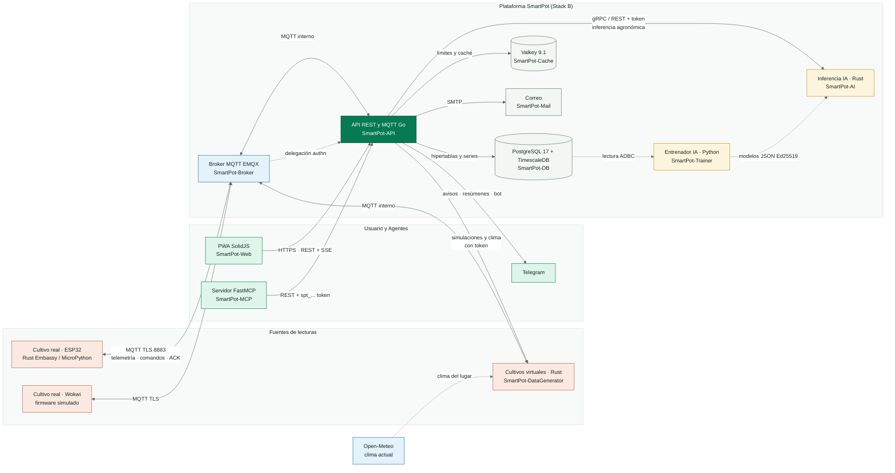

### 2.1 Componentes (Stack B en Producción)

| Componente | Repositorio | Tecnología | Responsabilidad |
|---|---|---|---|
| PWA | SmartPot-Web | SolidJS 1.9, TypeScript, Bun 1.4, Vite, Tailwind CSS | Landing pública, creación de cultivos reales o virtuales, ilustración en vivo vía SSE, modo oscuro profundo, soporte bilingüe reactivo (`es`/`en`) y control con switches |
| API | SmartPot-API | Go 1.26, Echo v4.16, pgx pool, arquitectura hexagonal | REST con OpenAPI en `/docs`, SSE, autenticación por cookies `HttpOnly` + CSRF, puente MQTT, delegación authn de EMQX, canales de notificación (Telegram) y orquestación |
| Inferencia de IA | SmartPot-AI | Rust 1.88+, Axum 0.8, Tonic gRPC, Tokio | Diagnóstico agronómico de alta velocidad, 21 reglas de sistema experto, lógica difusa Sugeno (salud 0–100) y evaluación nativa de modelos ML con verificación Ed25519 |
| Entrenador de IA | SmartPot-Trainer | Python 3.13, FastAPI, Polars, scikit-learn, ADBC | Aprendizaje continuo desacoplado: lectura eficiente de TimescaleDB mediante Arrow ADBC sobre cultivos reales seudonimizados y exportación de modelos JSON firmados |
| Servidor MCP | SmartPot-MCP | Python 3.13, FastMCP (SDK 2.3) | Servidor oficial de Model Context Protocol en `mcp.smartpot.app` para interacción con LLMs mediante tokens de conexión por cuenta (`spt_...`) |
| Broker MQTT | SmartPot-Broker | EMQX 5.8.9 (Erlang/OTP) | Broker MQTT con TLS 8883 y WebSocket seguro; autenticación y ACL delegadas dinámicamente en la API (`/internal/mqtt/authn`) |
| Firmware IoT | SmartPot-IoT | Rust (Embassy `no_std`, ESP32) | Firmware principal para microcontroladores físicos: tareas asíncronas, MQTT sobre TLS y telemetría compacta v2 (con alternativa MicroPython en `SmartPot-IoT-Python`) |
| Simulador | SmartPot-DataGenerator | Rust, Axum, Tokio, rumqttc | Simulación física concurrente de cultivos virtuales (clima real, manual o día/noche), soporte de paquetes JSON y binarios compactos v2; demo y QA |
| Base de datos | SmartPot-DB | PostgreSQL 17 + TimescaleDB 2.17.2 | Esquema relacional, hipertabla de lecturas con chunks diarios, compresión continua a 12 h, vistas materializadas de agregados en tiempo real y rol `smartpot_reader` |
| Caché | SmartPot-Cache | Valkey 9.1.2 (C/Lua) | Capa de caché en memoria endurecida y control de concurrencia con soporte para socket UNIX y TCP |
| Correo | SmartPot-Mail | Mailpit (Go) | SMTP autenticado y bandeja transaccional web para bienvenida y recuperación de acceso |
| Plataforma | .github | Docker Compose, Kubernetes, GitHub Actions | Orquestación central de entornos (`demo`, `dev`, `production`), manifiestos de clúster, QA E2E y documentación técnica |

> [!NOTE]
> **Componentes históricos (Stack A deprecado)**: La arquitectura previa (Spring Boot 4.1, Java 21, MongoDB 8, Redis 8, Mosquitto 2.1, React 19 y simulador Python) ha sido reemplazada en producción por los componentes descritos arriba. Sus repositorios (`SmartPot-API-Java`, `SmartPot-DB-Mongo`, `SmartPot-Cache-Redis`, `SmartPot-Broker-Mosquito`, `SmartPot-Web-React`, `SmartPot-AI-Python`, `SmartPot-DataGenerator-Python`, `SmartPot-Proxy`) se encuentran archivados como referencia técnica histórica.

### 2.2 Decisiones de arquitectura

| Decisión | Motivo |
|---|---|
| MQTT entre el dispositivo y la plataforma | Conexión persistente y liviana para microcontroladores, con QoS 1, mensajes retenidos y última voluntad (LWT) para monitorizar disponibilidad |
| Autenticación delegada en EMQX | La API valida las credenciales y define la ACL dinámicamente vía HTTP, eliminando archivos estáticos de credenciales en el broker |
| Inferencia desacoplada del entrenamiento | Inferencia en Rust ultrarrápida (sub-milisegundo) con modelos nativos y lógica difusa; el reentrenamiento pesado corre en Python fuera del camino crítico |
| PostgreSQL 17 + TimescaleDB | Hipertabla particionada por tiempo y cultivo, compresión a 12 h y vistas materializadas en tiempo real que aceleran dramáticamente los paneles |
| Cookies HttpOnly + CSRF doble firmado | Protección robusta contra XSS y robo de tokens en el navegador, sustituyendo el almacenamiento de JWT en localStorage |
| Servidor MCP oficial | Permite a herramientas y asistentes de IA interactuar con los cultivos de forma segura mediante tokens de conexión acotados |
| Valkey como reemplazo de Redis | Motor de caché 100% libre, endurecido y optimizado con opción de socket UNIX de alto rendimiento |
| Firmware dual (Rust Embassy y MicroPython) | Rust `no_std` brinda máxima estabilidad y eficiencia para producción; MicroPython permite prototipado rápido y simulación en Wokwi |
| Imágenes scratch y sin privilegios | Reducción drástica de superficie de ataque: sin shell ni gestores de paquetes en los contenedores de producción |

## 3. Flujo de una lectura

### En palabras simples

Cuando el dispositivo mide, la lectura llega al broker, la API la guarda y le pregunta al asistente cómo va el cultivo.
Si hay algo que corregir y el modo automático está activo, la API manda el comando al dispositivo, que lo ejecuta y lo
confirma.

### 3.1 Reglas del flujo

| Regla                          | Valor                                                                                                                           |
|--------------------------------|---------------------------------------------------------------------------------------------------------------------------------|
| Frecuencia del dispositivo     | Cada 30 s (firmware) o 15–120 s (simulación)                                                                                    |
| Lecturas guardadas por cultivo | Máximo una cada 5 s; las demás se descartan                                                                                     |
| Validación                     | Cada variable debe estar dentro del rango físico del sensor; si no, la lectura completa se descarta                             |
| Evaluación del asistente       | Asíncrona; como máximo cada 30 s con el modo automático y cada 5 minutos sin él (`AI_EVALUATION_INTERVAL`, 1 minuto en la demo) |
| Historial enviado a la IA      | 48 puntos repartidos en las últimas 384 lecturas, con la hora de cada una                                                       |
| Enfriamiento del agente        | 10 minutos por actuador entre acciones automáticas                                                                              |
| Órdenes por actuador           | Una a la vez: la siguiente espera la confirmación; apagar lo apagado o encender sin límite lo que ya está así responde 409      |
| Vencimiento de un comando      | 2 minutos sin confirmación → `EXPIRED` y alerta al dueño                                                                        |
| Lectura tras una orden         | El simulador publica una lectura 2 s después de ejecutar un comando, para ver su efecto                                         |
| Cultivo desconectado           | El broker publica `offline` (última voluntad); la API marca el dispositivo y avisa                                              |

<!-- diagrama: SmartPot_02_Reading_Sequence | titulo=Secuencia de una lectura con automatización | lamina=H -->

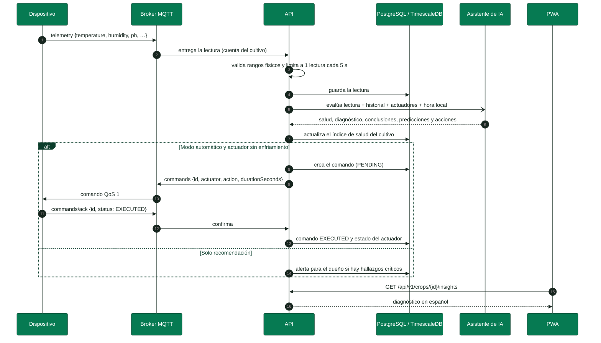

<!-- parte: PARTE II | Componentes -->

## 4. Contrato MQTT

### En palabras simples

Cada cultivo tiene una "dirección" propia en el broker, `smartpot/v1/{cropId}`, y su dispositivo solo puede usar la
suya. Por ahí publica lo que mide y recibe las órdenes.

### 4.1 Tópicos

| Tópico                              | Sentido                                 | QoS | Carga                                                                                                          |
|-------------------------------------|-----------------------------------------|-----|----------------------------------------------------------------------------------------------------------------|
| `smartpot/v1/{cropId}/telemetry`    | Dispositivo → API                       | 0   | `{"temperature":24.5,"humidity":61,"brightness":710,"ph":6.1,"tds":820,"atmosphere":1012.8,"soilMoisture":55}` |
| `smartpot/v1/{cropId}/commands`     | API → dispositivo                       | 1   | `{"id":"…","actuator":"WATER_PUMP","action":"ACTIVATE","durationSeconds":30}`                                  |
| `smartpot/v1/{cropId}/commands/ack` | Dispositivo → API                       | 1   | `{"id":"…","status":"EXECUTED","message":"Bomba de agua encendida por 15 s"}`                                  |
| `smartpot/v1/{cropId}/status`       | Dispositivo, retenido y última voluntad | 1   | `online` / `offline`                                                                                           |

### 4.2 Conexión del dispositivo

| Parámetro   | Valor                                                                                                                                                                                    |
|-------------|------------------------------------------------------------------------------------------------------------------------------------------------------------------------------------------|
| Servidor    | `mqtt.smartpot.app:8883`, MQTT sobre TLS 1.3 (mínimo 1.2)                                                                                                                                |
| Certificado | Firmado por la CA propia de SmartPot; el firmware la lleva en `config.py` (`BROKER["CA_CRT"]`), que la PWA genera con la CA incluida                                                     |
| Usuario     | El id del cultivo                                                                                                                                                                        |
| Contraseña  | La clave del dispositivo: 24 bytes aleatorios en Base64 URL, mostrada una sola vez al crear un cultivo real o al rotarla; la de un cultivo virtual solo la conocen la API y el simulador |
| Client id   | `smartpot-<cropId>`; el broker rechaza ids vacíos                                                                                                                                        |
| WebSocket   | `wss://mqtt.smartpot.app/mqtt` para clientes web                                                                                                                                         |

> [!IMPORTANT]
> **Rotación de la clave.** Rotar la clave desde la PWA cambia la contraseña en el broker y desconecta la sesión
> anterior en el acto. El firmware debe actualizarse con la clave nueva.

### 4.3 Permisos en el broker

La API administra el broker con el plugin de **seguridad dinámica** de Mosquitto. Al conectarse crea el rol `device` y
vuelve a crear la cuenta de cada cultivo a partir de la base de datos, así que el broker no necesita respaldo propio.

| Rol           | Permisos                                                                                                                                  |
|---------------|-------------------------------------------------------------------------------------------------------------------------------------------|
| `device`      | Publicar en `smartpot/v1/%u/telemetry`, `…/commands/ack` y `…/status`; suscribirse a `smartpot/v1/%u/commands` (`%u` = su propio usuario) |
| `admin` (API) | Publicar y suscribirse en `smartpot/v1/#` y usar los comandos de control de la seguridad dinámica                                         |
| Anónimo       | Rechazado                                                                                                                                 |

## 5. API REST

### En palabras simples

La API es la única puerta de la aplicación. Todo lo que el usuario ve o hace pasa por aquí, siempre con su sesión y solo
sobre sus propios cultivos.

### 5.1 Rutas

Base: `https://api.smartpot.app`. Las rutas de negocio viven bajo `/api/v1` y usan `Authorization: Bearer <token>`. La
documentación interactiva está en `/docs`.

| Método            | Ruta                                                                                                                       | Acceso                        |
|-------------------|----------------------------------------------------------------------------------------------------------------------------|-------------------------------|
| GET               | `/health`                                                                                                                  | Público                       |
| POST              | `/api/v1/auth/register`, `/login`                                                                                          | Público                       |
| POST              | `/api/v1/auth/password/forgot`, `/password/reset`                                                                          | Público                       |
| GET               | `/api/v1/crop-profiles`                                                                                                    | Público                       |
| GET, PUT, DELETE  | `/api/v1/users/me` y PUT `/users/me/password`                                                                              | Sesión                        |
| GET, POST         | `/api/v1/crops` (al crear: `kind` `REAL` o `VIRTUAL`, `form`, `placement` y, si es virtual, `virtual` con el modo inicial) | Sesión                        |
| PUT               | `/api/v1/crops/automation` (modo automático en varios cultivos)                                                            | Sesión, solo cultivos propios |
| GET, PUT, DELETE  | `/api/v1/crops/{id}` (PUT también cambia el lugar) y PUT `/crops/{id}/automation`                                          | Dueño                         |
| GET               | `/api/v1/crops/{id}/weather` (clima del lugar; 204 sin ubicación o sin clima disponible)                                   | Dueño                         |
| GET, POST         | `/api/v1/crops/{id}/device` y `/device/key` (solo cultivos reales)                                                         | Dueño                         |
| GET, POST         | `/api/v1/crops/{id}/readings`, `/latest`, `/summary`, `/export`                                                            | Dueño                         |
| GET, POST, DELETE | `/api/v1/crops/{id}/actuators`                                                                                             | Dueño                         |
| GET, POST         | `/api/v1/crops/{id}/commands`                                                                                              | Dueño                         |
| GET               | `/api/v1/crops/{id}/insights`                                                                                              | Dueño                         |
| GET               | `/api/v1/overview`, `/overview/series`, `/overview/fleet` (panel general)                                                  | Sesión                        |
| GET, POST         | `/api/v1/commands` y `/commands/bulk` (historial de todos los cultivos y órdenes en bloque)                                | Sesión, solo cultivos propios |
| GET, PUT, DELETE  | `/api/v1/notifications`, `/unread-count`, `/{id}/read`, `/read-all`                                                        | Sesión                        |
| GET, POST         | `/api/v1/channels` y `/channels/telegram/link` (código de vinculación de un solo uso)                                      | Sesión                        |
| PUT, POST, DELETE | `/api/v1/channels/links/{id}`, `/links/{id}/test`                                                                          | Dueño del vínculo             |
| POST              | `/api/v1/channels/telegram/webhook`                                                                                        | Telegram, con secreto         |
| GET, PUT          | `/api/v1/crops/{id}/channels` y `/channels/{type}` (avisos del cultivo por canal)                                          | Dueño                         |
| POST, DELETE      | `/api/v1/crops/{id}/channels/{type}/recipients` y `/recipients/{recipientId}` (compartir el cultivo con otro chat)         | Dueño                         |
| GET, PUT, DELETE  | `/api/v1/crops/{id}/virtual-device` (solo cultivos virtuales; PUT cambia o reanuda, DELETE pausa)                          | Dueño                         |
| GET               | `/api/v1/virtual-devices/places?q=`                                                                                        | Sesión                        |
| GET               | `/api/v1/ai/learning` (datos agregados por especie)                                                                        | Sesión                        |

### 5.2 Reglas de la API

| Regla                      | Valor                                                                                                                                                                                                    |
|----------------------------|----------------------------------------------------------------------------------------------------------------------------------------------------------------------------------------------------------|
| Sesión                     | JWT HS256 con vencimiento de 7 días; la PWA lo guarda en `sessionStorage` o, con "Mantener sesión iniciada", en `localStorage`                                                                           |
| Contraseñas                | 8 caracteres a 72 bytes, con mayúscula, minúscula y número; BCrypt de costo 12                                                                                                                           |
| Dueño                      | Un cultivo de otra cuenta responde 404, igual que uno inexistente, para no revelar qué ids existen                                                                                                       |
| Límite de peticiones       | 300 por minuto por IP y 10 por minuto en `/api/v1/auth/*`; responde 429 con `Retry-After`                                                                                                                |
| Cultivos por cuenta        | Máximo 20, y hasta 5 virtuales                                                                                                                                                                           |
| Tipo del cultivo           | `REAL` o `VIRTUAL` al crearlo; cambiarlo después responde 400 («Un cultivo no puede pasar de real a virtual ni al revés: crea uno nuevo»). La forma sí se puede editar                                   |
| Órdenes                    | Una por actuador a la vez; apagar lo que ya está apagado o encender sin límite lo que ya está encendido responde 409 («El ventilador ya está apagado»). En bloque, esos cultivos se omiten con su motivo |
| Lugar                      | `placement` con `setting` (`INDOOR` u `OUTDOOR`), `exposure` (`FULL_SUN`, `PARTIAL_SUN` o `SHADE`) y `location` opcionales; es uno solo para el cultivo y su simulación                                  |
| Clima del lugar            | Lo consulta el simulador; se guarda 10 minutos por lugar y, si falla, no se reintenta en 2 minutos                                                                                                       |
| Errores                    | JSON en español: `{"status","error","message","path","timestamp","fields"}`; `fields` detalla cada campo inválido                                                                                        |
| Recuperación de contraseña | Responde 202 aunque el correo no exista; el enlace vence en 30 minutos y el token se guarda como hash SHA-256                                                                                            |

### 5.3 Ciclo de vida de un comando

<!-- diagrama: SmartPot_05_Command_States | titulo=Estados de un comando -->

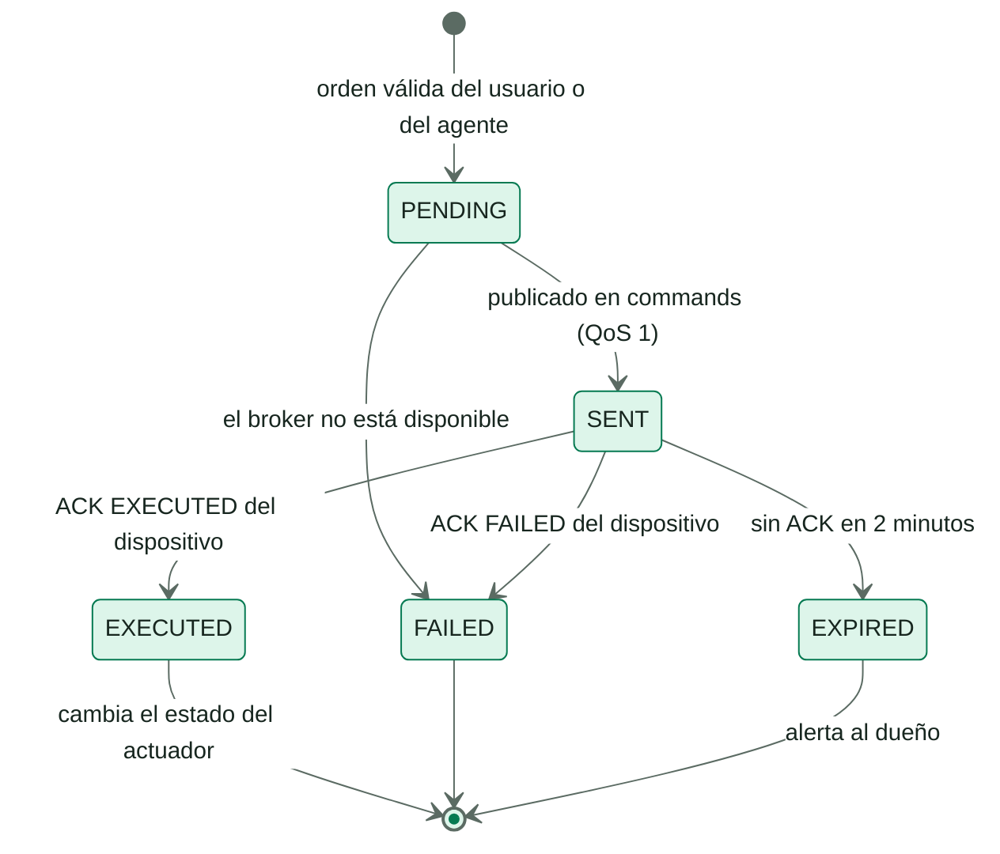

Antes de crear el comando, la API lo rechaza con 409 si el actuador espera otra confirmación o si la orden no cambiaría
nada; el agente, en ese caso, simplemente no la propone. Al confirmarse, el actuador queda encendido sin límite o hasta
`runningUntil`, que la PWA usa para su switch y su cuenta regresiva.

<!-- diagrama: SmartPot_39_Actuator_Switch | titulo=Un actuador como switch -->

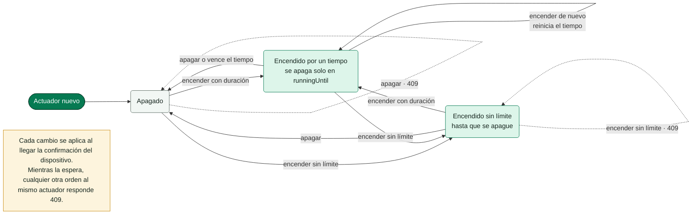

### 5.4 Notificaciones por Telegram

Cada notificación de la PWA se reenvía, en segundo plano, a los **canales externos** que la persona vinculó y solo con
los tipos que eligió (alertas del cultivo, cultivo desconectado, acciones del asistente, comandos, novedades). Los
canales implementan la interfaz `NotificationChannel`; sumar WhatsApp, correo o Slack es otra implementación sin tocar
el resto. Hoy existe Telegram, centralizado en la API. En el perfil, la sección **Aplicaciones** lista los canales: si
el servidor no tiene uno configurado, aparece en gris con su detalle técnico.

<!-- diagrama: SmartPot_14_Telegram_Sequence | titulo=Vinculación de Telegram -->

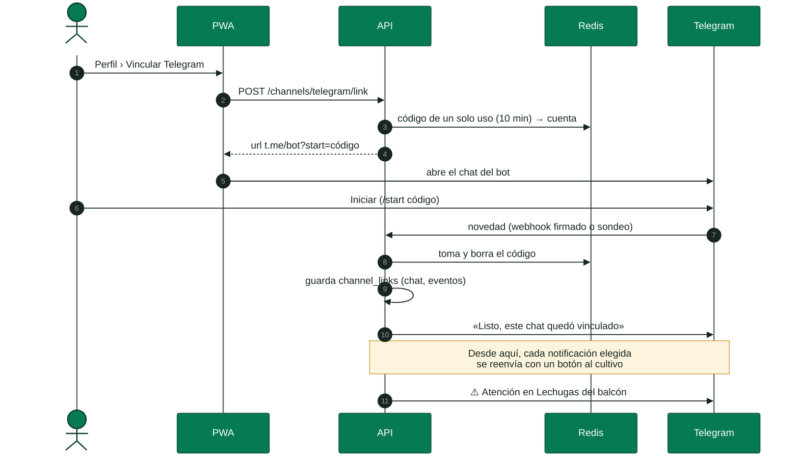

| Regla              | Valor                                                                                                                                                                                                                              |
|--------------------|------------------------------------------------------------------------------------------------------------------------------------------------------------------------------------------------------------------------------------|
| Vinculación        | Código aleatorio de 144 bits, de un solo uso, que vence en 10 minutos (Redis)                                                                                                                                                      |
| Recepción          | `webhook` en producción, validado con `X-Telegram-Bot-Api-Secret-Token`; sondeo largo en local y en la demo                                                                                                                        |
| Comandos del bot   | `/start <código>`, `/estado` (cultivos, conexión y salud), `/desvincular`, `/ayuda`; solo chats privados                                                                                                                           |
| Mensajes           | HTML escapado con el título, el detalle y un botón al cultivo cuando la PWA está en `https`                                                                                                                                        |
| Fallos             | Si Telegram rechaza el chat (bloqueado o borrado) o falla 5 veces seguidas, el vínculo se pausa                                                                                                                                    |
| Avisos por cultivo | `crop_channels`: qué tipos avisa, entrega `INSTANT` o `DIGEST` (un resumen cada 1 a 24 h) y un resumen diario a una hora fija (`HH:mm`, hora local); sin ajustes, el cultivo avisa al instante lo que el dueño eligió en su perfil |
| Compartir          | Enlace `t.me/bot?start=<código>` de un solo uso y 10 minutos; el chat recibe los avisos del cultivo sin entrar a la cuenta (hasta 10 por cultivo) y `/estado` también le muestra lo compartido                                     |
| Sin bot            | Telegram figura no disponible con las variables que le faltan al servidor (`TELEGRAM_BOT_TOKEN`, `TELEGRAM_BOT_USERNAME`); los ajustes por cultivo responden 503                                                                   |

Los avisos de cada cultivo se eligen en su pestaña Ajustes, que solo muestra la sección de un canal cuando el servidor
lo ofrece y la persona ya vinculó su chat:

<!-- diagrama: SmartPot_37_Crop_Alerts | titulo=Avisos de un cultivo por Telegram -->


## 6. Asistente de IA

### En palabras simples

El asistente se comporta como un agrónomo que mira la última lectura y el historial reciente. Primero revisa variable
por variable, después razona con reglas de experto, calcula un índice de salud de 0 a 100 y propone acciones concretas
que el dispositivo puede ejecutar. Además, aprende con cada lectura que llega de los cultivos reales de la misma
especie.

<!-- diagrama: SmartPot_03_AI_Assistant | titulo=Técnicas del asistente de IA -->

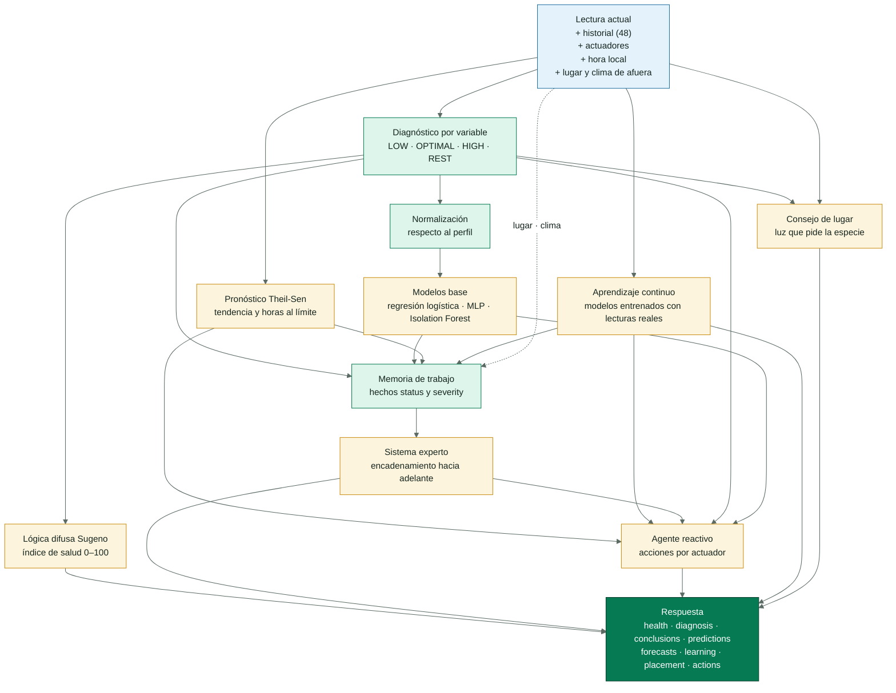

### 6.1 Diagnóstico por variable

Cada variable queda `LOW`, `OPTIMAL` o `HIGH` respecto al rango de la especie. La distancia al rango se mide en *
*tolerancias** (5 °C, 15 % de humedad, 300 lux, 0.8 de pH, 400 ppm y 15 % de sustrato); desde una tolerancia completa el
hallazgo es **crítico**.

> [!TIP]
> **Descanso nocturno.** Entre las 22:00 y las 6:00 (hora de Colombia, configurable con `AI_TIMEZONE`) la luz baja no es
> un problema: la planta necesita su periodo de oscuridad. La variable queda como `REST`, no resta salud, la regla de
> crecimiento ahilado no se dispara y el agente apaga la luz ultravioleta si quedó encendida.

### 6.2 Modelos base

Las variables se normalizan respecto al perfil (0 = mínimo ideal, 1 = máximo ideal), así un mismo modelo sirve para las
seis especies. Se entrenan al arrancar con 4000 muestras sintéticas y semilla fija, y responden desde el primer minuto,
antes de que exista ningún dato real (sección 6.8).

| Modelo           | Técnica                                | Predice                                                        | Exactitud                         |
|------------------|----------------------------------------|----------------------------------------------------------------|-----------------------------------|
| Ventilación      | Regresión logística                    | Probabilidad de que haga falta ventilar por calor y humedad    | 89.5 %                            |
| Corrección de pH | Red neuronal MLP                       | Probabilidad de que haya que corregir el pH                    | 94.3 %                            |
| Lectura atípica  | Isolation Forest + detección de saltos | Probabilidad de que la lectura sea anómala frente al historial | 100 % de detección en las pruebas |

### 6.3 Sistema experto

Un motor de encadenamiento hacia adelante dispara las reglas por prioridad, cada una una sola vez. Las conclusiones de
primer nivel alimentan a las de segundo nivel.

| Regla               | Se dispara cuando                                                              | Conclusión                                                   |
|---------------------|--------------------------------------------------------------------------------|--------------------------------------------------------------|
| `heat_stress`       | Temperatura alta y aire seco                                                   | Estrés térmico                                               |
| `fungal_risk`       | Humedad alta con temperatura templada o alta                                   | Riesgo de hongos                                             |
| `nutrient_lockout`  | pH fuera de rango con nutrientes presentes                                     | Bloqueo de nutrientes: corregir el pH primero                |
| `root_rot_risk`     | Sustrato encharcado y caliente                                                 | Riesgo de pudrición de raíz                                  |
| `drought`           | Sustrato críticamente seco                                                     | Sequía                                                       |
| `etiolation`        | Poca luz de día con temperatura cálida                                         | Crecimiento ahilado                                          |
| `cold_stress`       | Temperatura críticamente baja                                                  | Estrés por frío                                              |
| `salt_stress`       | Nutrientes críticamente altos                                                  | Exceso de sales                                              |
| `ventilation_model` | El modelo estima ≥ 70 % de necesidad de ventilar                               | Recomendación de ventilar                                    |
| `sensor_fault`      | Lectura atípica y dos o más variables críticas                                 | Posible falla de sensor: bloquea las acciones                |
| `critical_state`    | Dos o más variables críticas sin falla de sensor                               | Estado crítico                                               |
| `compound_stress`   | Estrés junto con riesgo o bloqueo                                              | Estrés combinado                                             |
| `drying_trend`      | El pronóstico lleva el sustrato al mínimo en 3 h o menos                       | Secado acelerado: regar pronto                               |
| `heat_building`     | El pronóstico lleva la temperatura al máximo en 3 h o menos                    | Calor en aumento                                             |
| `learned_drying`    | El modelo aprendido da ≥ 70 % de que el sustrato baje del mínimo en 1 h        | Riego probable en la próxima hora                            |
| `learned_heat`      | El modelo aprendido da ≥ 70 % de que la temperatura pase del máximo en 1 h     | Calor probable en la próxima hora                            |
| `unusual_pattern`   | El Isolation Forest de la especie marca la lectura como poco habitual          | Combinación poco habitual: revisar sensores                  |
| `rain_outside`      | Llueve 0,5 mm o más donde está un cultivo al aire libre                        | Está lloviendo: la lluvia riega y el agente no riega         |
| `sensor_vs_outside` | Al aire libre, el sensor marca 8 °C o más de diferencia con el clima de afuera | El sensor no coincide con el clima: darle sombra o revisarlo |
| `night_rest`        | Luz baja durante el descanso nocturno                                          | Descanso nocturno                                            |
| `ideal_conditions`  | Todas las variables en rango o en descanso                                     | Condiciones ideales                                          |

### 6.4 Índice de salud con lógica difusa

Cada desviación pertenece en distinto grado a los conjuntos **ideal**, **aceptable**, **desviada** y **crítica** (
funciones trapezoidales). La inferencia Sugeno de orden cero da la salud de cada variable (100, 75, 45 y 10 puntos por
conjunto) y el índice global las pondera por importancia agronómica: pH 1.3, temperatura 1.2, sustrato 1.2, nutrientes
1.1, humedad 0.9 y luz 0.8. Una regla de peor caso limita el índice cuando una variable es crítica.

| Índice | Nivel       | Etiqueta  |
|--------|-------------|-----------|
| 85–100 | `EXCELLENT` | Excelente |
| 70–84  | `GOOD`      | Saludable |
| 50–69  | `FAIR`      | Aceptable |
| 30–49  | `POOR`      | En riesgo |
| 0–29   | `CRITICAL`  | Crítico   |

### 6.5 Agente reactivo

El agente no guarda estado: convierte el diagnóstico en acciones solo para los actuadores que el cultivo tiene. La API
aplica el enfriamiento y ejecuta únicamente si el modo automático está activo; si no, las acciones quedan como
sugerencias en la PWA.

| Situación                                                         | Acción                                                                          |
|-------------------------------------------------------------------|---------------------------------------------------------------------------------|
| Sustrato seco                                                     | `WATER_PUMP` 15 s (30 s si es crítico)                                          |
| Llueve sobre un cultivo al aire libre                             | Ningún riego: la lluvia lo hace                                                 |
| Sustrato en rango, pero llegará al mínimo en menos de 1 h         | `WATER_PUMP` 10 s (riego preventivo)                                            |
| Poca luz de día                                                   | `UV_LIGHT` 15 minutos                                                           |
| Exceso de luz, o luz encendida de noche                           | Apagar `UV_LIGHT`                                                               |
| Calor, humedad alta o predicción de ventilación                   | `FAN` 10 minutos                                                                |
| Temperatura en rango, pero pasará el máximo en menos de 1 h       | `FAN` 10 minutos (ventilación preventiva)                                       |
| El modelo aprendido da ≥ 85 % de riego o calor en la próxima hora | `WATER_PUMP` 10 s o `FAN` 10 minutos (preventivo; el riego no se hace de noche) |
| Temperatura baja                                                  | Apagar `FAN`                                                                    |
| Aire seco                                                         | `HUMIDIFIER` 5 minutos                                                          |
| pH alto                                                           | `PH_DOSER` 3 s                                                                  |
| Nutrientes bajos sin bloqueo de pH                                | `NUTRIENT_DOSER` 3 s                                                            |
| Posible falla de sensor                                           | Ninguna acción                                                                  |

### 6.6 Pronóstico de tendencias

La API envía el historial con la hora de cada lectura. Con al menos 6 lecturas que abarquen 20 minutos, el asistente
ajusta una recta por variable con el estimador de **Theil-Sen** (la mediana de las pendientes entre todos los pares de
lecturas), que tolera lecturas atípicas mejor que los mínimos cuadrados. Con la pendiente por hora calcula el valor
esperado en 3 horas y, si la tendencia empuja la variable fuera de su rango ideal, en cuántas horas cruzará el límite.
La luz no se pronostica porque sigue el ciclo del día.

| Salida                   | Uso                                                                                    |
|--------------------------|----------------------------------------------------------------------------------------|
| `trend`                  | `RISING`, `FALLING` o `STABLE` (se mueve menos del 10 % del rango en 3 h)              |
| `expectedIn3h`           | Valor esperado dentro de 3 horas                                                       |
| `hoursToLimit` · `limit` | Horas hasta salir del rango y por qué lado (`MIN` o `MAX`), si ocurre en menos de 24 h |
| `confidence`             | Fracción de pendientes que coinciden en el signo                                       |

Los pronósticos alimentan las reglas `drying_trend` y `heat_building` y las acciones preventivas del agente. En la PWA
aparecen en «Pronóstico de las próximas horas», junto con «De qué depende el índice», la salud de cada variable que
explica el índice difuso.

### 6.7 Análisis de todos los cultivos

El panel general pide al asistente una mirada de conjunto (`POST /v1/fleet`):

| Técnica                              | Resultado                                                                                                                                                    |
|--------------------------------------|--------------------------------------------------------------------------------------------------------------------------------------------------------------|
| Índice difuso por cultivo            | Ranking del que más atención necesita al que menos y salud promedio                                                                                          |
| Problemas compartidos                | La misma variable fuera de rango en la mitad o más de los cultivos: probablemente es el entorno (la habitación, el agua, la solución) y no un cultivo        |
| K-Means sobre variables normalizadas | Grupos de cultivos con condiciones parecidas; la cantidad de grupos se elige por el coeficiente de silueta y los grupos con la misma descripción se fusionan |
| Agente reactivo por cultivo          | Acciones reunidas por actuador para aplicarlas en bloque con `/api/v1/commands/bulk`                                                                         |

### 6.8 Aprendizaje continuo

Los modelos base nacen de datos sintéticos; el aprendizaje continuo los complementa con lo que de verdad pasa en los
cultivos reales. Cada lectura de un cultivo real que llega por MQTT se encola en la API (las de los virtuales no) y
viaja a la IA en lotes cada minuto (`POST /v1/learning/readings`). La IA la reenvía al Trainer, que la guarda en SQLite en el volumen `ai_data`,
con el id del cultivo **seudonimizado** con SHA-256; al borrar un cultivo, sus lecturas se olvidan.

<!-- diagrama: SmartPot_16_Learning | titulo=Aprendizaje continuo con lecturas reales -->

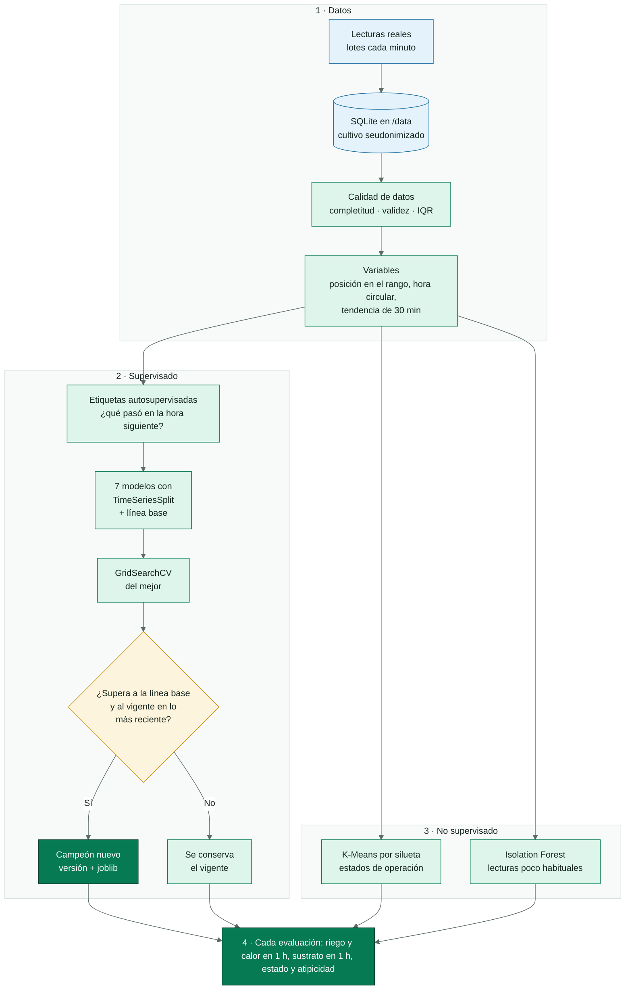

| Paso                       | Técnica                                                                                                                                                                                                          |
|----------------------------|------------------------------------------------------------------------------------------------------------------------------------------------------------------------------------------------------------------|
| Calidad de datos           | Completitud, validez física y atípicos por rango intercuartílico (k = 3), que se excluyen; puntaje DQS                                                                                                           |
| Variables                  | Posición de cada variable en su rango ideal, hora del día circular (seno y coseno) y tendencia de la última media hora del sustrato y la temperatura                                                             |
| Etiquetas autosupervisadas | Lo que pasó en la hora siguiente a cada lectura: ¿el sustrato bajó del mínimo?, ¿la temperatura pasó del máximo?, ¿cuánto cambió la humedad del sustrato?                                                        |
| Comparación supervisada    | Línea base, regresión logística, K vecinos, árbol de decisión, bosque aleatorio, gradient boosting y red neuronal; validación cruzada temporal (`TimeSeriesSplit`, 4 cortes) con F1 macro o error medio absoluto |
| Ajuste                     | `GridSearchCV` sobre el mejor candidato                                                                                                                                                                          |
| Campeón y retador          | Se evalúa en el 20 % de lecturas más recientes: reemplaza al modelo vigente solo si lo mejora y si supera a la línea base (la clase mayoritaria o «el sustrato no cambia»)                                       |
| No supervisado             | Estados de operación con K-Means (k de 2 a 6 por silueta, con nombres legibles) e Isolation Forest entrenado con lecturas reales                                                                                 |

Cada especie entrena por separado desde 200 lecturas etiquetadas y se reentrena cada 300 lecturas nuevas, en un proceso
aparte para no frenar las evaluaciones. Una tarea queda pendiente, con su razón, mientras falten datos o casos: si
ningún cultivo ha tenido calor, todavía no se puede aprender a anticiparlo. Los modelos se guardan con joblib y se
cargan al arrancar; si cambia la versión de scikit-learn, se reentrenan.

Cada evaluación trae la sección `learning`: estado de operación, si la lectura es habitual para la especie, probabilidad
de riego o calor en la próxima hora y humedad esperada del sustrato, cada una con su modelo y su puntaje en las lecturas
más recientes. La página **Aprendizaje** de la PWA muestra la calidad de los datos, la comparación de modelos, los
estados y el detector de atípicos por especie (`GET /api/v1/ai/learning`, solo datos agregados).

### 6.9 Lugar del cultivo

Cada especie pide una cantidad de sol. El asistente compara esa necesidad con el lugar del cultivo (bajo techo o al aire
libre y su exposición) y con el diagnóstico, y devuelve en cada evaluación un consejo `placement` que la PWA muestra en el
Asistente. Se puede poner el cultivo donde se quiera: el consejo sube de tono solo cuando el lugar ya se nota en las
lecturas.

<!-- diagrama: SmartPot_38_Placement_Advice | titulo=Consejo de lugar -->

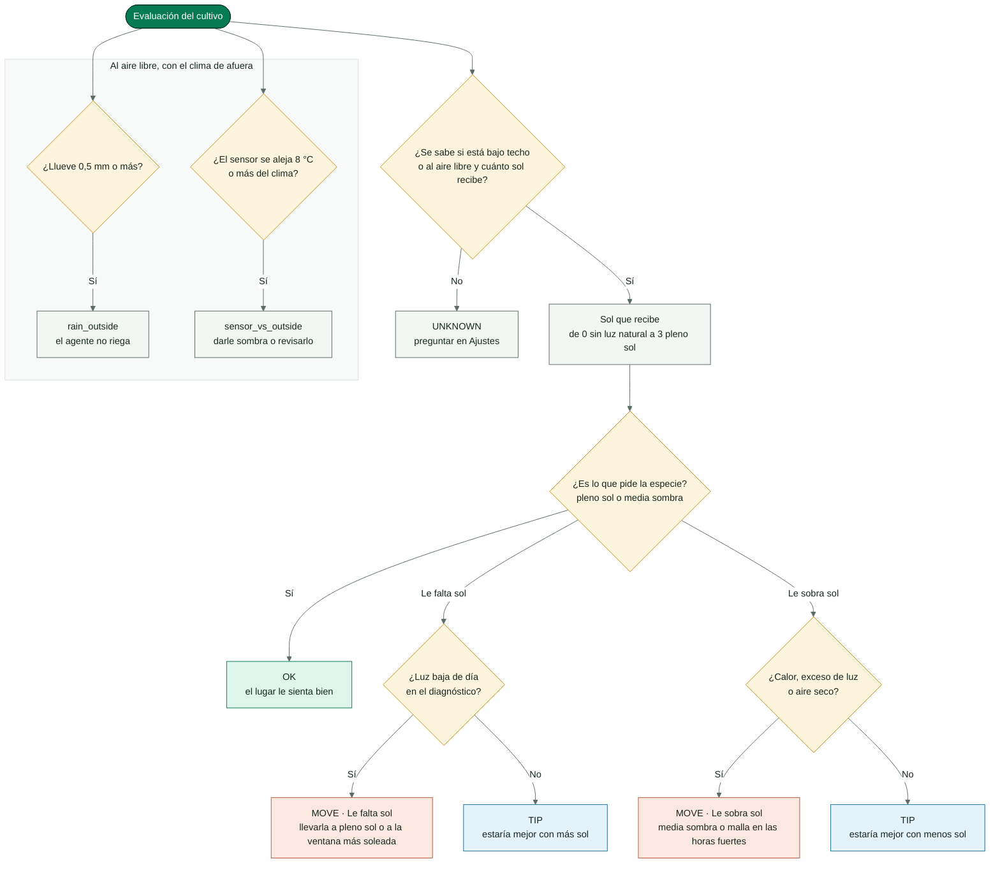

| Especie                            | Luz que pide                      | Lugar ideal                   |
|------------------------------------|-----------------------------------|-------------------------------|
| Tomate, pimentón, fresa y albahaca | Pleno sol: 6 a 8 h de sol directo | Al aire libre a pleno sol     |
| Lechuga y espinaca                 | Media sombra: de 3 a 5 h de sol   | Al aire libre en media sombra |

| Nivel     | Cuándo                                                                                             |
|-----------|----------------------------------------------------------------------------------------------------|
| `OK`      | El lugar le sirve a la especie                                                                     |
| `UNKNOWN` | No se sabe dónde está: el asistente pregunta en Ajustes                                            |
| `TIP`     | No es su lugar ideal, pero la planta está bien hoy                                                 |
| `MOVE`    | El lugar ya se nota: poca luz de día en una de sol, o calor y exceso de luz en una de media sombra |

Bajo techo cuenta la ventana: la más soleada equivale a media sombra de afuera. Con el clima del lugar, el asistente
suma dos reglas: con lluvia sobre un cultivo al aire libre no riega (`rain_outside`) y, si el sensor de temperatura se
aleja 8 °C o más del clima de afuera, sugiere darle sombra o revisarlo (`sensor_vs_outside`).

## 7. Modelo de datos

<!-- diagrama: SmartPot_04_Data_Model | titulo=Colecciones de MongoDB | lamina=H -->


| Colección               | Índices y vencimiento                                                       | Validación                                                                                                                                                                                                 |
|-------------------------|-----------------------------------------------------------------------------|------------------------------------------------------------------------------------------------------------------------------------------------------------------------------------------------------------|
| `users`                 | Correo único                                                                | Correo, hash, rol (`USER` o `ADMIN`) y fecha obligatorios                                                                                                                                                  |
| `crops`                 | Dueño + fecha de creación                                                   | Dueño, nombre, especie del catálogo y modo automático obligatorios; `kind` `REAL` o `VIRTUAL`, `form` `POT`, `NFT`, `TOWER` o `RAFT` y `placement` (lugar, exposición y ubicación con coordenadas válidas) |
| `readings`              | Cultivo + fecha descendente; TTL de 365 días                                | Cultivo, fecha y medidas obligatorios; origen `MQTT` o `HTTP` (los rangos físicos los valida la API)                                                                                                       |
| `actuators`             | Cultivo + tipo, único                                                       | Tipo dentro del catálogo y `active` (encendido sin límite); `runningUntil` si corre por tiempo                                                                                                             |
| `commands`              | Cultivo + fecha; estado + envío para vencer los pendientes; TTL de 180 días | Acción, estado y origen (`USER` o `AGENT`) del catálogo                                                                                                                                                    |
| `notifications`         | Usuario + fecha; TTL de 90 días                                             | Tipo `INFO`, `ALERT`, `COMMAND`, `DEVICE` o `AI`                                                                                                                                                           |
| `channel_links`         | Usuario + canal, único; canal + dirección, única                            | Canal `TELEGRAM`, chat, eventos elegidos y estado                                                                                                                                                          |
| `crop_channels`         | Cultivo + canal, único                                                      | Canal `TELEGRAM`, entrega `INSTANT` o `DIGEST`, resumen cada 1 a 24 h, resumen diario `HH:mm` y hasta 10 chats                                                                                             |
| `virtual_devices`       | Cultivo, único                                                              | Solo de cultivos virtuales: modo `AUTO`, `MANUAL` o `WEATHER`, medidores, ubicación y `active` (`false` en pausa)                                                                                          |
| `password_reset_tokens` | Hash único; TTL por `expiresAt`                                             | Hash, usuario y vencimiento obligatorios                                                                                                                                                                   |

La API se conecta con un usuario propio (`smartpot`) con permisos acotados sobre su base; el superusuario
administrador de la base de datos no se usa en la aplicación.

El esquema relacional e hipertablas de TimescaleDB viven en `schema/schema.sql` de SmartPot-DB. Una base nueva los
recibe al crearse; las migraciones son idempotentes y aplican hipertablas, políticas de retención, compresión continua
a 12 horas y vistas materializadas de agregados en tiempo real.
para que se puedan seguir actualizando; si no, en `strict`.

Los cultivos creados antes de existir el tipo y la forma se completan solos al arrancar la API (`CropKindBackfill`,
idempotente): los que tenían una simulación pasan a virtuales, el resto a reales, y los que no tienen forma quedan como
maceta. La ubicación de una simulación anterior pasa al lugar de su cultivo, que desde entonces es la única.

## 8. Aplicación web

### En palabras simples

La PWA es lo que ve el usuario: una página pública que explica SmartPot y, tras ingresar, un panel general con todos sus
cultivos, el detalle de cada uno con su ilustración, un control general, un centro de acciones y lo que ha aprendido el
asistente. Se instala como una app en Android, iOS y escritorio.

| Pantalla                         | Qué permite                                                                                                                                                                                                                                                                                                                                                                                                          |
|----------------------------------|----------------------------------------------------------------------------------------------------------------------------------------------------------------------------------------------------------------------------------------------------------------------------------------------------------------------------------------------------------------------------------------------------------------------|
| Inicio público                   | Presentación, funciones, especies y preguntas frecuentes; indexable                                                                                                                                                                                                                                                                                                                                                  |
| Ingreso, registro y recuperación | Validaciones en español y "Mantener sesión iniciada"                                                                                                                                                                                                                                                                                                                                                                 |
| Panel general                    | Salud promedio, cultivos en línea y comandos del día; ranking de salud, análisis de la IA de todos los cultivos, comparación de una variable entre cultivos y tabla de últimas lecturas frente al rango ideal                                                                                                                                                                                                        |
| Mis cultivos                     | Tarjetas con tipo (real o virtual), especie y forma, estado en línea, salud y últimas lecturas                                                                                                                                                                                                                                                                                                                       |
| Nuevo cultivo                    | Tres pasos: real o virtual (se avisa que no cambia después); nombre, especie y forma con la vista previa de la ilustración y, si es virtual, cómo arranca la simulación; si es real, la clave y la guía de conexión                                                                                                                                                                                                  |
| Control general                  | Modo automático por cultivo o para todos, atajos (regar, ventilar, luz) y órdenes personalizadas a varios cultivos con el resultado de cada uno; se omiten los que ya están así o esperan otra orden                                                                                                                                                                                                                 |
| Acciones                         | Acciones sugeridas por la IA aplicables en bloque e historial de todas las órdenes, filtrado por estado y origen (persona o agente)                                                                                                                                                                                                                                                                                  |
| Detalle · Resumen                | Lecturas actuales frente al rango ideal y gráfico de 24 h con la banda ideal                                                                                                                                                                                                                                                                                                                                         |
| Aprendizaje                      | Lecturas reales por especie, calidad de los datos, comparación de modelos con su puntaje frente a la línea base, estados de operación y detector de atípicos                                                                                                                                                                                                                                                         |
| Detalle · Asistente IA           | Índice de salud y de qué depende, consejo de lugar, diagnóstico, conclusiones, predicciones, pronóstico de las próximas horas, lo aprendido de cultivos reales y acciones ejecutables                                                                                                                                                                                                                                |
| Detalle · Control                | Modo automático, un switch por actuador con la duración al encenderlo (o sin límite, en la luz, el ventilador y el humidificador), su cuenta regresiva y los últimos comandos                                                                                                                                                                                                                                        |
| Detalle · Historial              | 6 h, 24 h o 7 días por variable y exportación CSV                                                                                                                                                                                                                                                                                                                                                                    |
| Detalle · Ilustración            | Sobre todas las secciones, para reales y virtuales: la forma del cultivo (maceta, tubos NFT, torre o balsa) con su especie y el color de su salud, su lugar (bajo techo con ventana o al aire libre, con media sombra o sombra) con el clima de afuera y el estado de cada actuador, animado mientras está encendido. No tiene botones: las órdenes se dan en Control. Si el cultivo no está conectado no se ilustra |
| Detalle · Simulación             | Solo cultivos virtuales, en dos partes como Dispositivo: el estado en línea con Pausar y Reanudar, y cómo se simula (modo, lugar, medidores y frecuencia) con «Aplicar cambios»                                                                                                                                                                                                                                      |
| Detalle · Dispositivo            | Solo cultivos reales: estado, guía para el ESP32 físico (circuito, firmware y `config.py`) o para Wokwi, datos de conexión MQTT y rotación de la clave                                                                                                                                                                                                                                                               |
| Detalle · Ajustes                | Nombre, especie y forma; dónde está (bajo techo o al aire libre, cuánto sol y su ubicación); los avisos del cultivo por Telegram cuando el chat está vinculado; el tipo real o virtual se muestra y no se puede cambiar                                                                                                                                                                                              |
| Alertas y perfil                 | Notificaciones; Aplicaciones (Telegram, en gris con su detalle técnico si el servidor no lo tiene) con los avisos elegidos; datos personales, contraseña y borrado de la cuenta                                                                                                                                                                                                                                      |

### 8.1 Identidad visual

| Token                                | Color                                         | Uso                                                              |
|--------------------------------------|-----------------------------------------------|------------------------------------------------------------------|
| `leaf-900`                           | `#0B3D2B`                                     | Barra lateral, navegación, encabezados y color de tema de la PWA |
| `leaf-700`                           | `#067A52`                                     | Acciones principales y cabeceras                                 |
| `leaf-500`                           | `#00B074`                                     | Verde de marca                                                   |
| `water-500`                          | `#2D9CDB`                                     | Agua, información y la señal del logo                            |
| `sun-500`                            | `#F2B632`                                     | Luz y advertencias                                               |
| `clay-500`                           | `#D9734E`                                     | La maceta de la ilustración y la temperatura                     |
| `danger-500`                         | `#D64545`                                     | Errores                                                          |
| `ink` · `muted` · `line` · `surface` | `#17261F` · `#5B6B63` · `#D5E3DC` · `#F2F7F4` | Texto, bordes y superficies                                      |

Tipografías: **Outfit** en títulos e **Inter** en el cuerpo, servidas desde la propia aplicación. Las comparativas entre
cultivos usan 8 colores en orden fijo (`#009A64`, `#2D9CDB`, `#D9734E`, `#1F6FA0`, `#C98D12`, `#067A52`, `#7A5AC8`,
`#B85A38`), validados para daltonismo y contraste entre vecinos; cada cultivo conserva su color mientras siga en la
comparación.

### 8.2 SEO y PWA

- Metadatos, URL canónica, Open Graph, Twitter Card y datos estructurados `Organization`, `WebSite`,
  `SoftwareApplication` y `FAQPage`, con contenido estático para rastreadores sin JavaScript.
- `robots.txt` y `sitemap.xml`; `/app` no se indexa.
- Manifiesto con íconos normales y adaptables, accesos directos y botón "Instalar app".
- Service worker que guarda el app shell y los recursos con hash; la API y la configuración nunca se guardan en caché.

## 9. Cultivos reales y virtuales

Al crear un cultivo se elige una sola vez de dónde vienen sus lecturas:

| Tipo                     | Dispositivo                                                          | Credenciales                                              | Qué ofrece la PWA                                                  |
|--------------------------|----------------------------------------------------------------------|-----------------------------------------------------------|--------------------------------------------------------------------|
| Real · ESP32 físico      | Una placa con el firmware de SmartPot-IoT, sus sensores y actuadores | Clave mostrada una vez; rotación desde Dispositivo        | Guía del circuito y `config.py` con la red WiFi y la CA del broker |
| Real · simulado en Wokwi | El mismo firmware en un ESP32 del navegador                          | Las mismas del cultivo real                               | Enlace al proyecto de Wokwi y `config.py` con la red `Wokwi-GUEST` |
| Virtual                  | SmartPot-DataGenerator, siempre encendido                            | Ninguna que configurar: la API se la entrega al simulador | Modo día y noche, clima real o manual, pausa y reanudación         |

Simulado en Wokwi y virtual son cosas distintas: Wokwi ejecuta el firmware real y cuenta como cultivo real; el virtual
lo simula la plataforma. Los cultivos reales nacen con bomba, luz ultravioleta y ventilador (los del firmware); los
virtuales, con los seis actuadores. La **forma** (maceta, tubos NFT, torre vertical o balsa flotante) solo cambia la
ilustración y se puede editar; el **lugar** también se edita y lo usan la ilustración, la
simulación y el asistente.

### 9.1 Dispositivo ESP32

| Componente                    | Pin             | Escala       |
|-------------------------------|-----------------|--------------|
| DHT22 (temperatura y humedad) | GPIO 15         | °C y %       |
| Luz                           | GPIO 34         | 0–2000 lux   |
| pH                            | GPIO 35         | 0–14         |
| Nutrientes (TDS)              | GPIO 32         | 0–3000 ppm   |
| Humedad del sustrato          | GPIO 33         | 0–100 %      |
| Bomba de agua                 | GPIO 19         | `WATER_PUMP` |
| Luz ultravioleta              | GPIO 18         | `UV_LIGHT`   |
| Ventilador                    | GPIO 5          | `FAN`        |
| LCD 20×4 I2C                  | SCL 16 · SDA 17 | —            |

El firmware sincroniza la hora por NTP, se conecta por TLS verificando el broker con la CA de `config.py`, publica cada
30 s, apaga cada actuador al cumplirse `durationSeconds` y confirma cada orden en español («Ventilador encendido por 10
min»). La PWA genera el `config.py` de cada cultivo real, con la red WiFi, sus credenciales y la CA del broker.

### 9.2 Wokwi

El mismo firmware corre en [Wokwi](https://wokwi.com) sobre un ESP32 simulado, con el `diagram.json` del repositorio. Es
la forma de validar el firmware antes de pasar a hardware: se ejecuta **a mano**, en el navegador, mientras la pestaña
está abierta, y el cultivo es **real** para la plataforma. La copia del proyecto debe quedar privada: quien vea
`config.py` puede publicar como el cultivo.

### 9.3 Cultivos virtuales

SmartPot-DataGenerator es el simulador que corre siempre, desplegado con la plataforma. Cada cultivo virtual usa su
propia cuenta en el broker, publica telemetría, obedece los comandos y responde su ACK como un dispositivo real. En
los tres modos los actuadores mueven las lecturas: la bomba sube la humedad del sustrato, el ventilador enfría y seca el
aire, el humidificador lo humedece, la luz ultravioleta suma luz y los dosificadores corrigen el pH y los nutrientes.
Encendido sin duración, un actuador sigue así hasta que se apaga, y tras cada orden ejecutada llega una lectura nueva a
los 2 s. Sus lecturas pasan por la IA, las alertas y el modo automático, pero no por el aprendizaje continuo.

| Modo      | Qué refleja                                                                                                                                                                                                                                                                                                                                                       |
|-----------|-------------------------------------------------------------------------------------------------------------------------------------------------------------------------------------------------------------------------------------------------------------------------------------------------------------------------------------------------------------------|
| `WEATHER` | El clima actual del lugar del cultivo con [Open-Meteo](https://open-meteo.com), un servicio abierto y sin clave: temperatura, humedad, radiación solar convertida a la escala de luz del sensor, lluvia que moja el sustrato y presión, filtrados por el lugar: bajo techo se amortiguan y la lluvia no moja; la media sombra y la sombra bajan la luz y el calor |
| `MANUAL`  | Los medidores que mueve la persona; los actuadores siguen actuando encima (por ejemplo, el agente riega y la humedad sube)                                                                                                                                                                                                                                        |
| `AUTO`    | Día y noche típicos de la especie en la hora local                                                                                                                                                                                                                                                                                                                |

<!-- diagrama: SmartPot_15_Virtual_Crop_Sequence | titulo=Cultivo virtual con clima real -->

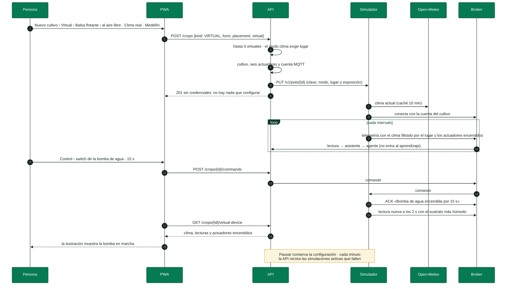

El simulador expone una API interna de control (`/v1/pots`, con token) que solo usa SmartPot-API. La configuración vive
en `virtual_devices`: pausar la simulación la marca `active: false` y la retira del simulador sin perderla; reanudarla
la vuelve a crear. Cada minuto la API recrea las simulaciones activas que falten y retira las pausadas o huérfanas;
borrar el cultivo la elimina. Los cultivos fijos de `SIMULATOR_DEVICES` (datos demo y QA) son cultivos reales que el
simulador hace publicar con su clave.

### 9.4 Ilustración del cultivo

Encima de todas las secciones del detalle, la PWA dibuja cada cultivo, real o virtual, como es:

| Pieza      | Qué muestra                                                                                                                                                                                                                                      |
|------------|--------------------------------------------------------------------------------------------------------------------------------------------------------------------------------------------------------------------------------------------------|
| Forma      | Maceta con depósito y riego por goteo; tubos NFT con colectores y retorno; torre con bolsillos escalonados; balsa flotante con raíces en la solución                                                                                             |
| Planta     | La especie tal como es: lechuga en roseta, espinaca de hoja ancha, albahaca de hojas pareadas, tomate con tutor, flores y frutos rojos, fresa con flor blanca y frutos, pimentón rojo y amarillo; el color de las hojas sigue su índice de salud |
| Entorno    | Bajo techo, una ventana con el cielo de afuera, de día o de noche, con sol que entra si es soleada o cortina si no tiene luz natural; al aire libre, el clima del lugar, con malla de media sombra o un árbol que da sombra                      |
| Actuadores | Solo los instalados: la bomba hace correr la solución (o burbujas en la balsa), la luz ilumina, el ventilador gira, el humidificador suelta bruma y los dosificadores gotean; cada uno con su estado, sin botones                                |

Un actuador se ve encendido si quedó encendido sin límite o si su última orden por tiempo sigue corriendo; en los
virtuales también cuenta lo que informa el simulador. Si el cultivo no está conectado (dispositivo sin señal o
simulación en pausa) la escena no se dibuja y la PWA explica cómo conectarlo o reanudarlo. Junto a la escena, la PWA
escribe dónde está el cultivo y el clima de afuera; solo los virtuales llevan una etiqueta de tipo.

<!-- parte: PARTE III | Operación -->

## 10. Seguridad

### En palabras simples

Cada pieza tiene solo los permisos que necesita. Las contraseñas y claves nunca viajan ni se guardan en claro, las bases
de datos no se ven desde internet y cada dispositivo solo puede tocar lo suyo.

| Área                 | Control                                                                                                                                                                                                 |
|----------------------|---------------------------------------------------------------------------------------------------------------------------------------------------------------------------------------------------------|
| Autenticación        | JWT HS256, BCrypt 12, límite de peticiones por IP y respuestas que no revelan si un correo existe                                                                                                       |
| Autorización         | Control de dueño en cada ruta de cultivo; 404 para recursos ajenos                                                                                                                                      |
| Dispositivos         | Cuenta MQTT por cultivo, ACL con `%u`, clave de 192 bits cifrada con AES-256-GCM y mostrada una sola vez                                                                                                |
| Transporte           | HTTPS con HSTS; MQTT sobre TLS 1.2+ con CA propia; WebSocket seguro                                                                                                                                     |
| Web                  | CSP estricta con `connect-src` limitado a la API, `X-Frame-Options: DENY`, `nosniff`, `Referrer-Policy` y `Permissions-Policy` (geolocalización solo del propio sitio y solo cuando la persona la pide) |
| Servicio de IA       | Solo en la red interna y con token de servicio comparado en tiempo constante; aprende con ids de cultivo seudonimizados y solo expone datos agregados                                                   |
| Simulador            | API de control interna con token; recibe la clave de cada cultivo virtual solo por la red interna; sale a internet únicamente para el clima                                                             |
| Telegram             | Códigos de vinculación y enlaces para compartir un cultivo de un solo uso y 10 minutos, webhook con secreto comparado en tiempo constante, solo chats privados y sin datos a chats no vinculados        |
| Contenedores         | Solo lectura, sin capacidades de Linux, `no-new-privileges`, usuarios sin privilegios, límites de CPU y memoria                                                                                         |
| Red                  | Solo el broker (8883) escucha fuera de `127.0.0.1`; PostgreSQL, Valkey y la IA en una red sin salida; el simulador no publica puertos                                                               |
| Cadena de suministro | Dependabot, revisión de dependencias, CodeQL, SBOM y atestación de procedencia de cada imagen                                                                                                           |
| Secretos             | GitHub Secrets; el `.env` existe en el servidor solo durante el despliegue                                                                                                                              |

> [!NOTE]
> **Generación de secretos.** Las contraseñas, el secreto JWT, la llave AES, los tokens de la IA y del simulador y el
> secreto del webhook se derivan con HKDF-SHA512 a partir de ruido atmosférico de random.org mezclado con el generador
> criptográfico del sistema; ninguna de las dos fuentes por sí sola determina el resultado. Las llaves de los certificados
> usan la misma entropía.

## 11. Despliegue

### 11.1 Entornos

| Entorno    | Carpeta             | Imágenes                                                 | Uso                                                                                                       |
|------------|---------------------|----------------------------------------------------------|-----------------------------------------------------------------------------------------------------------|
| Demo       | `docker/demo`       | GHCR (principal) o Docker Hub (`compose.dockerhub.yaml`) | SmartPot completo con datos de ejemplo, dos cultivos reales que publica el simulador y cultivos virtuales |
| Desarrollo | `docker/dev`        | Compiladas desde los repositorios locales                | Programar con toda la plataforma                                                                          |
| Producción | `docker/production` | GHCR con etiqueta configurable                           | Servidor con Nginx y HTTPS                                                                                |
| Kubernetes | `kubernetes`        | GHCR                                                     | Clústeres locales con Pod Security `restricted`                                                           |

### 11.2 Despliegue automático

<!-- diagrama: SmartPot_06_Deployment | titulo=Despliegue continuo -->

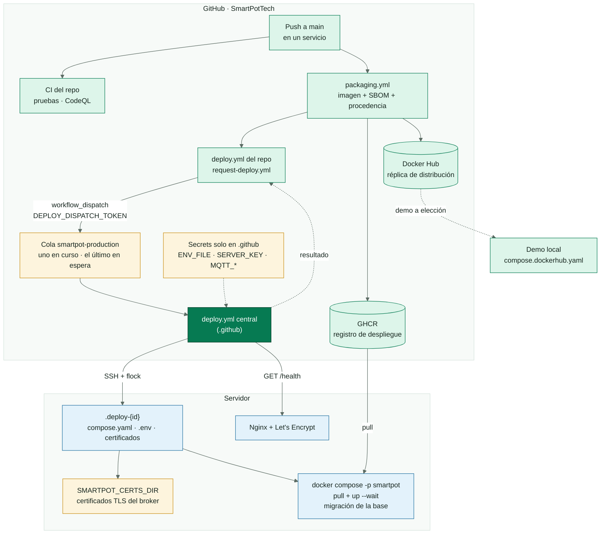

Cada servicio publica su imagen en `ghcr.io/smartpottech` (y en Docker Hub, como réplica, si tiene `DOCKER_USERNAME` y
`DOCKER_PASSWORD`) y pide el despliegue al workflow central con `request-deploy.yml`, que espera el resultado. Solo
`SmartPotTech/.github` se conecta al servidor, y su `deploy.yml` corre de a uno (`concurrency`): si llegan varios
pedidos mientras despliega, queda en espera solo el más reciente, porque cada despliegue descarga todas las imágenes. El
workflow valida el `ENV_FILE` (longitudes mínimas, llave AES de 32 bytes, variables por perfil), comprueba que el
certificado del broker esté firmado por la CA y que la llave le corresponda, sube la configuración por SSH, instala los
certificados con dueño `1883`, descarga las imágenes desde GHCR, actualiza los contenedores, aplica los esquemas de la
base con la migración de SmartPot-DB y verifica `/health` desde internet. Los despliegues simultáneos esperan su turno
con `flock`.

| Secret                                                              | Contenido                                                                                                                                           |
|---------------------------------------------------------------------|-----------------------------------------------------------------------------------------------------------------------------------------------------|
| `SERVER_HOST`, `SERVER_PORT`, `SERVER_USER`, `SERVER_KNOWN_HOSTS`   | Acceso SSH al servidor                                                                                                                              |
| `SERVER_KEY`                                                        | Llave privada SSH de despliegue                                                                                                                     |
| `DEPLOY_PATH`                                                       | Carpeta de producción en el servidor                                                                                                                |
| `ENV_FILE`                                                          | `.env` completo de producción, incluidos `SIMULATOR_TOKEN` y, si hay bot, `TELEGRAM_BOT_TOKEN`, `TELEGRAM_BOT_USERNAME` y `TELEGRAM_WEBHOOK_SECRET` |
| `MQTT_CA_CERT`, `MQTT_SERVER_CERT`, `MQTT_SERVER_KEY`               | Certificados del broker (opcionales)                                                                                                                |
| `DEPLOY_DISPATCH_TOKEN` (en cada servicio)                          | Token con permiso **Actions: Read and write** solo sobre `.github`, para pedir el despliegue                                                        |
| `DOCKER_USERNAME`, `DOCKER_PASSWORD` (en cada servicio, opcionales) | Publicación en Docker Hub                                                                                                                           |

### 11.3 Red de producción

| Dominio                             | Destino                                     |
|-------------------------------------|---------------------------------------------|
| `smartpot.app` y `www.smartpot.app` | PWA (`www` redirige al dominio principal)   |
| `api.smartpot.app`                  | API y `/docs`                               |
| `mqtt.smartpot.app:8883`            | Broker con TLS directo                      |
| `mqtt.smartpot.app/mqtt`            | WebSocket seguro a través de Nginx          |
| `mail.smartpot.app`                 | Bandeja de Mailpit con usuario y contraseña |

<!-- diagrama: SmartPot_07_Networks | titulo=Redes y puertos en producción -->

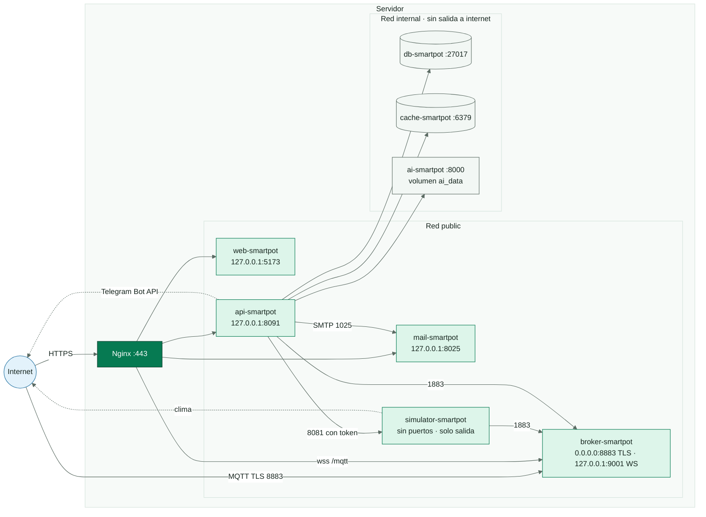

## 12. Calidad

<!-- diagrama: SmartPot_08_QA | titulo=Workflow de QA -->

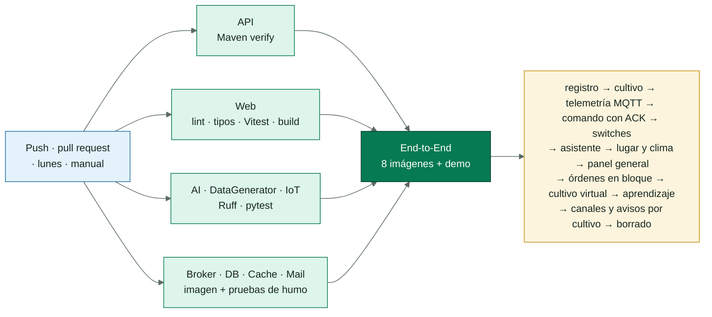

| Repositorio                | Pruebas           | Qué cubren                                                                                                                                                                                                                                                                                                                                                                                                                                                                                                            |
|----------------------------|-------------------|-----------------------------------------------------------------------------------------------------------------------------------------------------------------------------------------------------------------------------------------------------------------------------------------------------------------------------------------------------------------------------------------------------------------------------------------------------------------------------------------------------------------------|
| SmartPot-API               | 147               | Cifrado, JWT, contraseñas, MQTT, aprovisionamiento, comandos y switches (409 al no cambiar nada o al cruzar órdenes), cultivos, lugar y clima, agente, caché, historial con hora para la IA, panel general, órdenes y automatización en bloque, envío de lecturas para el aprendizaje, canales, avisos por cultivo y compartidos, bot de Telegram, webhook firmado, tipo fijo y forma de los cultivos, simulación solo de virtuales con pausa, aprendizaje solo con reales y seguridad de los controladores           |
| SmartPot-AI                | 84                | Base de conocimiento, reglas, descanso nocturno, pronóstico Theil-Sen, acciones preventivas, lluvia y sensor frente al clima, consejo de lugar, análisis de flota, índice difuso, exactitud de los modelos, agente, contrato HTTP y aprendizaje continuo (seudonimización, calidad, etiquetas, modelos frente a la línea base, campeón y retador, persistencia)                                                                                                                                                       |
| SmartPot-Web               | 65                | Cliente HTTP, sesión, validaciones, ingreso, componentes del cultivo, switches, asistente con pronóstico, consejo de lugar y lo aprendido, comparación de modelos, Aplicaciones y avisos por cultivo, ilustración (formas, especies, lugar, actuadores, clima y conexión), Simulación en dos partes, creación real o virtual, guía de conexión con la CA, panel general y requisitos de SEO y PWA                                                                                                                     |
| SmartPot-DataGenerator     | 34                | Modelo físico, efecto de los actuadores en los tres modos, actuadores sin duración, lugar y clima, lluvia y sol, caché del clima, contrato MQTT, lectura tras una orden, mensajes de confirmación y API de control                                                                                                                                                                                                                                                                                                    |
| SmartPot-IoT               | 15                | Cliente MQTT, verificación del broker con la CA de la plantilla, telemetría, comandos y sus mensajes, actuadores y sensores con MicroPython simulado                                                                                                                                                                                                                                                                                                                                                                  |
| SmartPot-Broker            | 10 comprobaciones | Autenticación, ACL por cultivo, client ids, anónimos y TLS                                                                                                                                                                                                                                                                                                                                                                                                                                                            |
| SmartPot-DB, -Cache, -Mail | Pruebas de humo   | Validadores, permisos, datos demo, comandos deshabilitados de Redis y autenticación SMTP                                                                                                                                                                                                                                                                                                                                                                                                                              |
| End-to-End                 | 101 comprobaciones | Registro, cultivo real con su forma, telemetría y capacidades MQTT, clave incorrecta rechazada, comando con ACK, switches (orden cruzada y orden que no cambia nada, 409), asistente, lugar con su consejo y su clima, panel general, series, análisis de flota, orden en bloque que omite lo que no cambia y automatización en bloque, tipo que no cambia, cultivo virtual sin credenciales con seis actuadores publicando por MQTT, pausa de la simulación, aprendizaje continuo, canales y avisos por cultivo, código de Telegram y webhook firmado, resumen y exportación CSV, recuperación de contraseña por Mailpit, perfil y cambio de clave, conexiones `spt_` READ/CONTROL con MCP, aislamiento BOLA, validación de campos y borrado |

## 13. Operación

| Tarea                             | Cómo                                                                                                                                    |
|-----------------------------------|-----------------------------------------------------------------------------------------------------------------------------------------|
| Estado                            | `GET https://api.smartpot.app/health` → base de datos, broker, caché, IA y simulador                                                    |
| Logs                              | `docker logs -f smartpot-api` (y `-broker`, `-ai`, `-web`)                                                                              |
| Respaldo                          | `backup_smartpot.sh`: `pg_dump` comprimido de PostgreSQL/TimescaleDB con 14 días de retención                                   |
| Restauración                      | `pg_restore --clean --if-exists` sobre `smartpot-db`                                                                                     |
| Cambiar configuración             | Editar el secret `ENV_FILE` y ejecutar **Deploy to Production**                                                                         |
| Migrar la base                    | Idempotente en el despliegue; a mano: `docker exec -i smartpot-db psql -U smartpot -d smartpot < schema.sql`                            |
| Renovar el certificado del broker | Antes de 825 días: `generate-certs.sh` con la CA existente y actualizar `MQTT_SERVER_CERT` y `MQTT_SERVER_KEY`                          |
| Rotar la clave de un cultivo real | Desde la PWA, pestaña Dispositivo; los virtuales no tienen clave que rotar                                                              |
| Aprendizaje                       | Página Aprendizaje de la PWA; `docker logs smartpot-ai` muestra cada entrenamiento. Lo aprendido vive en el volumen `ai_data`           |
| Activar Telegram                  | Crear el bot con @BotFather, agregar `TELEGRAM_BOT_TOKEN`, `TELEGRAM_BOT_USERNAME` y `TELEGRAM_WEBHOOK_SECRET` a `ENV_FILE` y desplegar |
| Actualizar dependencias           | Revisar y fusionar los pull requests semanales de Dependabot                                                                            |

> [!WARNING]
> **Llave AES.** `SMARTPOT_AES_KEY` cifra las claves de los dispositivos. Si se pierde o se cambia, las cuentas MQTT no
> se pueden reconstruir y cada dueño debe rotar la clave de su cultivo real (y crear de nuevo los virtuales).

## 14. Glosario

| Término                       | Definición                                                                                                 |
|-------------------------------|------------------------------------------------------------------------------------------------------------|
| ACK                           | Confirmación que envía el dispositivo al ejecutar o fallar un comando                                      |
| Actuador                      | Salida del dispositivo que cambia el cultivo: bomba, luz, ventilador, humidificador o dosificadores        |
| Aprendizaje autosupervisado   | Etiquetas que salen de los propios datos: lo que pasó después de cada lectura                              |
| Campeón y retador             | El modelo vigente solo se reemplaza si el nuevo lo supera en las lecturas más recientes                    |
| Broker                        | Servidor MQTT que recibe y reparte los mensajes entre los dispositivos y la API                            |
| Clave del dispositivo         | Contraseña MQTT de un cultivo, generada por la API                                                         |
| Ilustración del cultivo       | Dibujo sobre todas las secciones del detalle con su forma, su especie y cada actuador encendido o apagado  |
| Cultivo real                  | Cultivo cuyas lecturas envía un ESP32 con el firmware, físico o simulado en Wokwi                          |
| Cultivo virtual               | Cultivo que simula SmartPot, siempre encendido, con su propia cuenta en el broker                          |
| Forma del cultivo             | Maceta, tubos NFT, torre vertical o balsa flotante: cómo se ilustra                                        |
| Encadenamiento hacia adelante | Técnica del sistema experto que parte de los hechos y dispara reglas hasta no poder concluir más           |
| GHCR                          | GitHub Container Registry, donde se publican las imágenes y desde donde se despliega                       |
| Isolation Forest              | Modelo que detecta datos atípicos aislándolos con árboles aleatorios                                       |
| Lugar del cultivo             | Bajo techo o al aire libre, cuánto sol recibe y su ubicación; uno solo para el cultivo y su simulación     |
| Línea base                    | Modelo trivial (la clase mayoritaria o «no cambia») que todo modelo debe superar para usarse               |
| Lógica difusa                 | Razonamiento con grados de pertenencia en lugar de sí o no                                                 |
| Modo automático               | Permiso del dueño para que el agente ejecute acciones sin preguntar                                        |
| MQTT                          | Protocolo de mensajería liviano para dispositivos conectados                                               |
| PWA                           | Aplicación web progresiva: se instala y funciona como una app nativa                                       |
| QoS 1                         | Nivel de MQTT que garantiza al menos una entrega                                                           |
| Resumen de avisos             | Mensaje que reúne los avisos de un cultivo cada cierta cantidad de horas, o una vez al día a una hora fija |
| Seguridad dinámica            | Plugin de Mosquitto para administrar usuarios, roles y permisos en caliente                                |
| Silueta                       | Medida de qué tan separados están los grupos de K-Means; elige cuántos grupos usar                         |
| Sondeo largo                  | Consulta que espera hasta que hay mensajes; alternativa al webhook sin dirección pública                   |
| Switch                        | Control de encendido y apagado de un actuador que solo admite órdenes que cambian su estado                |
| TDS                           | Sólidos disueltos totales: concentración de nutrientes en ppm                                              |
| Tolerancia                    | Unidad con la que se mide cuánto se aleja una variable de su rango ideal                                   |
| Última voluntad (LWT)         | Mensaje que el broker publica solo si el dispositivo se desconecta sin avisar                              |
| Validación cruzada temporal   | Evaluación que siempre entrena con el pasado y prueba con el futuro                                        |
| Webhook                       | Dirección a la que Telegram envía cada mensaje del bot, firmada con un secreto                             |

<!-- parte: PARTE VI | Plan Maestro de Maximización y Endurecimiento Industrial del Stack B (demo-beta) -->

## 15. Plan Maestro de Maximización y Endurecimiento Industrial del Stack B (demo-beta)

### 15.1. Directiva Arquitectónica Central: Evolución In-Place sin Proliferación de Stacks

> [!IMPORTANT]
> **No existe un "Stack C" ni repositorios paralelos.** El **Stack B (`demo-beta`)** es el stack definitivo de producción de SmartPot. Cualquier modernización técnica, cambio de protocolo o reemplazo de runtime se ejecuta **in-place** dentro de los repositorios existentes de la organización (`SmartPot-AI`, `SmartPot-Trainer`, `SmartPot-API-Go`, `SmartPot-DB-Postgre`, `SmartPot-Cache-Valkey`, `SmartPot-Broker-EMQX`, `SmartPot-Web-Solid`, `SmartPot-IoT-Rust`, `SmartPot-DataGenerator-Rust` y `.github`).

La evolución a escala industrial masiva resuelve las siguientes premisas críticas:
1. **Transporte Dual Adaptativo**: Queda superado el acoplamiento rígido a Unix Domain Sockets (UDS). Los servicios implementan autodetección: UDS (`/var/run/smartpot/*.sock`) en despliegues mononodo de latencia ultra-baja (como `demo-beta`), con conmutación transparente a **gRPC sobre HTTP/2 (con soporte eBPF Socket Bypass / Cilium)** o **TCP/TLS 1.3** en entornos multi-nodo distribuidos.
2. **Inferencia Segura Zero-Copy**: Erradicación total de `dlopen` de bibliotecas `.so` dinámicas (Treelite C) y deserialización `pickle`/`joblib` entre servicios. La inferencia en Rust opera exclusivamente con grafos estáticos **ONNX-ML (`tract-onnx`)** y tensores mapeados en memoria mediante **`rkyv`** (`memmap2`), con integridad verificada por hash **BLAKE3** y firma asimétrica **Ed25519**.
3. **Cero SQLite en `SmartPot-Trainer`**: Eliminada la redundancia de almacenamiento y re-ingesta local. `SmartPot-Trainer` lee las series temporales directamente desde TimescaleDB mediante **ADBC (`adbc-driver-postgresql`)**, transfiriendo bloques binarios **Apache Arrow** directo a `Polars LazyFrame` con cero copias en memoria.
4. **Separación Builder vs. Runner en Frontend**: **Bun 1.4** se confina a la fase de construcción y empaquetado (`builder`), generando activos estáticos pre-comprimidos con Zstandard (`.zst`, nivel 19) y Brotli (`.br`, nivel 11). El **runner** de producción en `SmartPot-Web-Solid` es un servidor estático ultraligero en **Caddy 2.9 (HTTP/3 QUIC + kTLS)** sin runtime de JavaScript en producción.

### 15.2. Arquitectura Industrial Definitiva

```text
┌────────────────────────────────────────────────────────────────────────────────────────────────────────────────────────┐
│                                 ARQUITECTURA INDUSTRIAL DEFINITIVA - SMARTPOT STACK B                                  │
└────────────────────────────────────────────────────────────────────────────────────────────────────────────────────────┘

  [ SmartPot-IoT-Rust (ESP32) ] ──┐ (mTLS X.509 Ed25519 + MQTT v5 Topic Aliases + Payload Postcard/Protobuf 22 Bytes)
  [ SmartPot-DataGenerator-Rust ] ┘ (Filtro Mediana + EKF Q16.16 en el borde / TLS Session Tickets < 15ms)
                 │
                 ▼
  [ SmartPot-Broker-EMQX 5.8 (OTP 27) ]
    • Autenticación mTLS en handshake (CN == device_id ACL criptográfico)
    • Stream persistente bidireccional vía EMQX gRPC ExHook (Protobuf binario, cero webhooks HTTP)
                 │
                 ▼
  [ SmartPot-API-Go (Go 1.26 + PGO + Distroless) ] ◄───(HTTP/3 QUIC + SSE Binary/SIMD Stream)───► [ SmartPot-Web-Solid ]
    │ • Lock-Free Ring Buffer de Ingesta (Disruptor pattern)                                        • Builder: Bun 1.4 (.zst/.br)
    │ • Caché L1 in-memory + L2 Valkey (Agronomic Deadband Filter)                                  • Runner: Caddy HTTP/3 QUIC
    │ • Auth Stateless PASETO v4 / JWT EdDSA (Ed25519 en memoria < 15µs)                            • Web Workers + Signals 60FPS
    │
    ├───────────────────────────────┬─────────────────────────────────────────┐
    │ (Dual: UDS / RESP3 Pipelined) │ (Dual: UDS / gRPC HTTP/2 Protobuf v3)   │ (pgx Binary COPY FROM STDIN cada 25ms/500 msgs)
    ▼                               ▼                                         ▼
[ SmartPot-Cache-Valkey 9.1 ]   [ SmartPot-AI (Migrado In-Place a Rust) ] [ SmartPot-DB-Postgre (PG 17 + TimescaleDB 2.18) ]
  • io-threads 4 + Jemalloc purge • Axum 0.8 (REST) + Tonic (gRPC)          • Rol Ingesta: synchronous_commit = off (150k ins/s)
  • Funciones Lua Deadband        • SIMD f64x4: Theil-Sen, VPD, EKF, Sugeno • Rol Transaccional: synchronous_commit = on + RLS
  • Pub/Sub de Hot-Reload IA      • Sistema Experto en Bitsets (u64 < 200ns)• Chunks 1d + Compresión Columnar Zstd a las 12h
                                  • Inferencia tract-onnx + rkyv mmap       • Continuous Aggregates: 1m, 15m, 1h (< 1.5ms query)
                                  • Hot-Reload lock-free vía ArcSwap (<500ns)
                                  • Verificación BLAKE3 + Firma Ed25519
                                                ▲
                                                │ (Exporta ONNX-ML + rkyv firmados con Ed25519 + Señal Valkey Pub/Sub)
                                                │
                                  [ SmartPot-Trainer (Python 3.13 + uv) ]
                                    • Cero SQLite: Lectura directa Arrow vía ADBC Postgres desde TimescaleDB
                                    • Procesamiento paralelo en Rust con Polars LazyFrame (IQR, Rolling, Lead/Shift)
                                    • Ruta Rápida: Adaptadores NumPy LoRA (W = W0 + α·B·A) actualizados en < 1ms
                                    • Ruta Profunda: Torneo Champion-Challenger Scikit-Learn exportado con skl2onnx
```

### 15.3. Comparativa de Protocolos y Estándar Builder/Runner

| Capa / Flujo | Protocolo Anterior | Protocolo Definitivo Industrial | Ganancia Arquitectónica |
| :--- | :--- | :--- | :--- |
| **Borde IoT → Broker** | MQTT v3.1.1 JSON (~180 B) | **MQTT v5 Postcard (22 B) + Topic Aliases** | Reducción de ancho de banda del 88%, eliminación de parsing JSON en microcontrolador. |
| **Broker → Gateway API** | Webhook HTTP POST JSON | **gRPC ExHook persistente (Protobuf binario)** | Eliminación de handshakes HTTP/1.1 por mensaje, multiplexación en un solo stream TCP. |
| **Gateway → Persistencia** | Inserciones SQL micro-batching | **`pgx.CopyFrom` binario masivo STDIN** | Supera 150,000 inserciones/s sin saturar buffer pool ni bloquear fsync de disco. |
| **Gateway → IA / Caché** | HTTP/1.1 REST JSON + TCP Redis | **Dual UDS (`.sock`) / gRPC HTTP/2 + RESP3** | Latencia sub-milisegundo (< 200 µs UDS) y bypass de pila TCP en mononodo. |
| **Gateway → PWA Web** | Polling condicional ETag 304 | **HTTP/3 QUIC + SSE (Server-Sent Events)** | Cero latencia de sondeo, actualización reactiva empujada en tiempo real por el servidor. |

| Componente | Builder / Entorno de Compilación | Runner / Imagen de Producción | Estrategia de Contención |
| :--- | :--- | :--- | :--- |
| **SmartPot-AI** | `rust:1.85-bookworm` (cargo-chef, target x86_64-unknown-linux-musl, `target-cpu=x86-64-v3`, LTO fat) | `gcr.io/distroless/static-debian12:nonroot` | Binario estático puro, 0 vulnerabilidades de SO, sin shell ni herramientas. |
| **SmartPot-Trainer** | `ghcr.io/astral-sh/uv:python3.13-bookworm-slim` (`uv sync --frozen --compile-bytecode`) | `ghcr.io/astral-sh/uv:python3.13-bookworm-slim` (usuario sin privilegios UID 65532) | Ingesta analítica directa por ADBC Arrow, aislamiento de procesos, sin SQLite. |
| **SmartPot-API-Go** | `golang:1.26-alpine` (`CGO_ENABLED=0`, `-pgo=default.pgo`, `-trimpath`, `-ldflags="-s -w"`) | `gcr.io/distroless/static-debian12:nonroot` | Imagen `scratch`/distroless, memoria < 15 MB, PGO habilitado. |
| **SmartPot-Web-Solid** | `oven/bun:1.4-alpine` (`bun run build`, pre-compresión Zstandard y Brotli) | `caddy:2.9-alpine` (servidor nativo HTTP/3 QUIC + kTLS) | Cero runtime JavaScript en producción; servicio de activos estáticos desde caché kernel. |
| **SmartPot-DataGenerator-Rust** | `rust:1.85-bookworm` (musl static builder) | `gcr.io/distroless/static-debian12:nonroot` | Simulador nativo en Rust con huella < 2 MB RAM. |

### 15.4. Especificación Técnica por Componente

#### A. SmartPot-AI (Migración In-Place a Rust 2024 Edition)
* **Stack**: `axum 0.8` (compatibilidad REST v1 completa) + `tonic` (gRPC sobre `/var/run/smartpot/ai.sock` y TCP interno) + `tokio` multi-hilo con `mimalloc` como `#[global_allocator]`.
* **Núcleo SIMD (`core::simd` / `wide`)**:
  * Cálculo de **Déficit de Presión de Vapor (VPD) foliar psicrométrico** mediante la ecuación de Tetens/Buck con offset térmico radiativo:
    $$e_s(T) = 0.61078 \exp\left(\frac{17.27 \cdot T}{T + 237.3}\right), \quad \text{VPD} = e_s(T_{\text{air}} - 1.5) - \left(e_s(T_{\text{air}}) \cdot \frac{\text{RH}}{100}\right)$$
  * **Filtro de Kalman Extendido (EKF 1D)**: pre-filtrado de ruido electromagnético en lecturas de pH, conductividad (TDS/EC) y humedad de sustrato.
  * **Regresión Robusta Theil-Sen $O(M)$** y **Lógica Difusa Sugeno Branchless** vectorizadas en registros `f64x4`.
* **Sistema Experto en Bitsets `u64`**: Hechos agronómicos codificados como máscaras de bits individuales (`TempHigh`, `VpdCritical`, `PhAcidicDrift`, `MoistureDepleting`). Evaluación atómica bit a bit de las 21 reglas en $< 200\text{ ns}$.
* **Motor ML Zero-Copy**: Inferencia de árboles con `tract-onnx` (`TreeEnsembleClassifier`) y tensores LoRA mapeados con `rkyv`/`memmap2`.
* **Hot-Reload Atómico**: Sustitución de modelos mediante `arc_swap::ArcSwap<ModelBundle>` sin contención de cerrojos, verificando hash BLAKE3 y firma Ed25519 del artefacto.

#### B. SmartPot-Trainer (Python 3.13 + uv + ADBC Arrow + Polars + ONNX)
* **Ingesta Analítica Directa**: Cero SQLite. Conexión de alto rendimiento mediante `adbc-driver-postgresql` transfiriendo flujos binarios Arrow directo a `Polars LazyFrame`.
* **Pipeline Vectorizado**: Filtrado IQR, métricas DQS, medias/desviaciones móviles y generación de etiquetas autosupervisadas en el motor multihilo de Polars.
* **Entrenamiento en Dos Velocidades**:
  * *Ruta Rápida (LoRA)*: Actualización analítica de matrices $B_s \in \mathbb{R}^{d \times r}$ y $A_s \in \mathbb{R}^{r \times k}$ ($r=2$) en $< 1\text{ ms}$.
  * *Ruta Profunda*: Torneo Champion-Challenger con `TimeSeriesSplit(4)` sobre Scikit-Learn paralelizado con joblib en `/dev/shm`.
* **Exportación y Firma**: Generación de `.onnx` (`skl2onnx`), firma criptográfica Ed25519 y notificación mediante Valkey Pub/Sub (`smartpot:ai:reload`).

#### C. SmartPot-API-Go (Go 1.26 + PGO + Disruptor + CopyFrom + Deadband)
* **Ingesta Masiva**: Cola Ring Buffer lock-free (Disruptor) con vaciado cada 25 ms o 500 registros ejecutando `pgxPoolIngest.CopyFrom` directo a PostgreSQL.
* **Filtro de Banda Muerta Agronómico**: Caché L1 en memoria de Go respaldada por Valkey L2. Bypass de hasta el 80% de consultas a la IA si $|\Delta T| < 0.1^\circ\text{C}$, $|\Delta RH| < 0.4\%$, $|\Delta pH| < 0.03$ y $|\Delta EC| < 15\,\mu\text{S/cm}$ dentro del TTL de 60s.
* **Transporte Dual**: Conexión adaptativa hacia IA y Valkey por socket UNIX o gRPC HTTP/2 / RESP3.
* **Seguridad Stateless**: Verificación en memoria de tokens PASETO v4.public / JWT EdDSA (curva Ed25519) en $< 15\text{ µs}$.

#### D. SmartPot-DB-Postgre (PostgreSQL 17 + TimescaleDB 2.18 Ultra-Tuned)
* **Separación de Roles**:
  * `smartpot_ingest`: `synchronous_commit = off` y `commit_delay = 10000`, optimizado para ingesta continua masiva (> 150k ins/s).
  * `smartpot_app`: `synchronous_commit = on` con políticas RLS (`ENABLE ROW LEVEL SECURITY`) aisladas por `app.current_tenant_id`.
* **Hipertablas y Vistas Continuas**: Fragmentos de 1 día, compresión columnar Zstandard a las 12 horas y continuous aggregates (`readings_1m`, `readings_15m`, `readings_1h`) para consultas históricas sub-milisegundo.

#### E. SmartPot-Cache-Valkey (Valkey 9.1 Multi-IO + UDS + Lua)
* Listener dual en puerto 6379 y `/var/run/smartpot/valkey.sock`.
* `io-threads 4`, purga asíncrona de memoria Jemalloc (`lazyfree`, `activedefrag`).
* Funciones Lua atómicas para evaluación de Deadband, deduplicación de paquetes MQTT y rate limiting GCRA.

#### F. SmartPot-Broker-EMQX (EMQX 5.8 + MQTT v5 + mTLS X.509 + gRPC ExHook)
* MQTT v5 con Topic Aliases (`topic_alias_maximum = 64`).
* Autenticación mTLS en handshake (certificados cliente Ed25519 / P-256) con TLS Session Resumption y validación ACL `peer_cert_cn == clientid`.
* Integración gRPC ExHook persistente hacia la API sin sobrecarga de webhooks HTTP.

#### G. SmartPot-IoT-Rust y DataGenerator-Rust (Borde Ciberfísico)
* Filtro de mediana de 5 muestras + EKF unidimensional en aritmética de punto fijo Q16.16 en el ESP32.
* Serialización binaria Postcard/Protobuf en 22 bytes (`timestamp_delta`, `temp_centi`, `rh_centi`, `soil_moisture_centi`, `ph_milli`, `tds_ppm`, `light_lux`, `battery_mv`, `status_flags`, `crc8`).

#### H. SmartPot-Web-Solid (Frontend Reactivo HTTP/3)
* Builder con Bun 1.4 y pre-compresión dual Zstandard y Brotli.
* Runner en Caddy 2.9 sobre HTTP/3 (QUIC) con kTLS.
* Conexión reactiva continua vía Server-Sent Events (SSE) y procesamiento de telemetría en Web Worker con `Float64Array` transferibles (`SharedArrayBuffer`) a 60 FPS.
