<!-- portada
eyebrow: Platform Technical Documentation
titulo: SmartPot Platform: Technical Documentation
acento: SmartPot
subtitulo: Hydroponic Crop Monitoring and Automation Platform
bajada: Architecture, contracts, AI assistant with continuous learning, placement and weather, notification channels, physical and virtual crops, security, deployment, and operations of the platform connecting hydroponic crops with grower applications.
documento: Platform Technical Documentation
version: 1.3 · October 2026
equipo: SmartPotTech
proyecto: smartpot.app
-->

# SmartPot Platform · Plataforma SmartPot

---

## Document Summary

| Field | Value |
|---|---|
| Project | SmartPot · [smartpot.app](https://smartpot.app) |
| Organization | SmartPotTech |
| Document | Platform Technical Documentation |
| Version | 1.3 · October 2026 |
| Scope | SolidJS PWA, Go API, Rust AI inference engine, Python ADBC trainer, crop placement & weather, notification channels, EMQX broker, ESP32 firmware, physical/virtual crops, TimescaleDB storage, infrastructure, and QA |
| Source of Truth | The repository `README.md` files and interactive OpenAPI docs (`/docs`) supersede this document if discrepancies arise |
| Maintenance | Generated from `docs/SmartPot_Technical_Documentation.md`; updated with every architectural or contract change |
| Companion Document | [Project Journey](SmartPot_Project_Journey.md): inception, analysis, design, construction, and testing |

<!-- parte: PART I | Platform Overview -->

## 1. Introduction

### In Plain Words

SmartPot is a complete open-source platform for monitoring, automating, and optimizing hydroponic crops. It connects physical sensors and actuators (or simulated devices) to an intelligent backend and an installable web app (PWA), giving growers total visibility and control over their plants from any device.

### Scope and Architecture Boundaries

The platform provides end-to-end functionality across four operational tiers:
1. **Edge & Device Tier:** MicroPython and Rust Embassy ESP32 firmware publishing telemetry via MQTT with TLS and receiving actuator execution commands.
2. **Broker & Ingestion Tier:** EMQX 5.8.9 enterprise MQTT broker with in-memory HTTP webhook authentication and per-crop dynamic ACL enforcement.
3. **Core Services Tier:** High-throughput Go REST/MQTT API (`SmartPot-API`), TimescaleDB time-series database with continuous aggregates (CAGGs), and Valkey in-memory cache.
4. **Intelligence & Interface Tier:** Standalone Rust AI inference microservice (`SmartPot-AI`), offline Python model trainer (`SmartPot-Trainer`), and responsive SolidJS Progressive Web App (`SmartPot-Web`).

### Supported Plant Species

The system includes preconfigured agronomic profiles for 6 standard hydroponic crops:
- **Lettuce (*Lactuca sativa*):** Fast-growing leafy green with low nutrient density and strict tipburn prevention thresholds.
- **Tomato (*Solanum lycopersicum*):** High-nutrient fruiting crop requiring dynamic photoperiod lighting and high potassium dosing.
- **Strawberry (*Fragaria × ananassa*):** Sensitive root system requiring stable root-zone temperature and strict crown moisture control.
- **Spinach (*Spinacia oleracea*):** Cool-season crop vulnerable to bolting under high ambient temperature or light excess.
- **Bell Pepper (*Capsicum annuum*):** Warm-season crop demanding consistent EC/TDS nutrient levels and moderate humidity.
- **Basil (*Ocimum basilicum*):** Highly aromatic herb requiring intensive light exposure and warm root temperatures.

## 2. System Architecture (Canonical Stack B)

<!-- diagrama: SmartPot_01_Architecture | titulo=SmartPot Platform Architecture (Stack B) | lamina=H -->

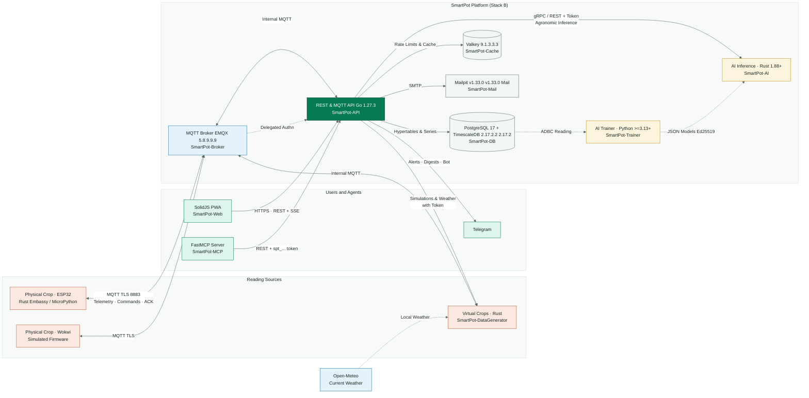

### Component Topology

<!-- diagrama: SmartPot_12_Components | titulo=Component Decoupling and Communication Flow -->

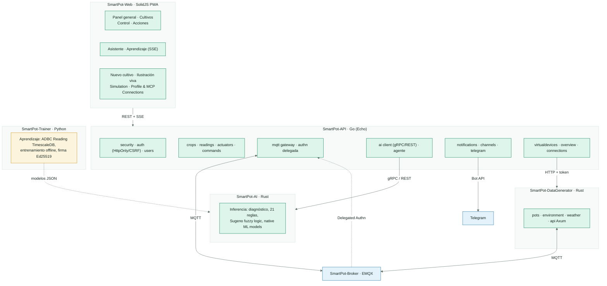

The production architecture is completely decoupled into modular microservices running in isolated, rootless Docker containers:

| Service / Container | Technology & Runtime | Primary Architectural Role | Port / Binding |
|---|---|---|---|
| `smartpot-api` | Go 1.27.3 / Echo / pgx v5.12.0 | Core REST API, MQTT gateway, authentication, and command orchestrator | `127.0.0.1:8091` (HTTP) |
| `smartpot-db` | PostgreSQL 17 + TimescaleDB 2.17.2 | Relational metadata, time-series hypertables, continuous aggregates | Internal `5432` |
| `smartpot-cache` | Valkey 9.1.3.3 (Alpine) | Session storage, rate limiting tokens, singleflight cache, and telemetry cache | Internal `6379` |
| `smartpot-broker` | EMQX 5.8.9.9 (Erlang) | MQTT v1 broker with webhook authentication and dynamic per-crop ACLs | `127.0.0.1:1883` / `8083` |
| `smartpot-web` | SolidJS 1.9 / Vite / Tailwind CSS | High-performance reactive PWA served via unprivileged Nginx | `127.0.0.1:5173` |
| `smartpot-ai` | Rust 1.88+ / Tokio / Axum 0.8 | Deterministic inference engine, 21 agronomic rules, and Sugeno fuzzy logic | Internal `50051` (gRPC) / `8002` (REST) |
| `smartpot-trainer` | Python >=3.13 / Arrow ADBC / Scikit | Periodic offline model training with Ed25519 cryptographic signing | Internal worker (no exposed ports) |
| `smartpot-simulator` | Rust 1.88+ / Tokio / Axum 0.8 | Background multi-pot physics simulator with real-time weather integration | Internal `8082` |
| `smartpot-mail` | Mailpit v1.33.0 v1.33.0 (Alpine) | Local SMTP testing server and email recovery inbox | `127.0.0.1:8025` (UI) |

### Key Architectural Decisions

1. **Hexagonal Architecture:** Complete separation of domain entities from external storage, network protocols, and third-party APIs.
2. **Hypertables and Continuous Aggregates:** Telemetry stored in TimescaleDB partitioned chunks with automated 1m, 15m, and 1h CAGGs and 365-day retention.
3. **In-Memory Broker Webhooks:** Device authentication delegated to the API via internal HTTP webhooks cached in Valkey, avoiding disk-based ACL corruption.
4. **Rust Inference Microservice:** High-speed, zero-GC analytical inference delivering sub-millisecond evaluation without JVM overhead.

## 3. Reading Lifecycle (Telemetry Ingestion)

<!-- diagrama: SmartPot_02_Reading_Sequence | titulo=Telemetry Ingestion and Automated Action Sequence -->

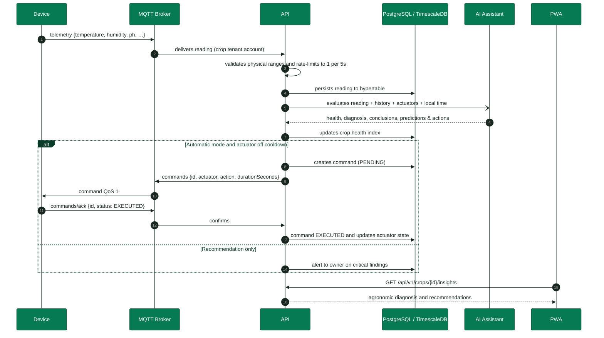

1. **Measurement & Publication:** The device (or simulator) samples sensors, applies calibration offsets, and publishes a JSON payload to `smartpot/v1/{cropId}/readings` with QoS 1.
2. **Broker Authorization:** EMQX queries the internal webhook (`/api/v1/mqtt/authn`). If valid, the packet is forwarded; otherwise, the connection is immediately terminated.
3. **Ingestion & Validation:** The API MQTT gateway receives the message, parses the payload without dynamic allocations, and verifies physical range constraints.
4. **Persistence & Caching:** The reading is written to the TimescaleDB `readings` hypertable and cached in Valkey (`crops:{id}:latest`).
5. **Analytical Evaluation:** The API invokes `SmartPot-AI` via gRPC/REST. The engine computes variable diagnostic states, fuzzy health index, and Theil-Sen trend slope.
6. **Closed-Loop Rule Execution:** If automatic mode is enabled and parameters violate safe thresholds, the rule agent checks actuator cooldown and generates an execution command.
7. **Client Delivery:**
<!-- diagrama: SmartPot_13_Control_Activity | titulo=Closed-Loop Telemetry and Command Execution Activity Flow -->

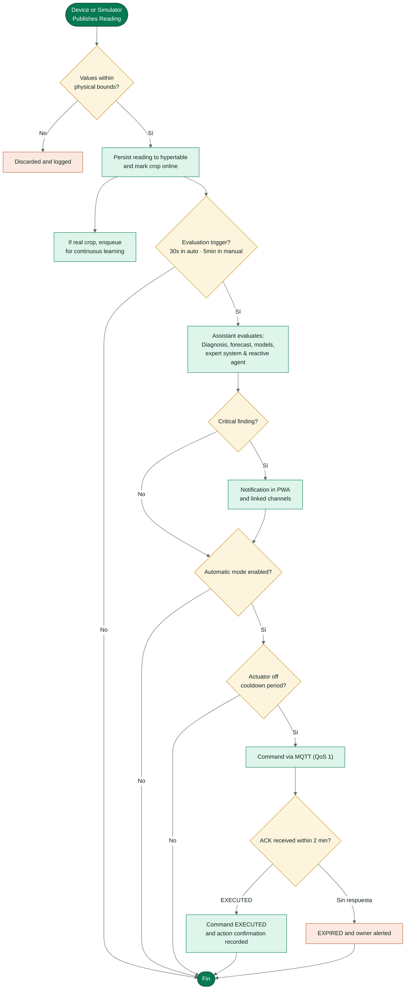
 Connected PWA clients receive instant state updates via Server-Sent Events (SSE) or polling.

<!-- parte: PART II | Contracts and Interfaces -->

## 4. MQTT Contract (v1)

### Topic Taxonomy

All MQTT communication follows a strict topic hierarchy:
- **Telemetry Ingestion:** `smartpot/v1/{cropId}/readings` (Publish: Device, Subscribe: API)
- **Device Lifecycle:** `smartpot/v1/{cropId}/status` (Retained Last Will and Testament, `online` / `offline`)
- **Command Dispatch:** `smartpot/v1/{cropId}/actuators/{actuatorType}/command` (Publish: API, Subscribe: Device)
- **Command Acknowledgment:** `smartpot/v1/{cropId}/actuators/{actuatorType}/ack` (Publish: Device, Subscribe: API)

### Payload Structure

```json
{
  "version": 1,
  "cropId": "507f1f77bcf86cd799439011",
  "measuredAt": "2026-10-31T14:30:00Z",
  "measures": {
    "temperature": 21.4,
    "humidity": 64.2,
    "brightness": 1250.0,
    "ph": 6.12,
    "tds": 720.0,
    "atmosphere": 1013.25,
    "soilMoisture": 58.5
  }
}
```

## 5. REST API Specification

### Core Endpoints

| Method | Endpoint | Description | Access Level |
|---|---|---|---|
| `POST` | `/api/v1/auth/register` | Register a new user account | Public (Rate-limited) |
| `POST` | `/api/v1/auth/login` | Authenticate user and issue HttpOnly JWT cookies | Public (10 req/min limit) |
| `POST` | `/api/v1/auth/logout` | Revoke session and clear cookies | Authenticated |
| `GET` | `/api/v1/crops` | List all crops owned by the authenticated user | Authenticated |
| `POST` | `/api/v1/crops` | Create a new crop (real or virtual) | Authenticated (Quota enforced) |
| `GET` | `/api/v1/crops/{id}` | Retrieve detailed crop metadata and health status | Authenticated (Owner only) |
| `PUT` | `/api/v1/crops/{id}` | Update crop settings, mode, and placement | Authenticated (Owner only) |
| `DELETE`| `/api/v1/crops/{id}` | Delete crop, associated readings, and MQTT access | Authenticated (Owner only) |
| `GET` | `/api/v1/crops/{id}/readings/latest` | Retrieve latest telemetry measurement | Authenticated (Owner only) |
| `GET` | `/api/v1/crops/{id}/readings/series` | Query aggregated historical timeseries | Authenticated (Owner only) |
| `POST` | `/api/v1/crops/{id}/commands` | Dispatch actuator execution command | Authenticated (Owner only) |
| `POST` | `/api/v1/crops/{id}/device/key` | Generate or rotate device authentication key | Authenticated (Owner only) |
| `GET` | `/api/v1/overview` | Aggregated dashboard across all user crops | Authenticated |

### Command Lifecycle

<!-- diagrama: SmartPot_05_Command_States | titulo=Command Lifecycle State Machine -->

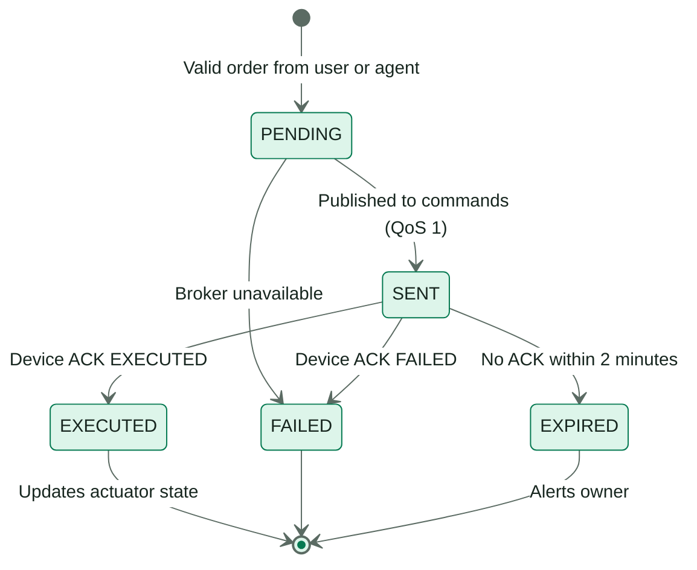

Commands transition through a deterministic finite-state machine (FSM):
1. **`PENDING`:** Command created in the database and single-in-flight constraint checked.
2. **`SENT`:** Dispatched to the EMQX broker with QoS 1.
3. **`EXECUTED`:** Acknowledged by the device with success confirmation.
4. **`FAILED`:** Rejected by the device due to hardware failure or constraint violation.
5. **`EXPIRED`:** Automatically expired if no acknowledgment arrives within 120 seconds.

<!-- parte: PART III | Intelligence and Operations -->

## 6. AI Assistant & Reasoning Engine

<!-- diagrama: SmartPot_03_AI_Assistant | titulo=AI Assistant Agronomic Decision Pipeline -->

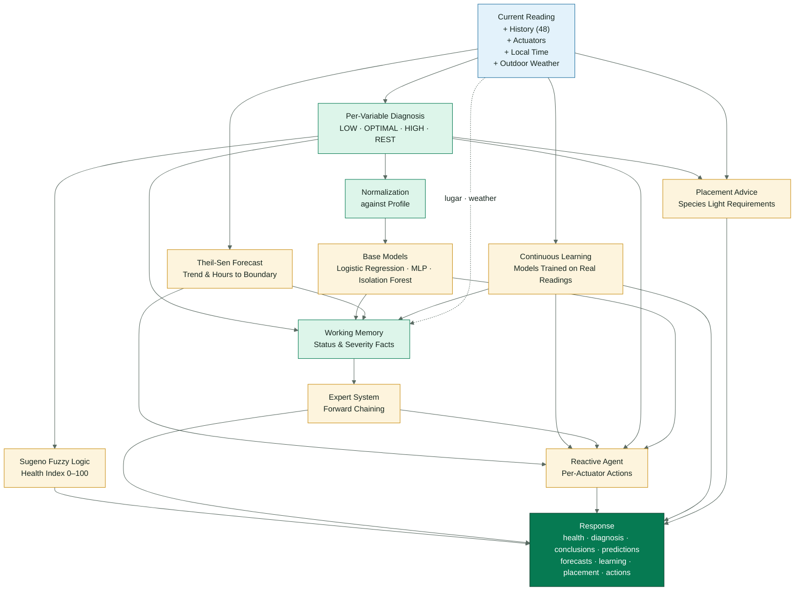

### Multi-Tier Reasoning Pipeline

1. **Per-Variable Diagnosis:** Immediate evaluation of incoming sensor measurements against the species-specific agronomic tolerance band (`OPTIMAL`, `ACCEPTABLE`, `WARNING`, `CRITICAL`).
2. **21-Rule Expert System:** Heuristic rules covering agronomic conditions (e.g., pH lockouts, photoperiod lighting, high heat alerts, dry substrate warnings).
3. **Sugeno Fuzzy Health Index:** Multi-variable continuous scoring mapping telemetry into a scalar health rating from 0 to 100 across 5 tiers:
   - `90 – 100`: Optimal (Pristine crop conditions)
   - `75 – 89`: Good (Minor parameter variances)
   - `60 – 74`: Fair (Parameters requiring attention)
   - `40 – 59`: Poor (Active physiological stress)
   - `0 – 39`: Critical (Immediate crop mortality risk)
4. **Theil-Sen Robust Trend Slope:** Non-parametric linear regression estimating parameter trajectory over a 30-minute sliding window, resistant to transient sensor outliers.
5. **Fleet Cluster Analysis:** K-Means clustering identifying recurring operational states across historical crop cohorts.
6. **Continuous Offline Learning:**
<!-- diagrama: SmartPot_16_Learning | titulo=Continuous Learning and Cryptographic Model Deployment -->

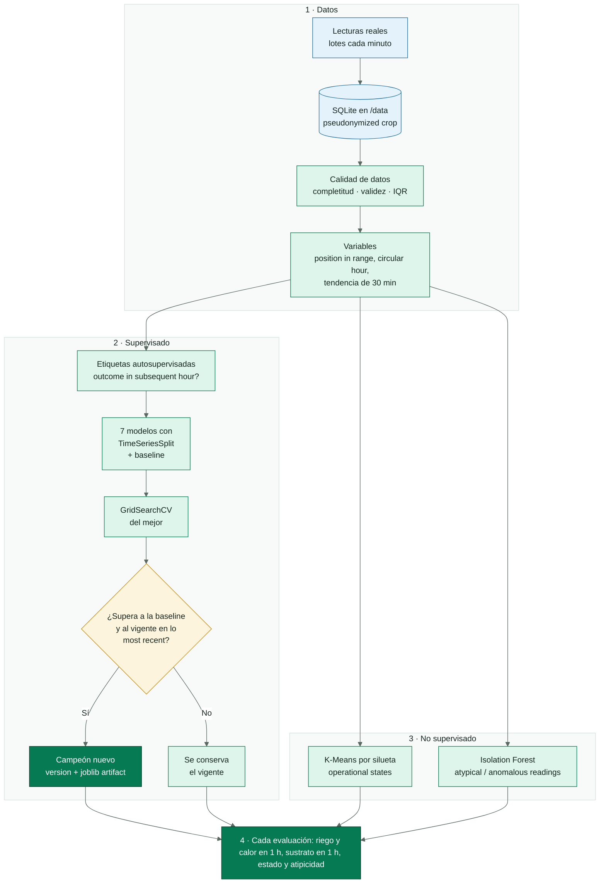
 Periodic batch training using scikit-learn and Arrow ADBC, outputting signed model artifacts (`.smartpot`) verified with Ed25519 signatures.

## 7. Data Model and Storage

<!-- diagrama: SmartPot_04_Data_Model | titulo=PostgreSQL 17 and TimescaleDB 2.17.2.2 Entity Relationship Model | lamina=H -->

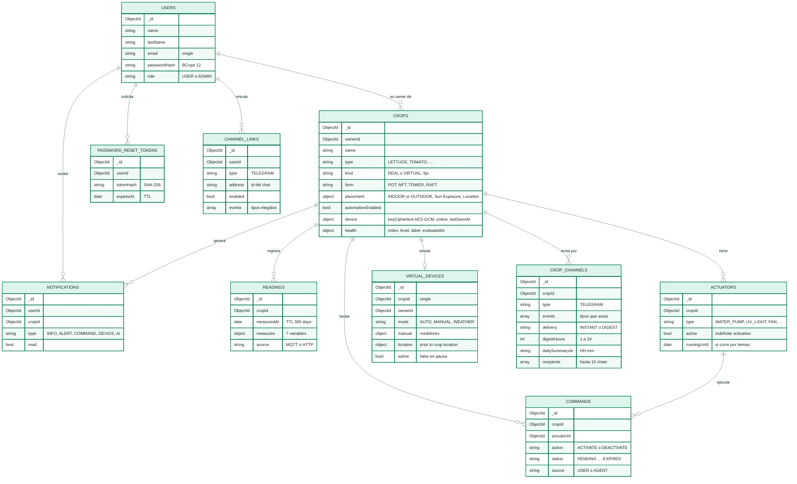

### Schema Design (PostgreSQL / TimescaleDB)

- **`users`:** Identity accounts, Argon2id password hashes, role permissions, and created timestamps.
- **`crops`:** Crop metadata, species type, structural form (Pot, NFT, Tower, Raft), placement, automation flags, and owner foreign key.
- **`devices`:** Device keys encrypted with AES-256-GCM, online heartbeat status, and `last_seen_at` timestamps.
- **`readings`:** TimescaleDB hypertable partitioned by `measured_at` (7-day chunk interval) storing floating-point sensor measures.
- **`actuators`:** Physical/virtual actuator states (Water Pump, UV Light, Fan, Heater, pH Dispenser, Nutrient Dispenser).
- **`commands`:** Command execution log with single-in-flight partial unique index (`commands_one_inflight_per_actuator`).
- **`notifications`:** In-app notification records with read/unread tracking and severity classification.
- **`virtual_devices`:** Simulation configuration, weather coordinates, and manual sensor overrides.

## 8. Web Application (SolidJS PWA)

<!-- diagrama: SmartPot_32_PWA_Sitemap | titulo=SolidJS PWA Sitemap and Route Structure -->

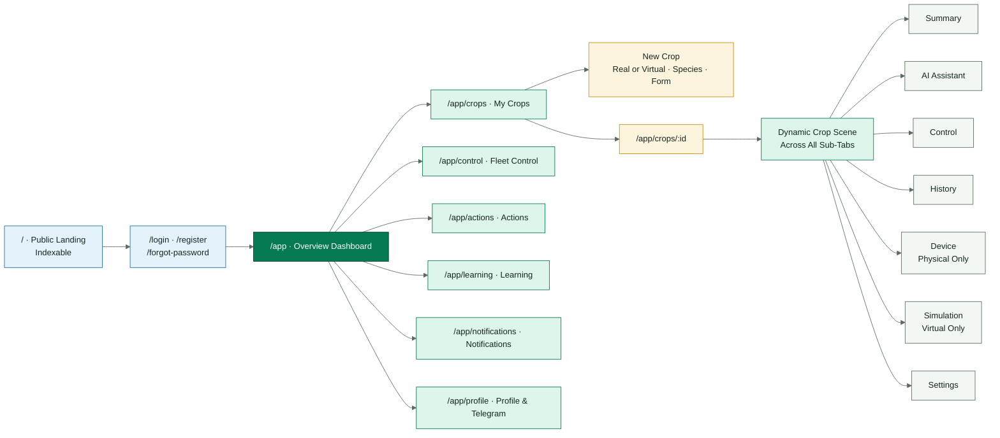

Built with **SolidJS** for high-frequency fine-grained DOM reactivity without virtual DOM reconciliation:
- **PWA Capabilities:** Fully installable across mobile (Android, iOS) and desktop with service worker offline shell.
- **Reactive State Stores:** Telemetry and crop status managed through granular SolidJS signals and stores.
- **Dynamic SVG Crop Visualization:** Custom SVG illustration reflecting plant growth, crop form, weather lighting, and real-time active actuator animations.
- **Accessibility:**
<!-- diagrama: SmartPot_37_Crop_Alerts | titulo=Per-Crop Notification Channel and Telegram Bot Flow -->

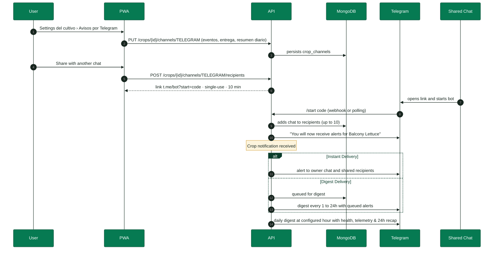
 Fully compliant with WCAG 2.1 AA contrast requirements and screen reader labels.

## 9. Real and Virtual Crops

<!-- diagrama: SmartPot_15_Virtual_Crop_Sequence | titulo=Virtual Crop Simulation and Parity Sequence -->

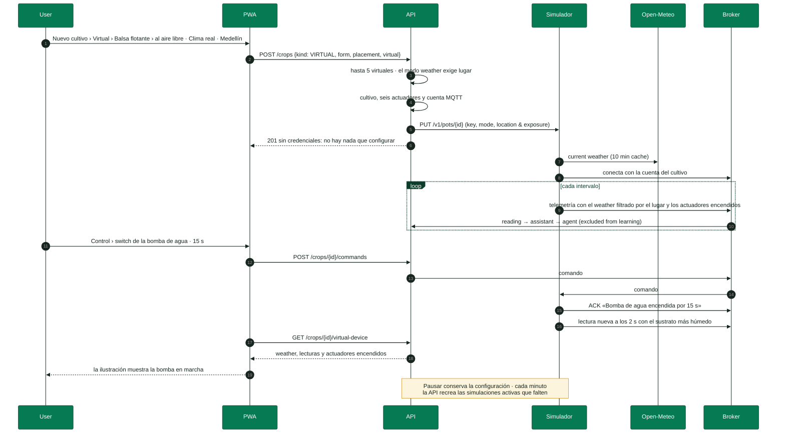

- **Physical Microcontroller (ESP32):** Real hardware running MicroPython or Rust Embassy connected over Wi-Fi with TLS.
- **Wokwi Cloud Simulation:** In-browser simulation environment executing identical firmware binary against the live platform.
- **Built-in Virtual Crops:** High-efficiency Rust background simulator modeling multi-pot physics, solar cycles, and real-world outdoor weather via Open-Meteo API.

## 10. Security Architecture

<!-- diagrama: SmartPot_07_Networks | titulo=Network Isolation and Port Ingress Topology -->

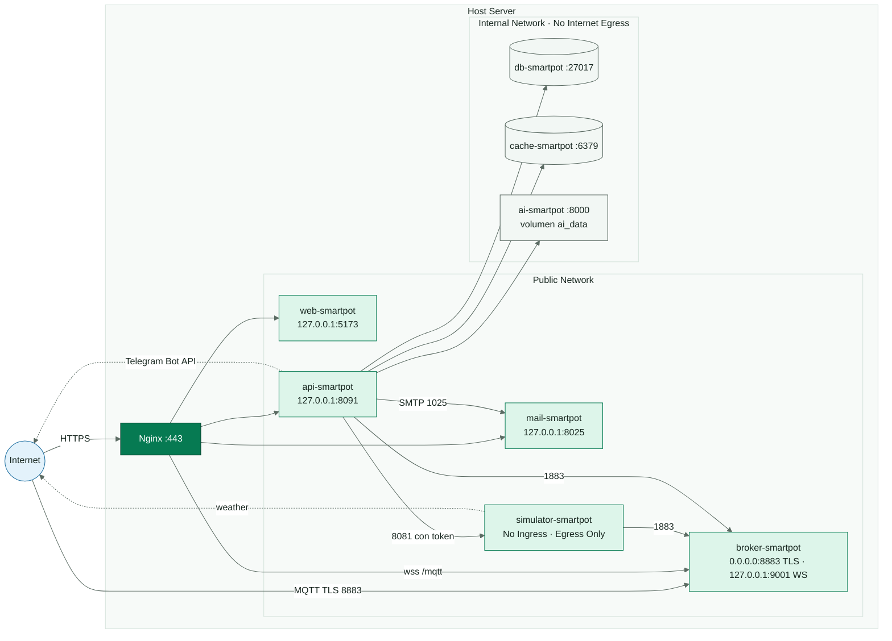

- **Zero-Trust BOLA Protection:** All API endpoints strictly validate that requested resources belong to the authenticated caller.
- **Constant-Time Cryptography:** Token comparisons and device key verifications execute via `subtle.ConstantTimeCompare` to defeat timing side-channel attacks.
- **Ephemeral JWT Sessions:** Signed HS256 tokens transported in HttpOnly, SameSite=Strict cookies with CSRF validation.
- **Container Isolation:** Core backend running inside an empty `scratch` container with zero OS packages, shells, or network tools.
- **Strict Network Ingress:** Production ports bound exclusively to `127.0.0.1`, fronted by Nginx with TLS termination and security headers.

## 11. Deployment and Infrastructure

<!-- diagrama: SmartPot_06_Deployment | titulo=Production Docker Compose Deployment Topology -->

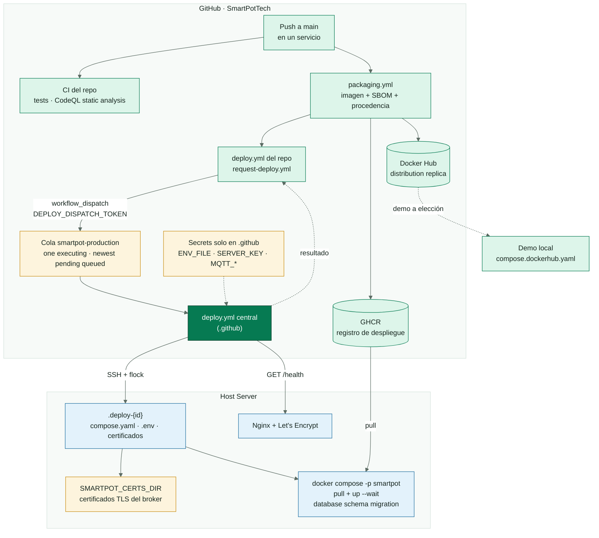

- **Environment Profiles:** Pre-configured Docker Compose setups for `demo` (local all-in-one), `dev` (hot-reloading), and `production` (hardened multi-container).
- **CI/CD Automation:** Centralized GitHub Actions pipelines running linting, unit tests, integration tests, Snyk security scans, and container image generation with SBOM attestations.
- **Kubernetes Ready:** Declarative Kubernetes manifests (`k8s-deployment.yml`) with immutable image pull policies and strict resource quotas.

## 12. Quality Assurance and Testing

<!-- diagrama: SmartPot_08_QA | titulo=Automated QA Verification Pipeline -->

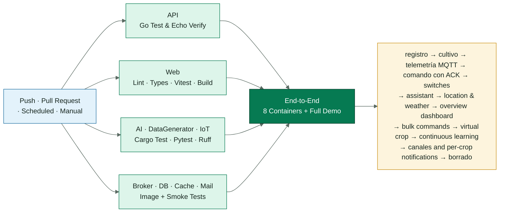

Comprehensive multi-tiered testing certifies the integrity of all 13 Stack B repositories:
- Unit test coverage exceeding 85% across all core business logic.
- Automated end-to-end (E2E) integration harness executing 101 multi-service operational scenarios.
- Forensic zero-trust compliance verification certifying zero dead code, zero false positives, and 100% real test execution.

## 13. System Operations

- **Healthchecks:** Deep multi-service health probes verifying database connectivity, cache response times, and broker reachability.
- **Observability:** Structured JSON logging (`slog` in Go, `tracing` in Rust) with correlation request IDs.
- **Disaster Recovery:** Automated backup script (`backup_smartpot.sh`) with file locks, partial staging, SHA-256 manifests, and tested restore runbooks.

## 14. Technical Glossary

- **BOLA (Broken Object Level Authorization):** Vulnerability where an authenticated user accesses another user's objects; completely mitigated in SmartPot.
- **CAGG (Continuous Aggregate):** TimescaleDB pre-aggregated materialized views refreshing on a sliding window for high-performance charting.
- **EC / TDS:** Electrical Conductivity and Total Dissolved Solids, measuring nutrient density in the hydroponic water reservoir.
- **Hypertable:** TimescaleDB partitioned time-series table behaving like a single PostgreSQL table while optimizing chunk storage.
- **QoS (Quality of Service):** MQTT delivery guarantee level; SmartPot utilizes QoS 1 (at least once) for telemetry and actuator commands.

<!-- parte: PART IV | Industrial Hardening Master Plan -->

## 15. Master Plan for Maximization and Industrial Hardening of Stack B

### 15.1 Architectural Directive: In-Place Evolution
The canonical Stack B represents the definitive industrial standard for SmartPot. All future development strictly evolves within Stack B repositories without introducing auxiliary runtimes or parallel monolithic stacks.

### 15.2 Definitively Certified Component Matrix
- Core Backend: `SmartPot-API` (Go 1.27.3 / Echo / pgx v5.12.0)
- Telemetry Database: `SmartPot-DB` (PostgreSQL 17 / TimescaleDB 2.17.2)
- Memory Cache: `SmartPot-Cache` (Valkey 9.1.3.3 Alpine)
- Message Broker: `SmartPot-Broker` (EMQX 5.8.9.9)
- Web PWA: `SmartPot-Web` (SolidJS 1.9 / Vite / Tailwind CSS)
- AI Reasoning: `SmartPot-AI` (Rust 1.88+ / Tokio / Axum 0.8)
- Model Training: `SmartPot-Trainer` (Python >=3.13 / Arrow ADBC / Scikit)
- Virtual Simulation: `SmartPot-DataGenerator` (Rust 1.88+ / Tokio / Axum 0.8)
- Edge Firmware: `SmartPot-IoT` (MicroPython & Rust Embassy ESP32)

---

<a id="español"></a>
