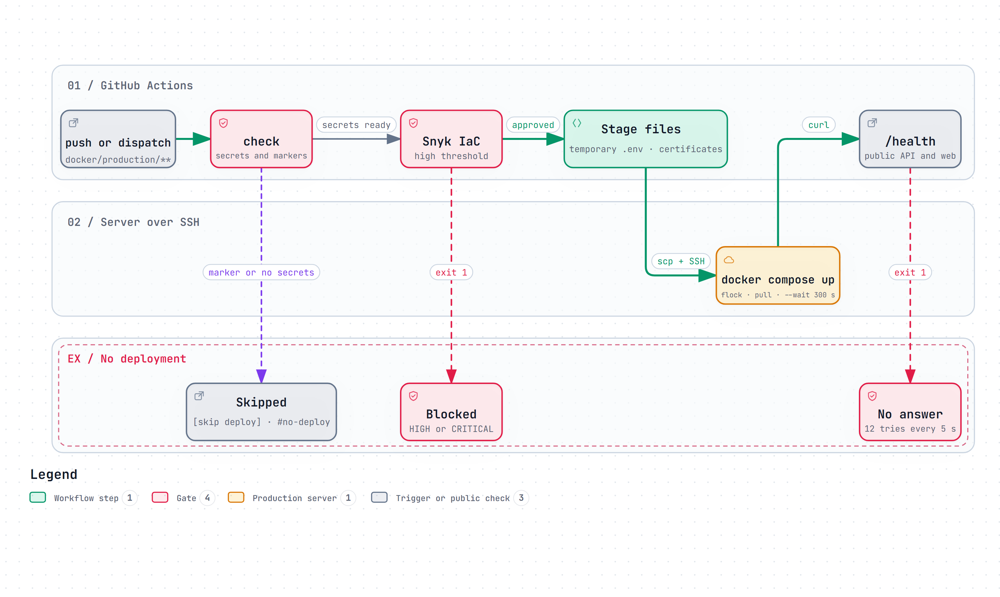
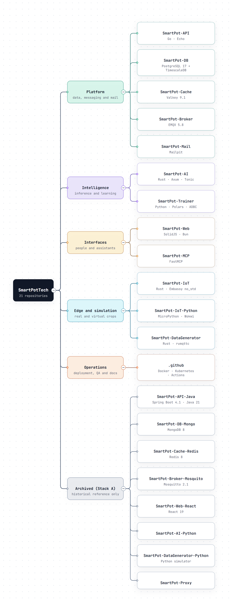
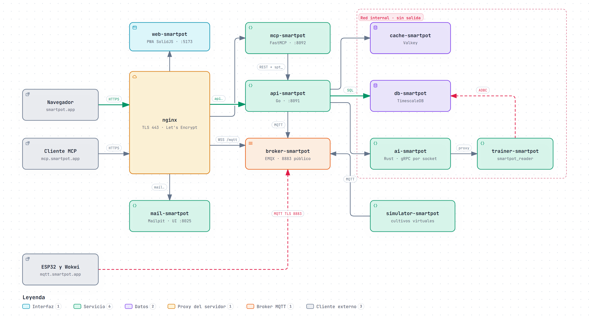
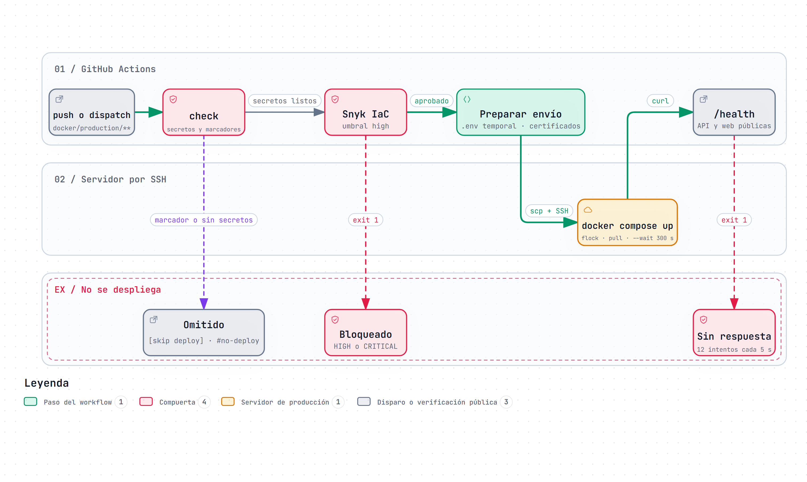
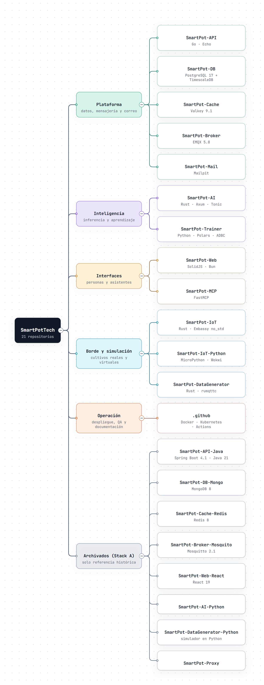

# .github · Interactive Diagrams

[English](#english) | [Español](#español)

---

## English

Each diagram is a self-contained HTML page that works offline. Download it and open it in a browser to zoom, search nodes, trace a path and jump to the exact source lines on GitHub. The PNG preview is the light-theme render of the same diagram.

### 1. Stack B Production Topology

The ten production containers of `docker/production/compose.yaml` behind the server nginx (TLS 443), the public MQTT TLS 8883 port for devices, and the `internal` network without egress that isolates the database, the cache, the AI and the Trainer.

- Interactive: [English](SmartPot_Global_A1_Production_Topology.en.html) · [Spanish](SmartPot_Global_A1_Production_Topology.es.html)
- Sources: `docker/production/compose.yaml` and `docker/production/nginx/` at commit `8112d2e`.

### 2. Production Deployment (deploy.yml)

How `deploy.yml` reaches production: skip markers and secret checks, the Snyk IaC gate (credit-tolerant), the staged `.env` and certificates, `docker compose up --wait` under a server lock, and the public `/health` check.

- Interactive: [English](SmartPot_Global_A2_Deploy_Workflow.en.html) · [Spanish](SmartPot_Global_A2_Deploy_Workflow.es.html)
- Sources: `.github/workflows/deploy.yml` at commit `8112d2e`.

### 3. SmartPotTech Repositories

The 21 repositories of the organization grouped by role: the 13 active Stack B repositories and the 8 archived Stack A ones.

- Interactive: [English](SmartPot_Global_A3_Repository_Tree.en.html) · [Spanish](SmartPot_Global_A3_Repository_Tree.es.html)
- Sources: `profile/README.md` at commit `8112d2e`.

---

## Español

Cada diagrama es una página HTML autocontenida que funciona sin conexión. Descárgala y ábrela en un navegador para ampliar, buscar nodos, seguir un recorrido y saltar a las líneas exactas del código en GitHub. La vista previa PNG es el mismo diagrama en tema claro.

### 1. Topología de producción del Stack B

Los diez contenedores de producción de `docker/production/compose.yaml` detrás del nginx del servidor (TLS 443), el puerto público MQTT TLS 8883 para los dispositivos y la red `internal` sin salida que aísla la base, la caché, la IA y el Trainer.

- Interactivo: [inglés](SmartPot_Global_A1_Production_Topology.en.html) · [español](SmartPot_Global_A1_Production_Topology.es.html)
- Fuentes: `docker/production/compose.yaml` y `docker/production/nginx/` en el commit `8112d2e`.

### 2. Despliegue a producción (deploy.yml)

Cómo llega `deploy.yml` a producción: marcadores de omisión y comprobación de secretos, la compuerta Snyk IaC (tolerante a créditos), el `.env` y los certificados preparados, `docker compose up --wait` bajo un candado del servidor y la verificación pública de `/health`.

- Interactivo: [inglés](SmartPot_Global_A2_Deploy_Workflow.en.html) · [español](SmartPot_Global_A2_Deploy_Workflow.es.html)
- Fuentes: `.github/workflows/deploy.yml` en el commit `8112d2e`.

### 3. Repositorios de SmartPotTech

Los 21 repositorios de la organización agrupados por función: los 13 activos del Stack B y los 8 archivados del Stack A.

- Interactivo: [inglés](SmartPot_Global_A3_Repository_Tree.en.html) · [español](SmartPot_Global_A3_Repository_Tree.es.html)
- Fuentes: `profile/README.md` en el commit `8112d2e`.

